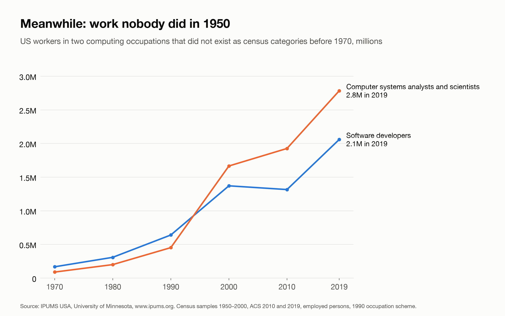

## The claim

On 16 November 2026 [Ethan Mollick posted](https://x.com/emollick/status/2122176524610884061):

> I think often about the fact that almost everyone working in the West has lived in a quite stable socio-technical period
>
> Only 1 job out of 270 in the 1950 census is now obsolete (elevator operator)
>
> 2026 is similar to 1957 in a way that 1969 was not from 1900.

The post does not give a source for the number. The question here is narrow: what does the census data say about the jobs of 1950?

## The short answer

The elevator operator is the only obvious automation casualty on the 1950 list. About 15 more categories are gone or nearly gone in 2010, some because technology removed them and some because demand did. Many others stayed on the list but lost 70–93% of their workers. And a list of 1950 categories can only show losses, so it cannot show the new work that appeared since.

My own framing is this. Few jobs disappeared completely, but many became museum pieces: there are still elevator operators. The claim also misses the large change that came through new jobs nobody in 1950 could have imagined.

## What the data shows

The 1950 census had 268 occupation categories with employed workers (58.9 million people; 140.2 million in 2010). 86 of them show zero workers in 2010. That number is misleading, because IPUMS maps every 2010 job code into some 1950 category and some 1950 categories receive none. Mathematicians, athletes, college professors by subject and apprentices all show zero, and all still exist. Sorting the 86 by judgement gave about 16 genuinely gone or nearly gone and about 70 artefacts of reclassification.

The 16 are the elevator operator (92,779 workers in 1950) and 15 others: locomotive firemen (58,557), blacksmiths (43,915), telegraph operators (36,105), boarding-house keepers (28,106), teamsters with horse and wagon (24,639), electrotypers and stereotypers (19,996), railway mail clerks and express messengers (19,672), milliners (17,553), bootblacks (15,725), furriers (13,906), bus and streetcar conductors (12,903), crossing watchmen and bridge tenders (12,852), telegraph messengers (8,134), baggagemen (7,789), and photoengravers, who sit inside a category shared with lithographers.

Technology removed most of these: diesel engines, the telephone and teleprinter, offset printing, motor vehicles, one-person buses and automatic crossing gates. Falling demand removed the others: boarding houses, hats, shoe shining and furs.

Several categories survived on the list but collapsed between 1950 and 2010. Railway brakemen fell 93% (78,981 to 5,368), textile weavers 92%, pattern and model makers 90%, farmers 86% (4.37 million to 0.62 million), compositors and typesetters 81%, paperhangers 80%, telephone operators 77% (384,440 to 89,392), stationary firemen 75%, sawyers 70% and metal filers, grinders and polishers 69%.

A follow-up question: which jobs did technology create and then take away? Using eight census and survey years from 1950 to 2019, six office and communication jobs rose and then fell. Computer operators went from none in 1960 to 659,000 in 1990 and 131,000 in 2010. Data-entry keyers rose from 281,000 (1970) to 598,000 (1990–2000) and were 300,000 in 2019. Typists fell from 974,000 (1970) to 54,000 (2019). Telephone operators fell from 409,000 (1970) to 62,000 (2019), photo-lab workers from 97,000 (1990) to 25,000 (2019), and stenographers from 274,000 (1960) to 76,000 (1990).

Compare a [1972 Univac educational film on office automation and clerical careers](https://www.youtube.com/watch?v=eorxtvnyGBY) from the Computer History Archives Project.

Over the same years new work appeared. Software developers went from 168,000 in 1970 to 2.1 million in 2019, and computer systems analysts and scientists from 89,000 to 2.8 million.

The wider literature puts the scale of new work higher. Autor, Chin, Salomons and Seegmiller ("New Frontiers: The Origins and Content of New Work, 1940–2018", Quarterly Journal of Economics 139(3), 2024, https://doi.org/10.1093/qje/qjae008) find that about 60% of US employment in 2018 was in job titles that did not exist in 1940. They used about 30,000 micro job titles from the Census Alphabetical Index, not the roughly 270 broad categories used here.

## How it was done

The point of this series is how quickly a claim can be checked now. This one took about 30 minutes from question to charts and 45 with the follow-up. Times are 16 November 2026, UK time.

- **07:43** — I asked the question.
- **~07:47** — A first pass with web search had found where the claim came from and the related literature.
- **Dead end** — Reading the source paper for the claim failed. The publisher and the repository block automated access, and the 1950 occupation index is a scanned 395-page document with no text layer. So we decided to go to the primary census data instead.
- **~08:02** — I had registered a free IPUMS account and an API key (about five minutes of my time; the key is in a password manager). The AI agent submitted the first data extract.
- **08:03** — The data came back, and the agent aggregated it in seconds.
- **08:11** — First charts.
- **08:26** — The follow-up question, on jobs that rose and fell, was answered with a second extract.

The data is IPUMS USA microdata. The first extract has the 1950 1% census sample and the 2010 American Community Survey, with the harmonised 1950 occupation code (OCC1950), employment status and person weights. The agent counted employed people in each 1950 category in each year. The second extract has the 1% census samples for 1950, 1960, 1970, 1980, 1990 and 2000 and the American Community Survey for 2010 and 2019, with the harmonised 1990 occupation code (OCC1990).

The agent was Claude Code running Claude Opus 5.5. It wrote about 150 lines of Python. I read the outputs and steered. The main judgement step was sorting the 86 zero-worker categories into genuinely gone and reclassified, which the agent did by judgement.

## What this does not show

- The samples are 1% samples, so small categories are noisy.
- Zeros are classification facts, not head counts.
- The sort of the 86 zero categories into gone and reclassified is a judgement. It has not been checked by a labour historian.
- Some odd points are mapping artefacts: the bump in typists in 2010, and computer operators' 2019 zero, which is dropped from the chart.
- The data covers the US only.
- The 1950 categories can only show losses, never new work.

## Data, code and citation

Data:

- [occ1950_1950_vs_2010.csv](data/occ1950_1950_vs_2010.csv)
- [occ1990_by_year.csv](data/occ1990_by_year.csv)

Code:

- [extract.py](code/extract.py)
- [extract2.py](code/extract2.py)
- [analyse.py](code/analyse.py)
- [analyse2.py](code/analyse2.py)
- [charts.py](code/charts.py)

Citation: Steven Ruggles, Sarah Flood, Matthew Sobek, Daniel Backman, Grace Cooper, Julia A. Rivera Drew, Stephanie Richards, Renae Rodgers, Jonathan Schroeder, and Kari C.W. Williams. IPUMS USA: Version 16.0 [dataset]. Minneapolis, MN: IPUMS, 2025. https://doi.org/10.18128/D010.V16.0
