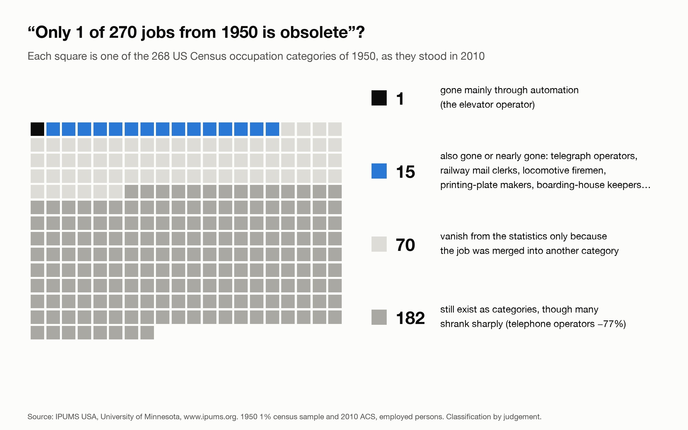
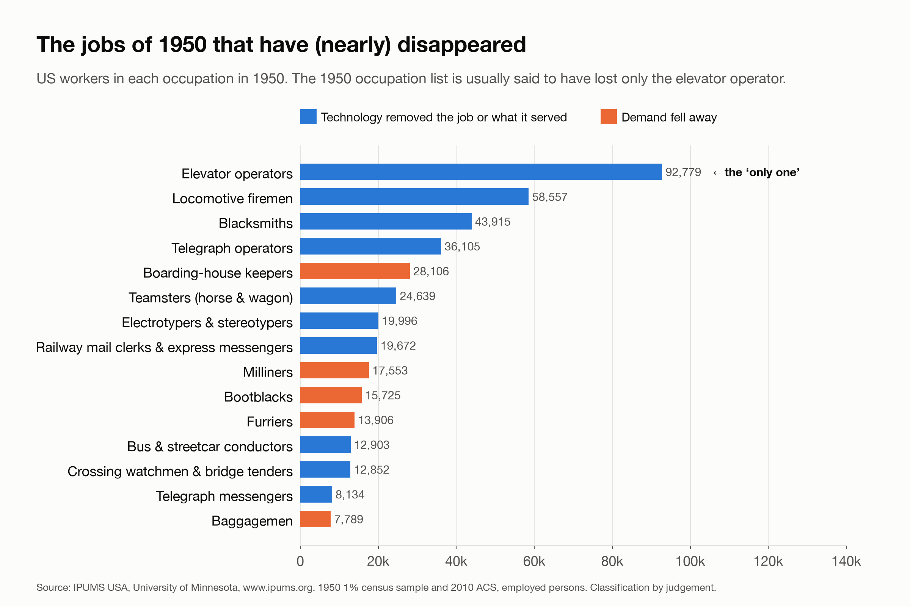
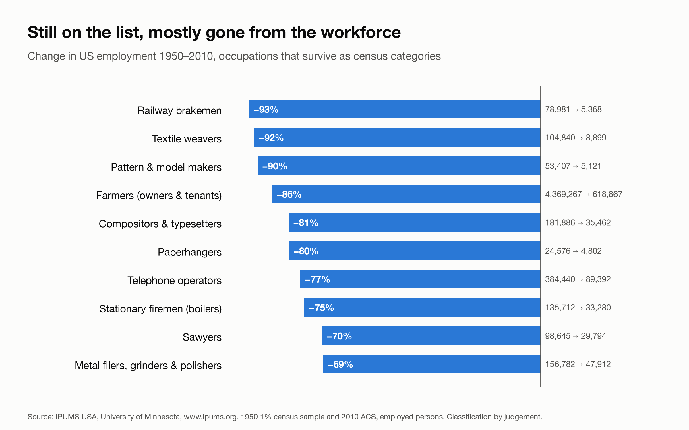
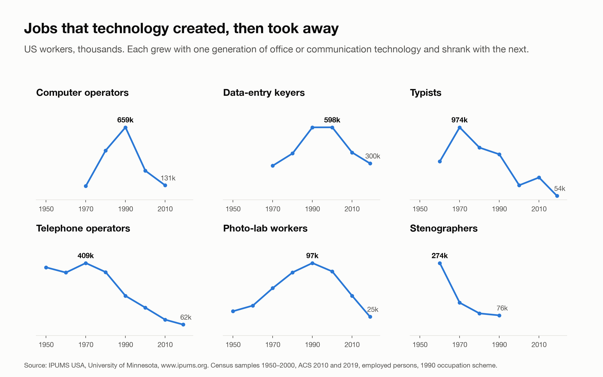
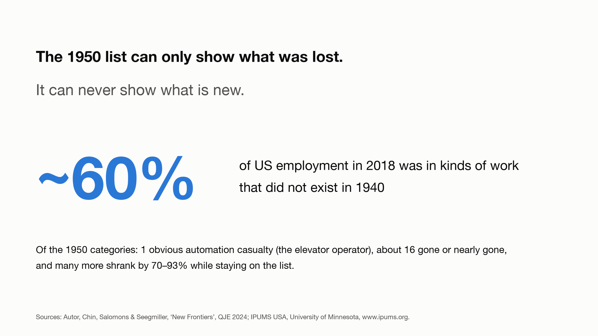

## The claim

On 16 November 2026 [Ethan Mollick posted](https://x.com/emollick/status/2122176524610884061):

> I think often about the fact that almost everyone working in the West has lived in a quite stable socio-technical period
>
> Only 1 job out of 270 in the 1950 census is now obsolete (elevator operator)
>
> 2026 is similar to 1957 in a way that 1969 was not from 1900.

There are two claims here. One is a fact about a list: only one of the 270 jobs in the 1950 census is obsolete. The other is about the scope of change: people working in the West have lived through a stable period, and the job list is the evidence.

The post gives no source, but the number seems to come from a paper by the economist James Bessen, [How Computer Automation Affects Occupations](https://papers.ssrn.com/sol3/papers.cfm?abstract_id=2690435) (2016). We could read its summary and how others quote it, but not the full text. As quoted, Bessen says that of the 270 detailed occupations in the 1950 census, only one, elevator operator, was eliminated *by automation*. Other occupations disappeared for other reasons, such as falling demand. That is a narrower statement than "only one is now obsolete".

## The short answer

The fact is wrong as stated. Elevator operator is the one job the paper counts as eliminated by automation, but it is not the only obvious automation casualty: telephone switchboard operators lost most of their jobs to automatic exchanges. In the census data about 15 more 1950 categories are gone or nearly gone, and many others lost 70–93% of their workers.

Few jobs disappeared completely, but many became museum pieces: there are still elevator operators. Counting what survives from a 1950 list also measures only half the change. The other half is work that did not exist in 1950. One major study finds that about 60% of US employment in 2018 was in job titles that did not exist in 1940. The change should be measured by both together, and on that measure the period does not look stable.

## What the data shows

The 1950 census had 268 occupation categories with employed workers (58.9 million people; 140.2 million in 2010). 86 of them show zero workers in 2010. That number is misleading, because IPUMS maps every 2010 job code into some 1950 category and some 1950 categories receive none. Mathematicians, athletes, college professors by subject and apprentices all show zero, and all still exist. Sorting the 86 by judgement gave about 16 genuinely gone or nearly gone and about 70 artefacts of reclassification.

### Jobs that are gone or nearly gone

| Occupation in 1950 | Workers in 1950 | Share of all workers, 1950 | What removed it |
|---|---|---|---|
| Elevator operators | 92,779 | 0.16% | Automatic lifts |
| Locomotive firemen | 58,557 | 0.099% | Diesel engines |
| Blacksmiths | 43,915 | 0.075% | Motor vehicles, factory-made tools |
| Telegraph operators | 36,105 | 0.061% | Telephone and teleprinter |
| Boarding-house keepers | 28,106 | 0.048% | Falling demand |
| Teamsters (horse and wagon) | 24,639 | 0.042% | Motor vehicles |
| Electrotypers and stereotypers | 19,996 | 0.034% | Offset printing |
| Railway mail clerks and express messengers | 19,672 | 0.033% | Changes in mail transport |
| Milliners | 17,553 | 0.030% | Falling demand for hats |
| Bootblacks | 15,725 | 0.027% | Falling demand |
| Furriers | 13,906 | 0.024% | Falling demand |
| Bus and streetcar conductors | 12,903 | 0.022% | One-person buses |
| Crossing watchmen and bridge tenders | 12,852 | 0.022% | Automatic crossing gates |
| Telegraph messengers | 8,134 | 0.014% | Telephone |
| Baggagemen | 7,789 | 0.013% | Changes in rail travel |
| Photoengravers | in a category shared with lithographers | – | Offset printing |

### Jobs that survived on the list but collapsed

| Occupation | Workers 1950 | Workers 2010 | Change | Share of all workers 1950 | Share of all workers 2010 |
|---|---|---|---|---|---|
| Railway brakemen | 78,981 | 5,368 | −93% | 0.13% | 0.004% |
| Textile weavers | 104,840 | 8,899 | −92% | 0.18% | 0.006% |
| Pattern and model makers | 53,407 | 5,121 | −90% | 0.091% | 0.004% |
| Farmers (owners and tenants) | 4,369,267 | 618,867 | −86% | 7.41% | 0.44% |
| Compositors and typesetters | 181,886 | 35,462 | −81% | 0.31% | 0.025% |
| Paperhangers | 24,576 | 4,802 | −80% | 0.042% | 0.003% |
| Telephone operators | 384,440 | 89,392 | −77% | 0.65% | 0.064% |
| Stationary firemen | 135,712 | 33,280 | −75% | 0.23% | 0.024% |
| Sawyers | 98,645 | 29,794 | −70% | 0.17% | 0.021% |
| Metal filers, grinders and polishers | 156,782 | 47,912 | −69% | 0.27% | 0.034% |

Total employment more than doubled over the same years (58.9 million employed people in 1950, 140.2 million in 2010), so as a share of all work the falls are starker still. In 1950 about one worker in 13 was a farmer; in 2010 it was about one in 230. The shares are of all employed people in each year.

### Jobs that technology created and then took away

This was a follow-up question. After seeing the first results, I remembered a [1972 Univac educational film on office automation and clerical careers](https://www.youtube.com/watch?v=eorxtvnyGBY), which shows jobs that existed for only a few decades. Using eight census and survey years from 1950 to 2019, six office and communication jobs rose and then fell (thousands of workers; – means no comparable category that year):

| Occupation | 1960 | 1970 | 1980 | 1990 | 2000 | 2010 | 2019 |
|---|---|---|---|---|---|---|---|
| Computer operators | 0 | 125 | 449 | 659 | 265 | 131 | – |
| Data-entry keyers | – | 281 | 383 | 597 | 598 | 390 | 300 |
| Typists | 516 | 974 | 701 | 611 | 196 | 300 | 54 |
| Telephone operators | 355 | 409 | 358 | 224 | 157 | 89 | 62 |
| Photo-lab workers | 40 | 63 | 84 | 97 | 85 | 53 | 25 |
| Stenographers | 274 | 124 | 84 | 76 | – | – | – |

### The jobs in the 1972 film

The film is a careers guide for school leavers. We extracted its narration and listed every job it names. The computer jobs it describes are keypunch operators (who coded data onto punched cards), data typists (who coded it onto paper tape), console operators and computer operators. The census has no separate category for these: punched-card and tape work falls under data-entry keyers, and console and tape-handling work under computer operators. The table maps each job in the film to the closest census category (thousands of workers).

| Job named in the film | Census category | 1970 | Peak | 2019 |
|---|---|---|---|---|
| Keypunch operator, data typist (paper tape) | Data-entry keyers | 281 | 598 (2000) | 300 |
| Console operator, computer operator | Computer operators | 125 | 659 (1990) | 131 (2010) |
| Typist, typing supervisor | Typists | 974 | 974 (1970) | 54 |
| Stenographer, court reporter | Stenographers | 124 | 274 (1960) | merged into secretaries |
| Telephone operator | Telephone operators | 409 | 409 (1970) | 62 |
| Office machine operator (tabulating machines) | Statistical clerks | 242 | 242 (1970) | 30 |
| File clerk | File clerks | 371 | 371 (1970) | 157 |
| Bookkeeper | Bookkeepers and accounting clerks | 1,538 | 1,829 (1980) | 1,176 |
| Secretary | Secretaries | 2,691 | 3,900 (1990) | 2,779 |
| Bank teller | Bank tellers | 249 | 493 (1990) | 306 |
| Office machine operator (billing machines) | Billing clerks | 202 | 489 (2010) | 474 |
| Mail carrier | Mail carriers | 258 | 349 (2000) | 337 |
| Shipping and receiving clerk | Shipping and receiving clerks | 413 | 793 (1990) | 662 |
| Receptionist | Receptionists | 313 | 1,309 (2019) | 1,309 |
| Stock clerk | Stock and inventory clerks | 441 | 1,614 (2019) | 1,614 |
| Cashier | Cashiers | 815 | 3,295 (2010) | 3,252 |
| Programmer (the film's promotion route) | Software developers | 168 | 2,060 (2019) | 2,060 |

The film's jobs split in two. The ones defined by a machine (keypunch, tape, console, typewriter, shorthand, switchboard, tabulator) rose and then collapsed. The ones defined by dealing with people or goods (receptionist, cashier, stock clerk) grew. The film says computer operation "is a fast-growing field" in which "employment is expected to increase very rapidly". That held for about 20 years.

### New work

Over the same years new work appeared. Software developers went from 168,000 in 1970 to 2.1 million in 2019, and computer systems analysts and scientists from 89,000 to 2.8 million.

The wider literature puts the scale of new work higher. [Autor, Chin, Salomons and Seegmiller (2024)](https://doi.org/10.1093/qje/qjae008) find that about 60% of US employment in 2018 was in job titles that did not exist in 1940. They used about 30,000 detailed job titles from the Census Alphabetical Index, not the roughly 270 broad categories used here. A broad category such as "computer operators" can hide many new titles inside it, so counting broad categories understates new work in the same way that it understates lost work.

## How it was done

The point of this series is how quickly a claim can be checked now. This one took about 30 minutes from question to charts and 45 with the first follow-up. Times are 16 November 2026, UK time.

- **07:43**: I asked the question.
- **~07:47**: A first pass with web search had found where the claim seems to come from and the related literature.
- **Dead end**: Reading the source paper failed. The publisher and the repository block automated access, and the 1950 occupation index is a scanned 395-page document with no text layer. So we decided to go to the primary census data instead.
- **~08:02**: I had registered a free IPUMS account and an API key (about five minutes of my time; the key is in a password manager). The AI agent submitted the first data extract.
- **08:03**: The data came back, and the agent aggregated it in seconds.
- **08:11**: First charts.
- **08:26**: Looking at the first results, I remembered the 1972 film and asked which jobs rose and fell. A second extract answered it.
- **~09:40**: The site and this write-up were live.
- **~11:00**: Revision: the agent downloaded the film's subtitles, listed the jobs it names and mapped them to census categories; it also added the tables and the references.

The data is IPUMS USA microdata. The first extract has the 1950 1% census sample and the 2010 American Community Survey, with the harmonised 1950 occupation code (OCC1950), employment status and person weights. The agent counted employed people in each 1950 category in each year. The second extract has the 1% census samples for 1950, 1960, 1970, 1980, 1990 and 2000 and the American Community Survey for 2010 and 2019, with the harmonised 1990 occupation code (OCC1990).

The agent wrote about 150 lines of Python. I read the outputs and steered. The main judgement step was sorting the 86 zero-worker categories into genuinely gone and reclassified, which the agent did by judgement. Mapping the film's jobs to census categories was also a judgement.

## What this does not show

- The samples are 1% samples, so small categories are noisy.
- Zeros are classification facts, not head counts.
- The sort of the 86 zero categories into gone and reclassified is a judgement. It has not been checked by a labour historian.
- Some odd points are mapping artefacts: the bump in typists in 2010, computer operators' 2019 zero (left out), and stenographers disappearing into secretaries after 1990.
- We could not read the full Bessen paper, so what it says is taken from its summary and how others quote it.
- The data covers the US only.
- The 1950 categories can only show losses, never new work.

## Models, tools and tokens

| Model | Role | Calls | Tokens read | Tokens written |
|---|---|---|---|---|
| Claude Opus 5.5 | Main agent: search, IPUMS extracts, analysis, charts, deployment, revision | 152 | 26,947,191 | 103,916 |
| Claude Sonnet 5.5 | Subagents: wrote the first draft of this page; built the site generator | 19 | 740,395 | 20,763 |
| Claude Haiku 5.5 | Subagents: fetched web pages (the paper, the film's page) | 8 | 144,143 | 10,091 |

Tokens read include the conversation history the model re-reads on every call, most of it from cache; that is why the number is large compared with what was written. The counts come from the agent's session logs and cover the whole session up to this revision (about 11:05). Publishing steps after that are not counted.

Other tools: the IPUMS USA API (data extracts), Python with matplotlib (analysis and charts), yt-dlp (the film's subtitles), web search, and Cloudflare Pages with wrangler (hosting).

## Data and code

Data:

- [occ1950_1950_vs_2010.csv](data/occ1950_1950_vs_2010.csv)
- [occ1990_by_year.csv](data/occ1990_by_year.csv)

Code:

- [extract.py](code/extract.py)
- [extract2.py](code/extract2.py)
- [analyse.py](code/analyse.py)
- [analyse2.py](code/analyse2.py)
- [charts.py](code/charts.py)

The census data is from IPUMS USA, University of Minnesota, [www.ipums.org](https://www.ipums.org); the full citation is in the references below.
