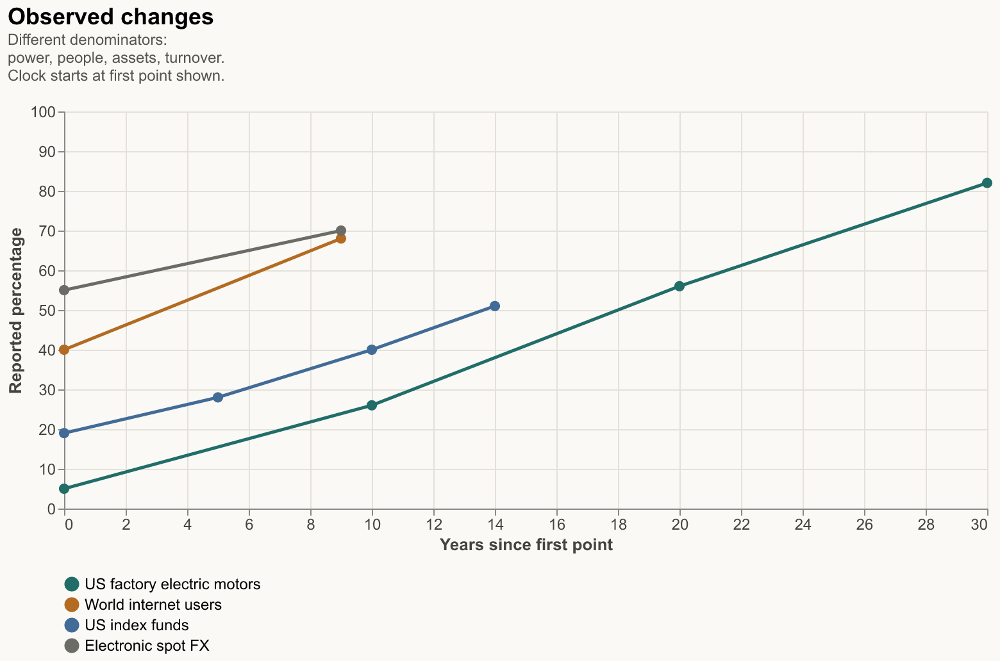
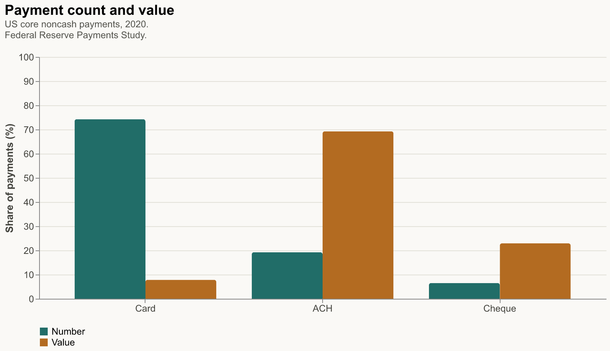

## The claim

### What was said

A post by [davidad](https://x.com/davidad) predicts:

> By 2050, more wealth will be under effective AI control than is currently under human control, almost surely.

My reply was:

> My timeline for that is 2035 for my definition of 'effective' and 'wealth' at least.

The source is a screenshot I supplied. The embedded post is truncated; the full sentence appears in my accompanying reply. The agent could not find the original post's URL or publication date. The link above identifies the author; it is not a link to the original post.

### Where the number seems to come from

These are predictions, with no dataset attached. There are separate claims about the amount of wealth, who controls it, the date and the confidence. This check asks whether earlier transfers of economic functions to machines make the earlier date plausible. It cannot verify a future outcome.

## The answer

### In short

**2035 is plausible as an aggressive scenario for delegated capital allocation. The historical evidence does not establish a global wealth crossover or support “almost surely”.** Fast transitions exist, but they concern particular functions on prepared infrastructure. Installed systems can take decades to convert. Neither observation supplies an adoption rate for AI discretion over global wealth.

### What counts as control and wealth

Here, **effective control** means discretion over consequential investments or operating uses of assets, plus authority to execute the resulting exchanges within a human mandate. People may retain ownership, broad objectives and removal powers. A system executing a human's selected trade, following a fixed index rule or recommending a property valuation does not qualify merely because it uses a computer. Capital allocation and running the underlying business are different measures; they must not be added together.

**Wealth** means global household net worth: real assets and financial or business claims, less liabilities. The [Fed's balance-sheet categories](https://www.federalreserve.gov/releases/z1/preview/html/b101.htm) illustrate this accounting approach, although that table also includes nonprofit organisations. This check includes illiquid property and excludes human capital, state assets and unpriced favours. It is a narrower accounting proxy for my original definition. Count ultimate household claims once, with funds and companies looked through instead of added again. Attribute only the net exposure over which AI has discretion, using consistent prices and exchange rates across years.

“More than humans currently control” compares **AI's future stock with humans' present stock**. It does not necessarily mean a future majority. For this check, “present” is a fixed 2026 baseline because the post's date is unverified. The condition is:

`AI-controlled net wealth in 2035 > human-controlled net wealth at the 2026 baseline`

Neither side is measured here. A forecast needs both the future control share and the growth of real wealth; the historical examples supply neither.

## Adoption has taken months or decades

### Observed changes, with different denominators

| Case | Observed interval | What changed | What the machine took over |
|---|---|---|---|
| US factory electrification | 1899–1929: 30 years | Electric motor horsepower / primary horsepower: 5% → 82% | Mechanical drive, not management |
| Bell automatic switching | Adoption began in 1919; 1952: 33 years later | 80% of Bell telephones were dial instruments | Connecting calls; no starting share measured here |
| World internet use | 2015–2024: 9 years | 40% → 68% of people | Access to a network, not economic decision authority |
| Electronic spot FX | 2010–2019: 9 years | About 55% → 70% of global spot turnover | Electronic trade execution |
| US index funds | 2010–2024: 14 years | 19% → 51% of long-term mutual fund and ETF assets | Rules-based portfolio allocation |
| Brazil's Pix | November 2020–February 2022: 15 months | 67% of adults had sent or received a payment | Payment infrastructure, not the decision to pay |

Sources: [Census, Table 2, p. 112](https://www2.census.gov/prod2/decennial/documents/03450419v1ch06.pdf); [Senate history](https://www.senate.gov/artandhistory/senate-stories/senators-balk-at-dial-telephones.htm) and [AT&T's own annual report](https://memorial.bellsystem.com/pdf/1952ATTar_Complete.pdf); [ITU](https://www.itu.int/en/ITU-D/Statistics/Pages/SDGs-ITU-ICT-indicators.aspx); [BIS FX report, p. 5](https://www.bis.org/publications/fx-execution-algorithms-and-market-functioning.pdf); [ICI, Figure 2.5](https://www.ici.org/system/files/2025-05/2025-factbook.pdf); [BIS/BCB Pix study, p. 5](https://www.bis.org/publications/bulletin-52-central-banks-monetary-system-and-public-payment-infrastructures-lessons-brazils-pix.pdf).

The chart also shows the intermediate published observations:

| Measure | Observations (year: percentage) |
|---|---|
| Factory electric motor horsepower / primary horsepower | 1899: 5%; 1909: 26%; 1919: 56%; 1929: 82% |
| Index share of long-term fund assets | 2010: 19%; 2015: 28%; 2020: 40%; 2024: 51% |

### What this says about 2035

Pix demonstrates rapid adoption when a common system is available: the [study identifies compulsory participation by large banks and central-bank provision of the infrastructure](https://www.bis.org/publications/bulletin-52-central-banks-monetary-system-and-public-payment-infrastructures-lessons-brazils-pix.pdf) as central to its success. Bell demonstrates the slower conversion of installed equipment and customer practices. Its dial-instrument share did not mean that all long-distance calls were automatic.

AI could spread quickly through existing digital mandates and newly created firms. Extending that inference to property, legacy businesses and fiduciary decisions requires evidence about permissions, reliability and liability. The chart does not estimate that extension: its starting points and denominators differ, and its lines simply connect observations.

## Financial automation is not a wealth-control share

### A stock comparison and its limits

Index funds are the closest stock comparison here. [ICI reports](https://www.ici.org/system/files/2025-05/2025-factbook.pdf) that their share became a majority within the long-term fund market. But domestic-equity index funds held only 18% of US stock-market value in 2024. The denominator changes the conclusion. Indexing also delegates a specified rule; it does not show AI exercising discretion. Changes in asset shares include valuation movements as well as investors switching funds.

The [BIS report](https://www.bis.org/publications/fx-execution-algorithms-and-market-functioning.pdf) estimates that execution algorithms handled 10–20% of global spot FX trading in 2020. Those algorithms choose how to execute a predefined order. That is a different category from all electronic trading, and neither measure is a share of wealth under discretionary AI management. Repeatedly trading an asset increases turnover without increasing the stock controlled.

### Counting transactions changes the answer

| US core noncash payments, 2020 | Share by number | Share by value |
|---|---|---|
| Card | 74.25% | 7.84% |
| ACH | 19.24% | 69.25% |
| Cheque | 6.51% | 22.91% |

Source: [Federal Reserve Payments Study, Table 1](https://www.federalreserve.gov/paymentsystems/december-2021-findings-from-the-federal-reserve-payments-study.htm). These estimates cover card, ACH and cheque payments; they exclude cash and wire transfers. The later shares extrapolate from large-institution samples. Even payment **value** is a flow, not a net wealth stock, and automated settlement does not identify who decided to spend or invest.

## Limits of this check

### What this does not show

The cases were selected for relevance and available measurements, not sampled from all technological transitions. Factory electrification measures power equipment, not the whole transition from hand production; its census coverage changes after 1919. Bell counts instruments, Pix counts people who used it, the internet counts users, trading counts volume and ICI counts assets. There is no defensible average transition time across them.

There is no measured starting share of global wealth under the definition of AI control used here. The earlier scenario model's adoption endpoints were assumptions, and other models' council opinions are not evidence. A global net-worth series and an auditable classification of decision authority would be needed to turn the prediction into a forecast. Evidence of sustained human approval at consequential decisions, or persistent inability to delegate property and business operations, would count against the earlier date. Rapid growth in audited discretionary AI mandates would count in its favour.

## How this was made

### Timeline

The research run began at 08:21:57 on 17 November 2026 (UK time, then GMT). The agent reused an earlier exploration, its historical source notes and its model's distinction between stock and turnover. It searched for the original post, checked selected primary sources, inspected the scanned census table and produced the charts. The first complete draft and usage snapshot were recorded at 08:36:53, 14.9 minutes after the start; rendering and publication checks followed.

A follow-up check added index funds because most of the original examples measured activity instead of assets. The direct ICI download returned an access error; its alternative publisher URL worked. The JavaScript-only BCB page was replaced by the readable BIS paper co-authored with central-bank staff.

### Data and method

The agent selected the cases and judged which kinds of control they represent. These are interpretation steps. Python copied the checked observations into charts, calculated elapsed intervals and checked payment-share totals. No diffusion curve was fitted. The chart uses ICI's published combined index shares, instead of adding rounded components. Source titles follow the providers' publications; sources without a supplied dataset citation are cited as reports or webpages.

The entry reuses the existing site design. Every chart has tooltips, a clickable legend, an export menu, the exact plotted CSV, a Vega-Lite specification and a PNG fallback. No new council or model experiment was run.

### Models, tools and tokens

Usage is recorded from the current Codex transcript through 08:36:53 GMT on 17 November 2026. Tokens read include cached history; cached tokens are already a subset of Codex input and are not added twice. Tokens written include reported reasoning tokens. Later publication checks are outside that snapshot. The site's Claude-oriented usage script is run on a content-free normalisation of the Codex usage events.

| Model | Role | Calls | Tokens read | Tokens written |
|---|---|---|---|---|
| gpt-6.1-sol | Source checking, analysis, drafting and publication | 30 | 4,016,524 | 21,530 |

Other tools: web search and retrieval, Python, Poppler, Vega-Lite, vl-convert, Git and Cloudflare Pages. Human time is an estimate; the time spent on the earlier exploration is not included in this run's duration.
