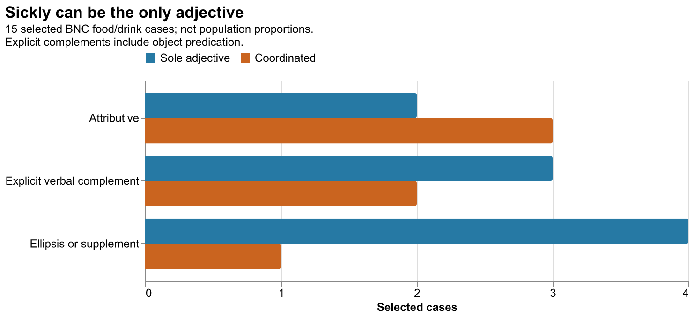
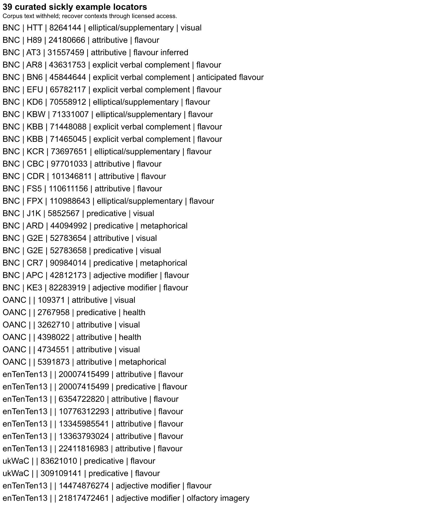

## The claim

### The question being checked

Can *sickly* describe food and other inanimate things in both **“a sickly cake”** and **“the cake is sickly”**, without another adjective? Does British English differ from American English? These two cake phrases illustrate the constructions; the corpus examples below supply the evidence.

### Where the evidence comes from

This question was investigated in a corpus study on 7 October 2026, using the [British National Corpus](https://www.sketchengine.eu/british-national-corpus-bnc/) and [Open American National Corpus](https://www.sketchengine.eu/oanc_masc-corpus/) through [Sketch Engine](https://www.sketchengine.eu/apidoc/), with supplementary historical web examples. This snack condenses that study.

## The answer

### In short

**Yes. Both constructions occur with *sickly* as the only adjective.** Before a noun, it is *attributive*; after a linking verb, it is *predicative*. Food need not be described as *sweet and sickly*: *sickly* can do the work alone.

### The dialect question remains open

**The American sample is too sparse to establish a British–American difference.** No clear food evaluation was found in its thirteen occurrences. That cannot establish that American English excludes the construction.

## Food does not need a second adjective

### Selected British examples

The study classified fifteen BNC food and drink examples after reading their wider contexts. These are selected cases, not a census of food uses.

| Construction | Sole adjective | With another adjective | Total |
|---|---:|---:|---:|
| Attributive | 2 | 3 | 5 |
| Explicit verbal complement | 3 | 2 | 5 |
| Ellipsis or supplement | 4 | 1 | 5 |
| Total selected | 9 | 6 | 15 |

The sole attributive cases include breakfast mix and shortbread buttons. Sole predicates include chocolate cake and chocolates. Degree expressions such as *a bit* are not second adjectives. The stand-off annotations identify the cases; their corpus lines are withheld for licensing.

The verbal-complement row includes object predication, such as finding a drink sickly. Fragments and supplements are separate: their five cases cannot be counted as five full “the food is sickly” clauses.

### The same cake, in both positions

One supplementary enTenTen13 passage describes a cake attributively and later predicatively with *sickly*. Both descriptions concern the same cake and neither coordinates another adjective. The two stand-off records share the retrieved passage’s anchor, not the later predicate’s own token position. Corpus lines are withheld for licensing; a licensed reader can rebuild the contexts using the [query settings and example locators](https://github.com/techczech/research-snacks-data/blob/main/snacks/2026-11-17-can-a-cake-be-sickly/README.md).

## The context determines the reading

### More than sweetness

Food *sickly* can mean cloying, excessively rich or unpleasantly intense. The selected examples also include canned tomatoes. Ham receives a visual judgement. Elsewhere, colour and light evoke an unhealthy appearance, while an economy or parody can be described through an extension of bodily weakness.

**“Sickly sweet” is a different construction:** *sickly* modifies *sweet*. It does not demonstrate *sickly* as the only adjective. The study separated these cases rather than counting every nearby food noun alike. It found no rule assigning baked goods to one construction and drinks to the other.

### Explore the examples

The table contains the stand-off locators and annotations for all **39 curated examples**, including diagnostic exclusions and supplementary web evidence. Search, filter or sort it, then export the visible rows. Corpus lines are withheld for licensing. A licensed reader can rebuild the contexts using the [corpus versions, query settings and anchors](https://github.com/techczech/research-snacks-data/blob/main/snacks/2026-11-17-can-a-cake-be-sickly/README.md).

## The American evidence is too small

### What was retrieved

These are exact-form hits for *sickly*, including adjective-modifying and adverbial uses, across all subjects.

| Collection | Words | Exact-form hits | Hits per million words |
|---|---:|---:|---:|
| BNC, speech and writing | 96,132,981 | 218 | 2.268 |
| OANC, written | 11,048,137 | 12 | 1.086 |
| OANC, spoken | 3,202,026 | 1 | 0.312 |

The collections differ in size, period and composition; these descriptive rates cannot isolate a national preference for a food sense. Manual reading found eleven attributive written American tokens and one predicative token about children; the spoken example was attributive and concerned kids. Visual and economic attributive uses occurred in both national collections.

### An empty automatic sketch was misleading

All twelve written OANC tokens were tagged as adverbs, including clear adjectives. Its empty automatic grammatical sketch therefore reflected tagging errors. The study retrieved the word form and read the syntax in context.

## Limits of this check

### What this does not show

The fifteen food cases and 39 display rows were selected and interpreted by an agent from wider contexts, without independent human annotation. They establish occurrences, not construction preferences or grammatical rules for food classes. Corpus membership does not guarantee a quoted writer’s nationality.

The web examples come from historical ukWaC and enTenTen13 collections. Their original pages were not independently checked as live. Some broader searches timed out and provide no evidence of absence. A completed narrow search found no adjacent *sickly cookie/biscuit* matches; that does not establish unacceptability.

The full report’s collocation tables distinguish frequency from association scores. A high score for a rare neighbour is neither a count of modified nouns nor evidence of grammatical acceptability.

## How this was made

### Timeline

The corpus study was run on **7 October 2026** and repackaged on **17 November 2026**. No new corpus searches were made for this snack. The original records do not give the run’s elapsed time. The repackaging snapshot covers **08:23:25–08:42:31 UK time on 17 November 2026** (19.1 minutes); deployment and subsequent live checks fall outside it.

### Data and method

The original study retrieved exact-form *sickly*, examined wider contexts, and classified construction, coordination and reading. Sketch Engine supplied concordances, grammatical relations and collocation statistics. The judgement steps were selecting examples and interpreting their syntax and sense. Repackaging preserved those labels and counts; Python grouped the existing food annotations and generated the figure and table. The BNC credit in References is copied verbatim from the provider’s documentation.

The checking repository preserves stand-off food annotations, example locators, aggregate statistics, query settings and the current method. Earlier report drafts, working notes and run records are not distributed. A checksum manifest identifies the original source copies without distributing them. The chart CSV contains exactly the six plotted construction counts; the locator CSV contains all 39 stand-off records without corpus lines.

### Models, tools and tokens

| Model or run | Role | Calls | Tokens read | Tokens written |
|---|---|---:|---:|---:|
| gpt-6.1-sol (Codex), repackaging | Shortening, page and chart implementation, verification | 45 | 5,951,264 | 29,178 |
| Codex, original study | Retrieval, interpretation and report | Not recorded | Not recorded | Not recorded |

The original records name Codex but do not record its model version or token totals. Repackaging counts come from this implementation session’s transcript, exported during that run. Calls count distinct cumulative usage events. Tokens read include cached history; cached input is part of the input total, not added twice. Tokens written include reasoning. Python and Vega-Lite were the other tools.
