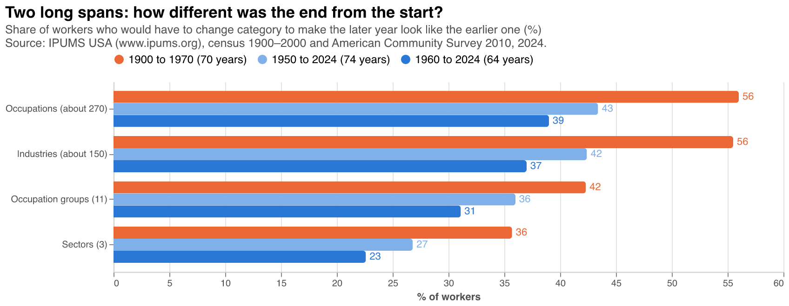
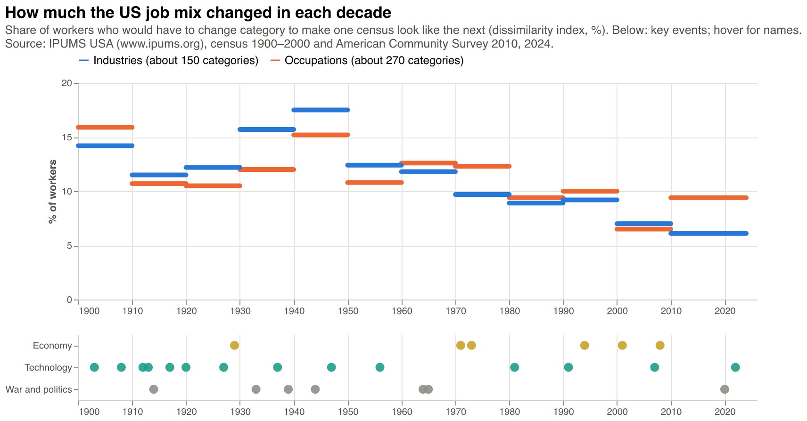
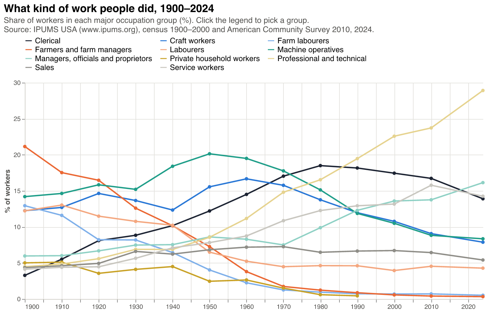
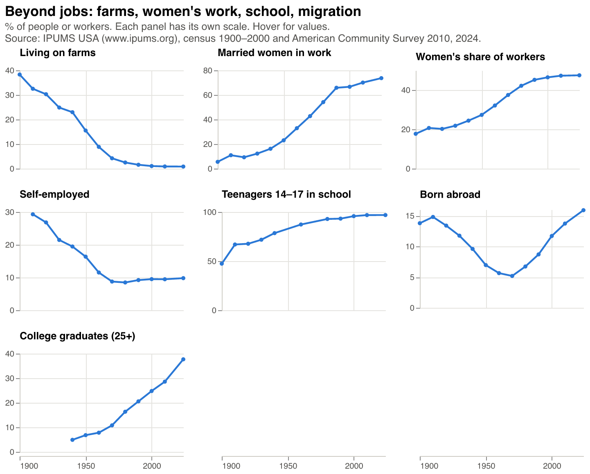
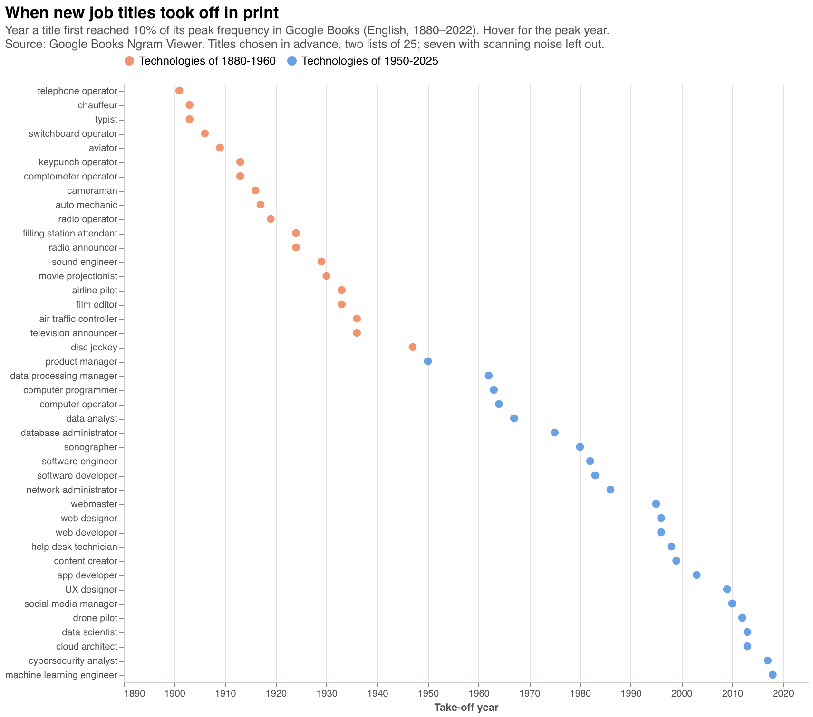

## The claim

### What was said

This is the third line of the post checked in the [first Research Snack](/2026-11-16-one-in-270-jobs/). On 16 November 2026 [Ethan Mollick wrote](https://x.com/emollick/status/2122176524610884061):

> I think often about the fact that almost everyone working in the West has lived in a quite stable socio-technical period
>
> Only 1 job out of 270 in the 1950 census is now obsolete (elevator operator)
>
> 2026 is similar to 1957 in a way that 1969 was not from 1900.

The two spans are the same length: 69 years each. The claim is that the second one changed people's lives and work much less than the first.

### What can be tested

The claim is about "socio-technical" change in general, which no single dataset covers. This check tests the part that census data can measure: what jobs people did, which industries they worked in, and some facts about how they lived (on farms or not, whether married women worked, whether teenagers were in school, how many people were born abroad). The census years closest to the claim's dates are 1900, 1960, 1970 and 2024, so the comparison is 1900 to 1970 against 1960 to 2024, with 1950 to 2024 as a span of similar length.

The best-known statement of the same idea is the economist Robert Gordon's *The Rise and Fall of American Growth* (2016), which argues that the century from 1870 to 1970 was a one-off: electricity, the motor car, indoor plumbing, the telephone and modern medicine changed daily life more than anything since.

## The answer

### In short

Counted in the job categories of 1950, the claim holds. Measured by how many workers would have to change job category to make the later year look like the earlier one, 1900 to 1970 changed 56% of the workforce and 1960 to 2024 changed 39% (43% for 1950 to 2024, a slightly longer span). The same pattern holds for industries, broad occupation groups and sectors: the first span changed 1.3 to 1.6 times as much as either later span.

### Where the claim goes too far

Counting in 1950's categories favours the earlier span, because those categories were built around the jobs of the first half of the century. Counted in the finer categories of 1990 or 2010, which only go back to 1950, the later span changed 52–54% of workers, about as much as the earlier span did in 1950's categories. The two numbers cannot be compared directly, but they show that the fixed categories hide much of the later change.

The later period changed as much or more on several things: married women's work (33% to 74% in the labour force, against 6% to 43% in the earlier span), professional and technical work (11% to 29% of workers, against 4% to 15%), and the share of people born abroad (6% to 16%). And the measure counts people in job categories. It does not see a clerk who moved from a typewriter to a computer, which is where much of the later change happened.

## How much the job mix changed

### Two long spans

The measure is the dissimilarity index ([Duncan and Duncan, 1955](https://doi.org/10.2307/2088328)): the share of workers who would have to move to another category to make one year's mix of jobs identical to another's. 0% means no change; 100% means no overlap at all. Every year is coded into the same scheme of about 270 occupations and 150 industries from the 1950 census, so the categories stay fixed.

| Span | Years | Occupations | Industries | Occupation groups | Sectors |
|---|---|---|---|---|---|
| 1900 to 1970 | 70 | 56.0% | 55.5% | 42.3% | 35.7% |
| 1950 to 2024 | 74 | 43.4% | 42.4% | 36.0% | 26.8% |
| 1960 to 2024 | 64 | 39.0% | 37.0% | 31.1% | 22.6% |
| 1970 to 2024 | 54 | 34.5% | 30.2% | 26.2% | 16.6% |

### The same test in today's categories

The census has also coded occupations into the 1990 and 2010 schemes, which split modern work more finely (about 300 categories in use instead of about 230 in 1960 under the same scheme). These codes exist only from 1950, so they cannot test 1900–1970, but they show how much the choice of categories matters for the later span:

| Span | 1950 scheme | 1990 scheme | 2010 scheme |
|---|---|---|---|
| 1950 to 2024 | 43.4% | 57.4% | 62.9% |
| 1960 to 2024 | 39.0% | 52.2% | 53.6% |

Part of the difference comes from the newer schemes having more categories in later years, which raises any dissimilarity index. Even so, the later span stops looking stable once the categories can see the new jobs.

### Decade by decade, with the events around them

The same measure between each pair of neighbouring censuses shows when the change happened. The 1900s, the 1930s and the 1940s (Depression, New Deal and war) moved the most. From 1950 to 1990 change ran at 9–13% a decade, and the 2000s were the calmest decade on record. The 14 years from 2010 to 2024 moved occupations by 9.4%, more than the decade before.

There is no visible break around 1971, the year the website [WTF Happened In 1971?](https://wtfhappenedin1971.com/) points to (the end of the dollar's convertibility to gold). The 1970s changed the job mix about as much as the 1960s. That site's charts are mostly about wages, prices and money, which this data does not measure.

### What changed, group by group

The table matches the big events of each period to the census measure they should move (share of workers or people, %):

| Change | Census measure | 1900 | 1960 | 1970 | 2024 |
|---|---|---|---|---|---|
| Tractors and mechanised farming | Farmers and farm labourers | 34.1 | 6.1 | 3.0 | 0.9 |
| Motor car, assembly line, factories | Machine operatives | 14.2 | 19.5 | 17.8 | 8.4 |
| Typewriter, telephone, office machines; then the PC | Clerical workers | 3.3 | 14.5 | 17.0 | 13.9 |
| Mass college education | Professional and technical workers | 4.5 | 11.2 | 14.8 | 28.9 |
| Globalisation, China, automation | Mining, construction and manufacturing | 23.1 | 35.3 | 32.3 | 17.2 |
| Services growth (Baumol's cost disease) | Services, trade, transport and government | 37.5 | 58.0 | 64.0 | 80.6 |
| Household appliances; then services | Private household workers | 5.0 | 2.6 | 1.5 | – |

The first span is dominated by one change, the move off the land: a third of workers farmed in 1900 and 3% in 1970. Nothing after 1960 compares with it in size. The second span has two big movements of its own: manufacturing halved and professional work doubled. Clerical work is the one group that rose in the first span and fell in the second.

## Beyond jobs

### How people lived

| Measure (%) | 1900 | 1960 | 1970 | 2024 | Change 1900–1970 | Change 1960–2024 |
|---|---|---|---|---|---|---|
| Population living on farms | 38.3 | 8.9 | 4.2 | 0.9 | −34.1 | −8.0 |
| Married women 16–64 in the labour force | 5.6 | 32.9 | 42.8 | 73.7 | +37.2 | +40.8 |
| Women as share of the labour force | 17.7 | 32.1 | 37.5 | 47.5 | +19.8 | +15.4 |
| Workers self-employed (1910 for 1900) | 29.3 | 11.5 | 8.8 | 9.8 | −20.5 | −1.7 |
| Teenagers 14–17 in school (1960 for 1970) | 47.4 | 87.3 | – | 96.9 | +39.9 | +9.6 |
| Population born abroad | 13.8 | 5.7 | 5.2 | 15.9 | −8.6 | +10.2 |
| Adults 25+ with four or more years of college (1940 for 1900) | 4.9 | 7.8 | 10.8 | 37.7 | +5.9 | +29.9 |

College education, asked from 1940, moved more in the later span: 4.9% of adults aged 25 and over had four or more years of college in 1940, 10.8% in 1970 and 37.7% in 2024.

The first span moved people off farms, out of self-employment and into school. The second span moved married women into paid work and brought immigration back to the level of 1900.

## New kinds of work

### Job titles written on the census forms, 1900 to 1940

The census forms up to 1940 record the job title each person gave, in their own words. Looking at titles that at least 15 people in the 1940 sample wrote and nobody in the 1900 or 1910 samples wrote, and sorting the 80 most common by hand, 38 are genuinely new jobs and the rest are new wording for old ones ("sales clerk", "executive"). The new ones show where the change came from:

| Driver | New titles by 1940 |
|---|---|
| Motor car and lorry | automobile mechanic, taxi driver, gas station attendant, bus operator, truck helper, route salesman, service man |
| Farm machinery | tractor driver, tractor operator |
| Powered machines | press operator, punch press operator, crane operator, shovel operator, power machine operator, sewing machine operator |
| Telephone and office machines | switchboard operator, comptometer operator, clerk typist, receptionist, linotype operator |
| Cinema and leisure | projectionist, pin setter (bowling) |
| New services | beautician, beauty operator, dental assistant, insurance salesman |
| New professions | electrical engineer, chemical engineer, sales engineer, technician |
| The New Deal | WPA, WPA labourer, NYA, CCC (public work programmes) |

These 38 titles alone covered about 1% of the 1940 workforce. That is a floor: it misses new jobs whose titles already existed in 1910 (chauffeur, telephone operator) and every spelling variant. The census stopped recording titles in words after 1940, so the same test cannot be run on the later period.

### When new job titles took off in print

As a rough check on both periods, the agent looked up 50 job titles in Google Books: 25 tied to technologies of 1880–1960 and 25 tied to technologies of 1950–2025, with both lists fixed before looking at the data. For each title it found the year it first reached 10% of its peak frequency.

Both periods produced a steady stream of new titles: about one every two to three years in each list. This is an illustration, not a measure: the titles were chosen by the agent, books lag behind practice, and recent titles have had less time to reach print.

### The wider literature

The most thorough count of new work is by [Autor, Chin, Salomons and Seegmiller (2024)](https://doi.org/10.1093/qje/qjae008), who traced about 30,000 detailed job titles in the census index. They find that about 60% of US employment in 2018 was in titles that did not exist in 1940. Their data starts in 1940, so it cannot compare the two spans in this claim.

## Limits of this check

- **Fixed categories understate later change.** Every year is coded into the 1950 list of occupations, which was designed around the jobs of 1950. Work invented later is folded into old categories (a software developer counts among "professional, technical" workers next to draftsmen), so the later span looks more stable than it was. The section above shows how much: with the 1990 or 2010 schemes, 1960–2024 changes 52–54% of workers instead of 39%.
- **Categories cannot see changes inside jobs.** A secretary in 1960 and in 2024 are the same category doing very different work.
- **US only.** The claim is about "the West".
- **Samples.** 1900–2000 are 1% census samples; 2010 and 2024 are the American Community Survey. Small categories are noisy.
- **Some series have gaps.** The school question is not available in the 1950 and 1970 samples used here, and private household workers stop being coded separately after 1990.
- **The events are a selection.** The timeline marks well-known events; it does not show that they caused the changes.

## How this was made

### Timeline

Times are 17 November 2026, UK time.

- **00:12**: I asked whether the third line of the post holds on the jobs front.
- **00:16**: The agent submitted a census extract for 13 years from 1900 to 2024; it was back by 00:18 (25 million person records).
- **00:19**: I asked for more measures of new jobs: job advertisements or Google Books. Job-advert archives with full text were not available, so the agent used Google Books and the census forms' written job titles.
- **00:21**: First results: dissimilarity indices, indicators, Google Books take-off years.
- **00:23**: I asked to bring in the big events of each period (wars, the aeroplane, containers, oil shocks, China, the internet, Baumol's cost disease, college education). The agent added an event timeline and a table matching events to census measures, and a further extract for college education.
- **~00:35**: Charts and the first draft of this page.

### Data and method

The data is IPUMS USA microdata: 1% census samples for 1900 to 2000 and the American Community Survey for 2010 and 2024. People aged 16 and over in the labour force are counted, weighted by person weights, in each occupation (1950 scheme, OCC1950) and industry (IND1950). The dissimilarity index is half the sum of absolute differences between two years' shares. The other measures use farm residence, marital status, class of worker, school attendance and birthplace. A second extract repeats the index with the 1990 and 2010 occupation schemes, and a third adds education from 1940.

Written job titles come from the occupation string (OCCSTR) in the 1900–1940 samples. Titles were normalised (capital letters, punctuation removed), and the 80 most common titles new by 1940 were sorted by judgement into new jobs and new wording; the sort is in the data files. Google Books frequencies come from the Ngram Viewer's English corpus, 1880–2022, case-insensitive.

### Models, tools and tokens

| Model | Role | Calls | Tokens read | Tokens written |
|---|---|---|---|---|
| Claude Opus 5.5 | The only agent: extracts, analysis, Google Books lookups, charts, writing, publishing | 63 | 18,933,619 | 60,090 |

The counts cover the session from the question (00:12) to the first draft (about 00:35), and include a side task in the same session: fetching Bessen's paper for the [first snack](/2026-11-16-one-in-270-jobs/). Tokens read are high because this check ran in the same conversation as the first snack, so the agent re-read that whole history, mostly from cache, on every call. A fresh session would have read far fewer.

Other tools: the IPUMS USA API (extracts), Python (analysis), the Google Books Ngram Viewer, and Vega-Lite (charts). The census data is from IPUMS USA, University of Minnesota, [www.ipums.org](https://www.ipums.org).
