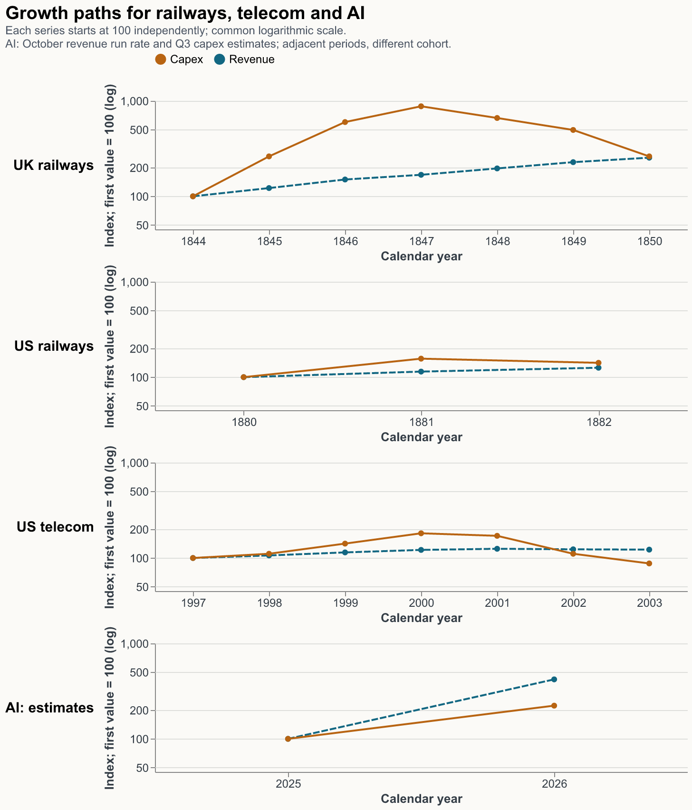

## The claim

### What was said

On 18 November [Understanding AI](https://www.understandingai.org/p/19-charts-that-explain-the-state) published an article by Kai Williams (Timothy B. Lee publishes the site). It says: “There is no 20th Century precedent for this level of infrastructure investment in the United States.” It also argues that rising AI revenue makes it more likely the investment will pay off.

That gives two questions. How unusual is the spending? And what does revenue growth tell us about returns?

### Where the numbers come from

The spending chart plots **Manhattan (1944), electricity (1949), Apollo (1964), interstate highways (1966), broadband (2000), and technology-company capex (2025 and 2026 year to date)**. Railways come up in the text. The source line lists BEA, *Manhattan District History*, The Planetary Society, Federal Highway Administration FA-203, US Telecom and company filings.

The revenue chart comes from [Exponential View’s 2 November brief](https://www.investmentbrief.ai/p/ai-investment-brief-monday-7), which credits company filings and reports. The estimate counts money once as it passes from an application to a model provider and then to a cloud provider.

## The answer

### Historically large, with clear precedents

**Railway booms took a bigger share of GDP than the big technology companies' total capital spending does now**, in both Britain and the United States. So AI spending is not unprecedented as a share of an economy. The article itself mentions railways. Its narrower claim, about twentieth-century US infrastructure, needs a fuller comparison than this quick check.

### Revenue growth supports demand, not a guaranteed return

**Fast revenue growth shows demand, but not adequate returns on the capital being committed.** Railways and telecoms had paying customers before investors lost money. Revenue has to cover running costs, replacement equipment and financing, and leave enough for investors.

## Railway booms absorbed more of their economies

### Annual spending divided by annual GDP

The measure is annual nominal spending divided by nominal GDP for the same country and year. For each window the table gives the year with the largest **GDP share**, not the largest dollar total. Public programme spending includes costs that private capital accounts would treat differently.

| Precedent and search window | Peak year | Annual spend / GDP | Revenue / annual capex where known |
|---|---:|---:|---:|
| [UK railways, 1844–1850](https://www-users.cse.umn.edu/~odlyzko/doc/hallucinations.pdf) | 1847 | 6.48% | 0.19× |
| [US railways, 1870–1889](https://www.nber.org/system/files/chapters/c1498/c1498.pdf) | 1871 | 5.53% | — |
| US railways, 1880–1889, same reconstruction | 1881 | 3.78% | 1.56× |
| [Five technology companies, article’s 2026 proxy](https://www.understandingai.org/p/19-charts-that-explain-the-state) | YTD | 2.3%, reported | 0.27–0.49×, AI-specific spending diagnostic below |
| [US broadband providers, 1996–2013](https://ustelecom.org/wp-content/uploads/2019/01/Latest-Data-Show-Broadband-Investment-Surged-in-2013.pdf) | 2000 | 1.15% | 1.94×, different provider coverage |
| [US private electricity, 1929–1950](https://www.nber.org/system/files/chapters/c1498/c1498.pdf) | 1930 | 0.83% | — |
| [Apollo, including overhead, FY1960–1973](https://www.planetary.org/space-policy/cost-of-apollo) | FY1964 | 0.48% | No direct commercial revenue |
| [Federal interstate programme, FY1956–1976](https://www.fhwa.dot.gov/ohim/summary95/fa203.pdf) | FY1964 | 0.44% | No comparable programme sales series |
| [Manhattan Project, 1942–1946](https://www.energy.gov/sites/default/files/2013/08/f2/HewlettandAndersonNewWorldNoBookmarks.pdf) | 1944 | 0.42% | No direct commercial revenue |
| British canal mania, 1790s | — | Not established | Not established |
| US railways, 1850s | — | National peak not reconstructed | — |
| Civil nuclear power build-out | — | Not established | Not established |

The AI row is **global total company capex divided by US GDP**, including non-AI assets, for an unfinished year. It is not a measured US-only AI investment share. The historical rows also differ in coverage: private electricity excludes public utilities and land; interstates include federal spending but not the state match; US railway spending includes land.

### What changes when the definitions change

For Britain, [Odlyzko’s tables](https://www-users.cse.umn.edu/~odlyzko/doc/hallucinations.pdf) give £43.9m of railway investment in 1847. Against his older factor-cost GDP that is **7.27%**. Against the [Bank of England’s historical UK market-price GDP](https://www.bankofengland.co.uk/statistics/research-datasets), including Ireland, it is **6.48%**. Both are well above the AI proxy.

The Apollo workbook separates the programme from the rest of NASA. Direct costs plus overhead give a peak share of 0.48%. The article’s bar of roughly 0.75% is closer to **all NASA obligations** in FY1964. That shows a difference in scope; it does not show exactly how the chart was calculated. [OMB](https://www.whitehouse.gov/omb/information-resources/budget/historical-tables/) also separates agency cash outlays from obligations. Private electricity peaks after the war at 0.76% in 1949, and higher still at 0.83% in 1930. Neither reproduces the chart’s broader electricity bar.

For Manhattan, the [official monthly expenditure table](https://www.energy.gov/sites/default/files/2013/08/f2/HewlettandAndersonNewWorldNoBookmarks.pdf) gives the annual figure. [Brookings’ *Atomic Audit* page](https://www.brookings.edu/the-costs-of-the-manhattan-project/) reports cumulative costs; dividing that total by one year’s GDP would answer a different question.

## Paying customers did not prevent investment losses

### Revenue against capex three years into each boom

This ratio divides one year’s gross receipts by the same year’s capital spending. It is **not** a profit margin or a return on the accumulated investment.

| Case | Chosen boom start → comparison year | Revenue / annual capex | Annual revenue / accumulated financed capital |
|---|---|---:|---:|
| UK railways | 1844 → 1847 | 0.19× | 5.02% |
| US railways | 1879 → 1882 | 1.89× | 10.98%, book-finance proxy |
| US telecom | 1996 → 1999 | 2.35× | — |
| AI, October run rate | 2023 → 2026 | 0.49× diagnostic | — |
| AI, trailing twelve months | 2023 → 2026 | 0.27× diagnostic | — |

UK figures use [Odlyzko’s receipts and investment tables](https://www-users.cse.umn.edu/~odlyzko/doc/hallucinations.pdf). US receipts and financed cost come from [Poor’s, reproduced in the Statistical Abstract](https://fraser.stlouisfed.org/files/docs/publications/stat_abstract/sa_1888.pdf), with annual capex from [Ulmer](https://www.nber.org/system/files/chapters/c1498/c1498.pdf). Telecom uses [FCC end-user revenue](https://docs.fcc.gov/public/attachments/DOC-269251A1.pdf) and the broader [provider capex](https://ustelecom.org/wp-content/uploads/2019/01/Latest-Data-Show-Broadband-Investment-Surged-in-2013.pdf), which includes cable. The coverage does not match exactly, and Poor's receipts cover the lines that reported, not every railway in the country.

The start years are judgement calls, and every case mixes an established business with new assets. The AI periods and coverage match even less well. The table cannot rank how profitable the four technologies will turn out.

### Revenue and capex in British railways and US telecom

| Industry | Year | Annual revenue | Annual capex |
|---|---:|---:|---:|
| UK railways | 1844 | £5.0m | £5.0m |
| UK railways | 1847 | £8.4m | £43.9m |
| UK railways | 1850 | £12.7m | £13.1m |
| US telecom | 1997 | $188.5bn | $65bn |
| US telecom | 2000 | $229.1bn | $118bn |
| US telecom | 2003 | $230.7bn | $57bn |

British railway receipts grew during the boom and kept growing afterwards. That did not deliver the returns investors expected in the 1840s. Telecom customer revenue in 2003 was slightly above 2000, while provider investment had more than halved. [Couper, Hejkal and Wolman](https://www.richmondfed.org/-/media/RichmondFedOrg/publications/research/economic_quarterly/2003/fall/pdf/wolman.pdf) document falling investment, overbuilt long-distance fibre and bankruptcies. Total sales never guaranteed a return on newly laid fibre.

It does not work the other way either. [Odlyzko finds that the earlier British railway mania of the 1830s rewarded original investors](https://www-users.cse.umn.edu/~odlyzko/doc/mania01.pdf). Infrastructure booms do not all end the same way.

## What the AI revenue figure shows

### The estimate is published but cannot be reproduced

The [original brief](https://www.investmentbrief.ai/p/ai-investment-brief-monday-7) confirms both revenue figures. The run rate in the screenshot is monthly revenue multiplied by twelve; trailing revenue adds up the previous twelve months. They measure different things.

| AI measure | Amount | What was verified |
|---|---:|---|
| October annualised revenue | $345bn | Published estimate and stated deduplication rule |
| Implied October monthly revenue | $28.75bn | $345bn ÷ 12 |
| Trailing twelve-month revenue | $188bn | Published estimate; company reconciliation unavailable |
| Year-on-year run-rate revenue growth | 320% | Published 4.2× multiple |
| Q3 AI cloud capex estimate | $176bn | [Exponential View’s October brief](https://www.investmentbrief.ai/p/ai-investment-brief-monday-6) |
| Growth in that Q3 capex estimate | 123% | $176bn versus $79bn a year earlier |

Reported run-rate revenue grew faster than estimated quarterly AI capex. That supports the optimistic argument. Costs still need checking, and so does how much of the demand is financed by firms within the same ecosystem.

Company disclosures confirm substantial business but do not reproduce the aggregate. [Anthropic’s IPO fact sheet](https://ipo.anthropic.com/documents/us/factsheet.pdf) reports $17bn of Q3 revenue and an October run rate of about $81bn. Its run rate adds 28 days of consumption multiplied by thirteen to monthly subscriptions multiplied by twelve. [Microsoft’s call](https://www.microsoft.com/en-us/investor/events/fy-2027/earnings-fy-2027-q1) reports cloud revenue as a whole, and [Amazon’s release](https://ir.aboutamazon.com/news-release/news-release-details/2026/Amazon-com-Announces-Third-Quarter-Results/) reports an AWS run rate. Neither is a separate AI total that can be added to the labs’ sales.

### Revenue against the AI capex pace

Annualising the estimated Q3 AI cloud capex gives **$704bn**. Against that pace, the revenue ratios are:

| Revenue numerator | Revenue / estimated AI capex pace | Revenue / all five firms’ capex pace |
|---|---:|---:|
| October run rate, $345bn | 0.49× | 0.38× |
| Trailing twelve months, $188bn | 0.27× | 0.20× |

The second denominator is Q3 total company capex multiplied by four, $920bn. **Neither column is a matched annual return.** October and trailing revenue are set against one quarter’s spending pace, and the company groups differ.

Buying long-lived assets is different from charging their annual depreciation and running costs. Exponential View’s separate cost-coverage model uses capital already in service, operating costs and a required return. Our cash-capex ratios neither reproduce nor refute it.

Deduplication also affects where revenue stays. Exponential View’s [August breakdown](https://www.investmentbrief.ai/p/ai-investment-brief-a-sample) put roughly three-quarters with hosting. Gross model-provider sales cannot be added to the cloud payments they fund. Without the underlying elimination table, this check cannot match what each layer keeps against independent end-user spending.

## Limits of this check

### Missing figures are not zero

For British canal mania, no defensible national series of annual spending against GDP was found, and no matched canal receipts and capex for its boom years. [Bogart’s survey](https://www.economics.uci.edu/files/docs/workingpapers/2012-13/bogart-06.pdf) reports canal dividends of around 6% of share capital in the 1820s. That is a later dividend yield, not revenue divided by investment.

[Wicker’s study of US railways before the Civil War](https://www.nber.org/system/files/chapters/c2488/c2488.pdf) has regional reconstructions and substantial objections to how they were measured. This snack does not infer a national 1850s peak from them.

For civil nuclear power, [EIA documents](https://www.eia.gov/todayinenergy/detail.php?id=2030) slowing demand growth and rising construction costs. No matching series of programme costs and realised nuclear-electricity revenue was found. Multiplying generation by a general retail electricity price would not give nuclear producers’ actual revenue. The expectation that this ratio was small remains untested.

### What these comparisons cannot settle

Historical capital accounts are reconstructions with different coverage. Public spending and private capex serve different purposes. The article’s proxy, global companies over an incomplete year, is especially unlike domestic annual investment. Peak shares depend on the window, the GDP geography and the price basis. Fiscal series use fiscal GDP; calendar series use calendar GDP.

The later, paid part of the article was not read. Exponential View’s underlying company estimates and eliminations were not obtained. These checks do not establish historical uniqueness, nor the future returns, financing resilience or valuation of AI businesses.

## How this was made

### Timeline

| Time, 19 November 2026 (UK/UTC) | Work |
|---|---|
| 08:51:55 | Session starts; questions and screenshot supplied |
| 08:53–09:10 | Source charts, historical annual tables and GDP definitions checked |
| 09:10–09:19:33 | Ratios calculated; writer brief, original charts and entry prepared |
| 09:19:33 | Usage snapshot; 27.6 minutes elapsed; release verification follows |

Human time is an estimate. The agent found the sources, inspected the chart and historical tables, calculated the ratios, drew original charts and prepared this entry. No extra human data collection was measured.

### Data and method

The reproducible calculation uses selected nominal spending and GDP figures. US calendar GDP is [BEA’s GDPA](https://fred.stlouisfed.org/series/GDPA); fiscal GDP is [OMB Table 10.1](https://www.whitehouse.gov/omb/information-resources/budget/historical-tables/); early US GDP is [MeasuringWorth](https://www.measuringworth.com/datasets/usgdp/); UK GDP is the [Bank of England’s historical-boundary series](https://www.bankofengland.co.uk/statistics/research-datasets).

The judgement steps were choosing boom windows and start years, separating cash spending from liabilities and capital stocks, choosing GDP geography and fiscal periods, and keeping mismatched coverage as a stated limitation. The public rerun checks the displayed arithmetic and chart tables. It does not independently check source transcription, reproduce the private full peak search, or audit the AI revenue model. MeasuringWorth’s full annual extract and copyrighted source images are not published; the numbers and source links are.

### Models, tools and tokens

| Model or tool | Role | Calls with recorded usage | Tokens read | Tokens written |
|---|---|---:|---:|---:|
| Codex, gpt-6.1-sol | Research, calculations, chart code and draft | 54 | 12,644,918 | 56,251 |
| Web search and page retrieval | Original sources and disclosure checks | — | — | — |
| Python, Poppler, Vega-Lite and vl-convert | Extraction, arithmetic and original charts | — | — | — |
| Astro, headless Chromium and Cloudflare Pages | Build, page checks and publication | — | — | — |

Tokens read include cached history and loaded instructions; cached tokens are counted once. The counts cover the research-and-draft session up to the snapshot, not the later release checks and deployment. No independent second-model review was run.
