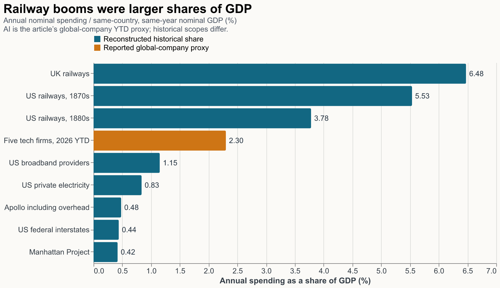
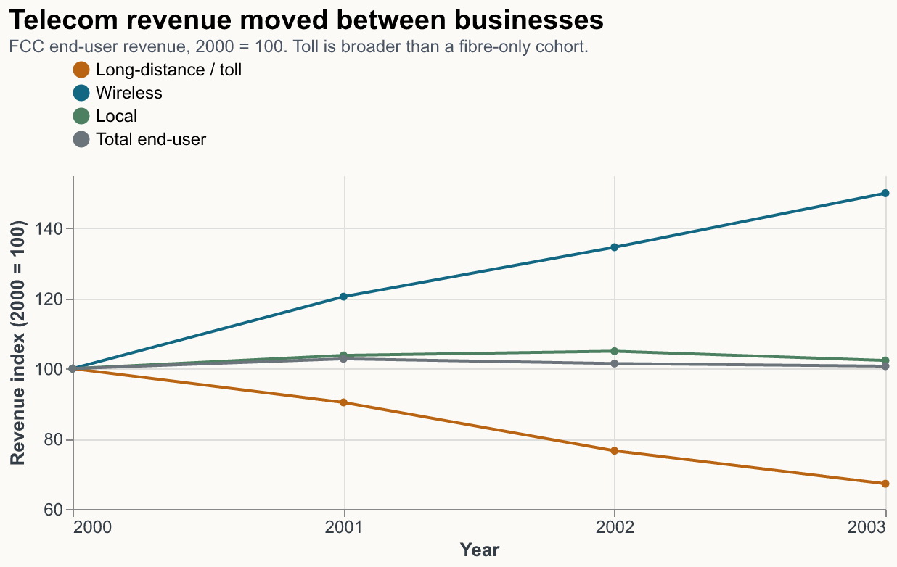

## The claim

### What was said

On 18 November [Understanding AI](https://www.understandingai.org/p/19-charts-that-explain-the-state) published an article by Kai Williams (Timothy B. Lee publishes the site). It says: “There is no 20th Century precedent for this level of infrastructure investment in the United States.” It already concedes the post-Civil-War railway boom. It also argues that the investment is likely to pay off **if revenue keeps growing at the current pace, or a little slower**.

That gives two questions. How unusual is the spending? And what does revenue growth tell us about returns?

### Where the numbers come from

The spending chart compares Manhattan, electricity, Apollo, interstate highways and broadband with capital expenditure by Meta, Amazon, Oracle, Alphabet and Microsoft. **Capex** means spending on assets such as equipment and buildings. The five firms' worldwide spending is divided by US GDP; it includes assets used for other businesses.

The revenue estimate comes from [Exponential View’s 2 November brief](https://www.investmentbrief.ai/p/ai-investment-brief-monday-7). It counts money once as it passes from an application to a model provider and then to a cloud provider. A **run rate** annualises recent revenue; **trailing twelve months** adds up revenue already earned.

## The answer

### The twentieth-century comparison is close

**US railway spending reached 2.19% of GDP in 1910: a close twentieth-century precedent.** The article's 2.3% exceeds it; a scenario allocating 70% of today's proxy to the US does not. “No precedent” is too categorical for this close comparison. A complete century-wide search remains unfinished.

The broader comparison is clearer. Nineteenth-century railway manias absorbed much larger shares of their economies, both annually and over the boom.

### Revenue growth gives grounds for optimism, with conditions

**AI revenue is growing faster than estimated AI capex, and Exponential View's model shows infrastructure revenue covering the annual cost of capital already in service.** That supports the optimistic argument. It does not establish that all the committed capacity will earn enough, or that investors buying today's shares will receive adequate returns. The equipment has to keep earning through replacement and changing prices.

Historical arithmetic is checked below. The AI revenue estimate is traced to its source, but its company-level reconciliation remains unavailable. The payoff remains conditional on costs and future demand.

## Spending is large; the definition matters

### Rebuilding the AI share

Cash purchases of property and equipment in the five firms' [filings and earnings statements](#filing-reconciliation) give **$560.4bn over nine reported months**. Dividing by the corresponding nine months of nominal GDP gives **2.30%**, reproducing the article's rounded 2.3%. Oracle's reporting periods run a month early; estimating its calendar alignment gives 2.31% instead. Exact September spending is not disclosed.

| Measure | Share of US GDP | What it measures |
|---|---:|---|
| Five firms' nine-month cash purchases | 2.30% | Global, all company assets; Oracle one month early |
| Calendar-alignment estimate | 2.31% | Oracle monthly proration and September carry-forward assumption |
| Allocate 70% of reported cash to the US | 1.61% | Illustrative allocation, still including non-AI assets |
| Latest-quarter cash purchases at an annual pace | 2.79% | A spending pace, not a full-year forecast |
| Exponential View's estimated AI cloud spending, Q3 pace | 2.13% | Different estimated company group; still not US-only |

The scenario range is **about 1.6–2.8%, alongside the article's 2.3%**. It does not bound domestic AI investment. The article's [US share of installed compute](https://epoch.ai/data/ai-chip-imports) identifies neither this year's domestic spending nor its AI fraction; other investors are missing too.

### Annual spending against GDP

The historical measure divides annual nominal spending by nominal GDP for the same country and year. Peak means the largest **GDP share** in the stated window.

| Commercial industry and search window | Peak year | Annual spend / GDP |
|---|---:|---:|
| [UK railways, 1844–1850](https://www-users.cse.umn.edu/~odlyzko/doc/hallucinations.pdf) | 1847 | About 6½% |
| [US railways, 1870–1889](https://www.nber.org/system/files/chapters/c1498/c1498.pdf) | 1871 | About 5½%, extrapolated |
| US railways, 1880–1889, same reconstruction | 1881 | About 3.8% |
| US railways, 1900–1914, same reconstruction | 1910 | 2.19% |
| [US broadband providers, 1996–2013](https://ustelecom.org/wp-content/uploads/2019/01/Latest-Data-Show-Broadband-Investment-Surged-in-2013.pdf) | 2000 | 1.15% |
| [US private electricity, 1900–1950](https://www.nber.org/system/files/chapters/c1498/c1498.pdf) | 1924 | 0.90% |

Ulmer's railway table gives **$740m in 1910** against [MeasuringWorth GDP of $33,746m](https://www.measuringworth.com/datasets/usgdp/). Excluding land lowers the share to 2.12%. The 1871 estimate extrapolates from the 1873 sample; the 1882 observation rests on a sampled year. [Wicker explains the weaknesses of these early reconstructions](https://www.nber.org/system/files/chapters/c2488/c2488.pdf).

| Public programme and search window | Peak year | Annual spend / GDP |
|---|---:|---:|
| [Apollo including overhead, FY1960–1973](https://www.planetary.org/space-policy/cost-of-apollo) | FY1964 | 0.48% |
| [Federal interstate programme, FY1956–1976](https://www.fhwa.dot.gov/ohim/summary95/fa203.pdf) | FY1964 | 0.44% |
| [Manhattan Project, 1942–1946](https://www.energy.gov/sites/default/files/2013/08/f2/HewlettandAndersonNewWorldNoBookmarks.pdf) | 1944 | 0.42% |

The public programmes compare resource commitments; commercial-return ratios do not apply.

### Spending over the boom

Each cumulative sum is divided by **one reference year's GDP**, named below. The windows differ in length; the comparison is nominal, not inflation-adjusted.

| Boom window | Cumulative spending | Reference GDP | Sum / one year's GDP |
|---|---:|---|---:|
| UK railways, 1845–1850 | £158m | 1847 | 23.3% |
| US railways, 1870–1873 | $1,472m | 1871 | 19.0% |
| US railways, 1880–1883 | $1,435m | 1881 | 12.1% |
| Five technology firms, 2024–September 2026 | $1,211bn | Q3 2026 annual GDP pace | 3.7% |

The last row is global company cash spending, with Oracle's window a month early, rather than domestic AI-only spending. It counts money spent so far; annualising the unfinished year would increase it artificially.

## Revenue has to cover capital already in use

### Sales relative to the installed capital

**Capital in service** means assets ready for use, excluding construction still in progress. It is closer to the assets earning today's revenue than this year's purchases are.

| Case | Annual revenue | Capital denominator | Revenue / capital |
|---|---:|---:|---:|
| UK railways, 1847 | £8.4m | £167.3m financed capital | 5.0% |
| US railways, 1882 | $770m | $7,017m book-finance proxy | 11.0% |
| AI infrastructure, 2 November estimate | $255bn run rate | $563bn in service | 45.3% |
| All AI layers, same estimate | $345bn run rate | $563bn infrastructure in service | 61.3% |
| AI infrastructure, including construction | $255bn run rate | $915bn deployed | 27.9% |

The railway figures are gross receipts against financed capital, from [Odlyzko](https://www-users.cse.umn.edu/~odlyzko/doc/hallucinations.pdf) and [Poor's accounts](https://fraser.stlouisfed.org/files/docs/publications/stat_abstract/sa_1888.pdf). [Exponential View's infrastructure revenue](https://www.investmentbrief.ai/p/ai-investment-brief-monday-7) is the closer AI match; downstream sales also bring downstream costs.

Asset life matters. The brief assumes compute equipment earns for **5–6 years**. [Alphabet describes servers and networking equipment with six-year useful lives, and data centres with much longer lives](https://abc.xyz/investor/events/event-details/2026/2026-Q3-Earnings-Call-2026-Ujou16CTw9/). Railway civil works served for decades. Land, buildings and power connections should not be written off at the same rate as chips.

### Rebuilding the capital-cost test

Exponential View charges the capital already in service for depreciation, running costs and a required return. Its rounded inputs give:

| Model input or calculation | Amount |
|---|---:|
| Capital in service | $563bn |
| Capital including construction in progress | $915bn |
| Annual depreciation | $80bn |
| Annual operating costs | $16bn |
| Required annual return | $84bn |
| Total annual hurdle | $180bn |
| Infrastructure revenue / hurdle | 1.42× |
| All-stack revenue / hurdle | 1.92× |

The arithmetic agrees to rounding. Capital valuation, depreciation, operating costs and company coverage remain unaudited. The source describes its required return as 15% ROIC excluding WACC; financing costs are not fully reconstructed.

The same brief estimates annual costs of **$475bn for capital committed over the next twelve months** and **$703bn over twenty-four months**, once in service. It says infrastructure revenue must grow at **22% or 36% a year**, respectively, throughout the equipment's life. Those are the source model's conditions, not forecasts established by this check.

### How the assumptions change the result

For a **hypothetical** $100bn equipment cohort earning $60bn at full utilisation/base price, coverage is cash operating surplus divided by straight-line depreciation plus a 15% return on original cost. Margin is before depreciation; buildings, land, tax and financing are excluded. Each row changes one assumption.

| Assumption | Equipment life | Utilisation | Price vs base | Cash margin | Cost coverage |
|---|---:|---:|---:|---:|---:|
| Illustrative base | 6 years | 100% | 1.0× | 60% | 1.14× |
| Five-year life | 5 years | 100% | 1.0× | 60% | 1.03× |
| Faster replacement | 3 years | 100% | 1.0× | 60% | 0.74× |
| Less use | 6 years | 75% | 1.0× | 60% | 0.85× |
| Lower realised price | 6 years | 100% | 0.8× | 60% | 0.91× |
| Lower margin | 6 years | 100% | 1.0× | 40% | 0.76× |

Shorter life, idle capacity or lower prices can remove coverage even while revenue remains substantial.

### One company's operating result

[Anthropic's fact sheet, pp. 13–15](https://ipo.anthropic.com/documents/us/factsheet.pdf), gives a concrete example of the difference between sales and profit.

| Q3 2026 | Revenue | Compute / infrastructure cost | GAAP operating result | Adjusted operating result |
|---|---:|---:|---:|---:|
| Anthropic | $16.956bn | $9.863bn | −$0.567bn (−3.3%) | $2.463bn (14.5%) |

The adjustment excludes $1.070bn stock compensation and $1.960bn non-cash charitable contributions. Sales above compute cost still pay for personnel and other operations. One company does not validate the aggregate.

## Growth paths tell us more than a third-year ranking

### What grew, and when

| Series | Start → end | Revenue growth | Capex growth |
|---|---|---:|---:|
| UK railways | 1844 → 1847 | 68% | 778% |
| US railways | 1880 → 1882 | 25.5% | 41.3% |
| US telecom | 1997 → 2000 | 21.5% | 81.5% |
| AI estimates | 2025 → 2026 | 320% | 122.8% |

AI revenue grew faster than estimated spending: a real difference in the optimistic argument's favour. Its October run rates and Q3 capex estimates have adjacent timing and changing coverage. Historical lines include established businesses; telecom receipts omit some providers included in capex. These paths cannot rank returns or equal stages of development. Each series starts at 100 on a common logarithmic scale.

### Telecom growth moved between businesses

[FCC end-user revenue](https://docs.fcc.gov/public/attachments/DOC-269251A1.pdf) shows what the aggregate hides.

| Revenue category | 2000 | 2003 | Change |
|---|---:|---:|---:|
| Long-distance / toll | $87.767bn | $58.983bn | −32.8% |
| Wireless | $56.857bn | $85.254bn | +49.9% |
| Total end-user | $229.149bn | $230.711bn | +0.7% |

Toll is broader than a pure long-distance fibre cohort. Still, growing wireless sales did not repay the owners of surplus long-distance fibre.

### What happened to investors

| Precedent | Investor outcome |
|---|---|
| UK railway mania | [Railway share prices collapsed in 1847–1850](https://www-users.cse.umn.edu/~odlyzko/doc/hallucinations.pdf), while traffic receipts continued to grow. |
| US railways | Receiverships spread in [1893](https://fraser.stlouisfed.org/title/commercial-financial-chronicle-1339/financial-review-583855/fulltext) and [1894](https://www2.census.gov/library/publications/1938/compendia/statab/59ed/1937-15.pdf). This later crisis does not measure returns for the earlier spending cohort. |
| US telecom | [Bankruptcies in 2001–2002 accompanied the investment collapse](https://www.richmondfed.org/-/media/RichmondFedOrg/publications/research/economic_quarterly/2003/fall/pdf/wolman.pdf), including Global Crossing and WorldCom. |

It does not work the other way either. [Odlyzko finds that the earlier British railway mania of the 1830s rewarded original investors](https://www-users.cse.umn.edu/~odlyzko/doc/mania01.pdf). Infrastructure booms do not all end the same way.

## Limits of this check

Follow-up: [Canals and nuclear: smaller booms, long earnings and expensive failures](https://researchsnacks.semanticmachines.fyi/2026-11-19-canals-nuclear-investment-booms/).

### Missing figures are not zero

[Ginarlis and Pollard's canal investment reconstruction](https://ideas.repec.org/b/oxp/obooks/9780198284086.html) and [Arnold and McCartney's returns study](https://onlinelibrary.wiley.com/doi/10.1111/j.1468-0289.2010.00541.x) yielded no national annual spending series here. Dividends are not investment returns.

[Fishlow's reconstruction](https://www.si.edu/object/american-railroads-and-transformation-antebellum-economy%3Asiris_sil_431447) and [Historical Statistics Df891–900](https://hsus.cambridge.org/HSUSWeb/toc/treeTablePathIdDf891-900.html) remain leads for 1850s US railways; the accessible table exposed headings only. [Wicker's objections](https://www.nber.org/system/files/chapters/c2488/c2488.pdf) still apply.

For nuclear power, the reviews identify EIA's *Nuclear Power Plant Construction Activity 1986* and *An Analysis of Nuclear Power Plant Construction Costs*. The [construction report download](https://www.osti.gov/servlets/purl/6259203) failed. No annual national spending-and-revenue series is inferred from plant costs or general retail electricity prices.

### What these comparisons cannot settle

Electricity covers private utilities through 1950. A valid [BEA investment workbook](https://apps.bea.gov/national/FA2004/Details/Index.htm) replaced the earlier HTML response, but a full-century comparison including public power remains unfinished. All-government highways and wartime facilities are further candidates. The article's electricity and Apollo bars are not fully reconstructed.

Historical capital accounts have different coverage. Peak shares depend on the window, GDP geography and price basis. Global companies' purchases include imports, land and non-AI assets; they cannot be equated with domestic AI fixed investment. The allocation scenarios do not bound the whole AI sector.

The later, paid part of the article was not read. Exponential View's company estimates, eliminations and full operating costs were not obtained. These checks do not establish future returns, financing resilience or today's valuation.

## How this was made

### Timeline

| Time, 19 November 2026 (UK/UTC) | Work |
|---|---|
| 08:51:55 | Original session starts; questions and screenshot supplied |
| 08:53–09:10 | Source charts, historical annual tables and GDP definitions checked |
| 09:10–09:19:33 | Ratios calculated; writer brief, original charts and entry prepared |
| 09:19:33 | Original usage snapshot; 27.6 minutes elapsed; release verification followed |
| 19 November | Revised 19 Nov after reviews by GPT-6 Astra and Claude Fable 5.2 |

Human time is an estimate. The agent found the sources, inspected the tables, calculated the ratios and prepared the charts. The revision applies two independent reviews after a separate author-voice rewrite. Revision and release usage is not included in the original snapshot below.

### Filing reconciliation

All amounts are cash purchases of property and equipment, in US$bn. New finance-lease assets and lease-principal payments are excluded. Thus Microsoft's lease-inclusive headline capex and Meta's purchases-plus-principal headline are not silently mixed with other firms' cash purchases. Amazon is before proceeds from asset sales and incentives; Oracle is before customer-financing offsets.

| Company | Nine reported months | Latest quarter | Calendar alignment |
|---|---:|---:|---|
| [Microsoft](https://www.microsoft.com/investor/reports/ar26/index.html) | 106.045 | 39.367 | FY2026 less [July–December 2025](https://www.microsoft.com/en-us/investor/earnings/fy-2026-q2/press-release-webcast/), plus [July–September 2026](https://www.microsoft.com/en-us/investor/earnings/fy-2027-q1/press-release-webcast/) |
| [Meta](https://investor.atmeta.com/investor-news/press-release-details/2026/Meta-Reports-Third-Quarter-2026-Results/default.aspx) | 83.055 | 33.942 | January–September; July–September |
| [Amazon](https://ir.aboutamazon.com/news-release/news-release-details/2026/Amazon-com-Announces-Third-Quarter-Results/) | 175.670 | 77.259 | January–September; July–September |
| [Alphabet](https://www.sec.gov/Archives/edgar/data/1652044/000165204426000084/goog-20260930.htm) | 131.953 | 51.400 | January–September; July–September; quarter rounded in filing |
| [Oracle](https://investor.oracle.com/investor-news/news-details/2026/Oracle-Announces-Q1-Results-Driven-by-Triple-Digit-Growth-in-Cloud-Infrastructure-Revenues/default.aspx) | 63.627 | 28.499 | December–August; June–August |
| Total | 560.350 | 230.467 | Oracle remains one month early |

[BEA/FRED GDP, 29 October 2026 vintage](https://fred.stlouisfed.org/series/GDP), gives these annual rates.

| Calendar quarter | GDP, US$bn at annual rate |
|---|---:|
| Q1 2026 | 31,906.274 |
| Q2 2026 | 32,563.030 |
| Q3 2026 | 33,010.036 |

Nine-month GDP is their sum divided by four: $24,369.835bn. The share is 560.350 / 24,369.835 × 100; Q3 pace is 230.467 × 4 / 33,010.036 × 100. Oracle's calendar estimate prorates December–February and carries June–August's monthly pace into September: $66.915bn. The checking package gives the full formula.

### Data and method

US calendar GDP is [BEA’s GDPA](https://fred.stlouisfed.org/series/GDPA); fiscal GDP is [OMB Table 10.1](https://www.whitehouse.gov/omb/information-resources/budget/historical-tables/); early US GDP is [MeasuringWorth](https://www.measuringworth.com/datasets/usgdp/); UK GDP is the [Bank of England’s historical-boundary series](https://www.bankofengland.co.uk/statistics/research-datasets). The UK annual peak is 6.48% at market prices, including Ireland, or 7.27% against Odlyzko's older factor-cost GDP. These are different definitions, not confidence bounds.

The Apollo workbook gives 0.48% for programme costs plus overhead in FY1964 and 0.74% for **all NASA obligations**. The article's Apollo bar remains unreproduced. Ulmer D-1, current-dollar column, gives $2,075.7m private electricity spending in 1949; dividing by $272,475m GDP gives 0.76%. Extending the GDP series back changes the window's peak to 1924.

The old trailing-revenue/current-quarter-spending ratio has been removed: its periods did not match. The reported $188bn trailing revenue remains a source estimate, alongside the $345bn October run rate. [Exponential View's 21 September breakdown](https://www.investmentbrief.ai/p/ai-investment-brief-a-sample) explains the layers; model-provider sales cannot be added to the cloud payments they fund.

Judgement steps include the boom windows, cumulative reference years, calendar alignment, land treatment and the separation of reported estimates from hypothetical scenarios. Full private peak searches retain the linked annual inputs; public files give isolated GDP observations and instructions for retrieving restricted series. The rerun checks displayed arithmetic and chart tables, not source transcription, an exhaustive century-wide search or the AI model's company reconciliation. Copyrighted source images, complete workbooks and the full MeasuringWorth extract are withheld.

### Models, tools and tokens

| Model or tool | Role | Calls with recorded usage | Tokens read | Tokens written |
|---|---|---:|---:|---:|
| Codex, gpt-6.1-sol | Original research, calculations, chart code and draft | 54 | 12,644,918 | 56,251 |
| GPT-6 Astra | Independent review supplied for this revision | — | — | — |
| Claude Fable 5.2 | Independent review supplied for this revision | — | — | — |
| Codex, gpt-6.1-sol | Apply reviews, rebuild inputs and verify publication | — | — | — |
| Web retrieval, Python, Poppler, Vega-Lite and vl-convert | Source extraction, arithmetic and original charts | — | — | — |

Counts cover the original research/draft snapshot, including cached history and instructions. Review, revision and release counts were unavailable; a dash means unrecorded, not zero.
