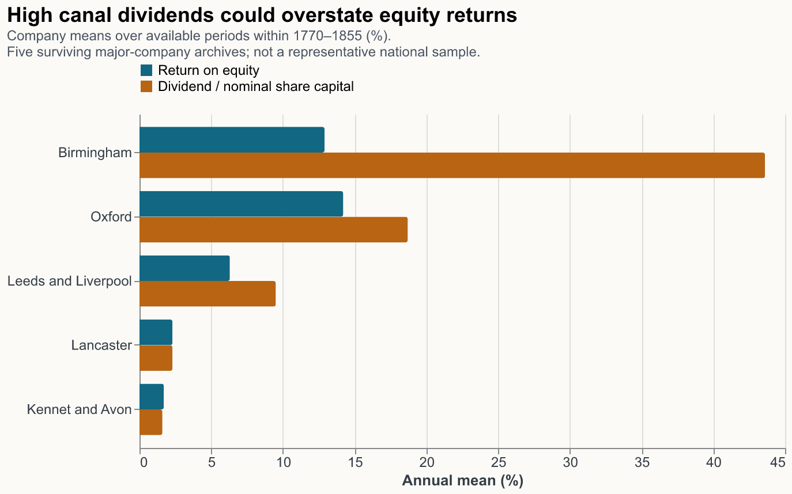
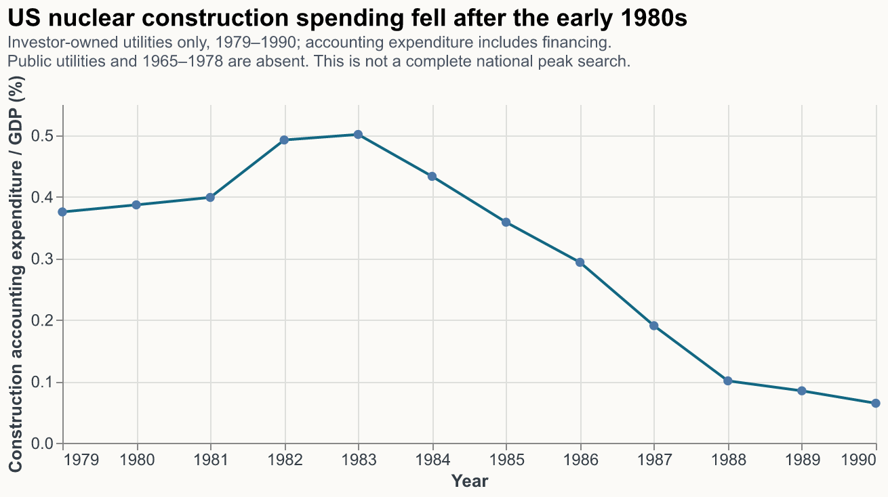
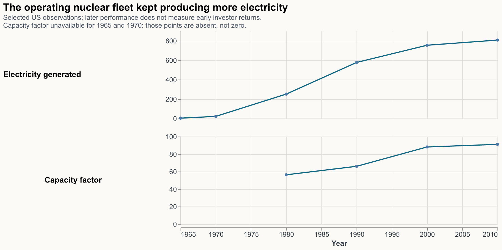
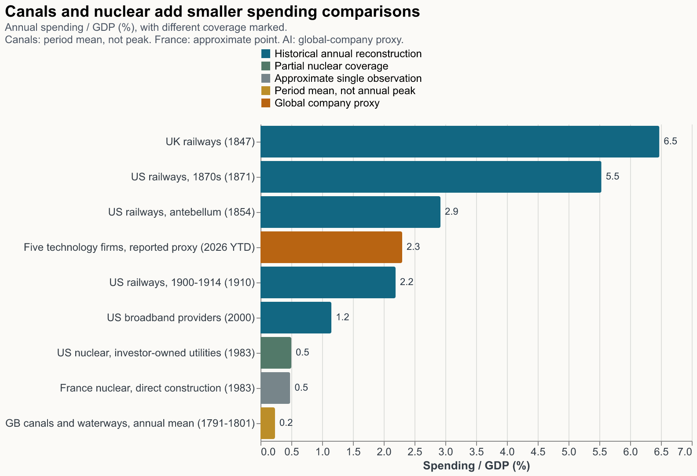

Follow-up to [AI spending, historical booms and the revenue test](https://researchsnacks.semanticmachines.fyi/2026-11-19-ai-capex-historical-booms/). This fills part of its canal and nuclear gaps, and adds the missing US railway comparison from the 1850s.

## The claim

### What was said

The [parent check's Limits](https://researchsnacks.semanticmachines.fyi/2026-11-19-ai-capex-historical-booms/#limits-of-this-check) left British canals, civil nuclear power and antebellum US railways without comparable spending figures. The follow-up asks how much they cost relative to their economies, what they earned, and what that adds to the argument that fast revenue growth can justify AI investment.

There is also a guess to test: **“revenues from nuclear power would be very small”.**

### Where the numbers come from

The canal evidence comes from historical investment reconstructions and surviving company accounts. Nuclear evidence combines utility construction accounts, EIA operating statistics and cost reports, and French public audits. These sources measure different things. Capital authorised, money spent, electricity produced, revenue and investor return are kept separate below.

The annual scale measure is **nominal spending divided by nominal GDP in the same year**. Cumulative scale divides the boom's nominal spending by **one named year's nominal GDP**. A spending total covering several years is not an annual peak.

## The answer

### In short

**The retrieved canal and nuclear spending figures are smaller than the parent’s AI proxy.** Canal spending averaged about **0.2% of GDP** over the broader period around the mania. The available US nuclear construction series reached about **0.5%**. Neither establishes the complete national peak asked for. The recovered US railway series gives **about 2.9% in 1854**, closer to the AI comparison.

**The very-small-nuclear-revenue guess is wrong as a general description of operating assets.** Completed plants earned substantial receipts over long lives. Cancelled plants earned no electricity revenue, and large receipts at completed plants could still leave little after operating costs and financing.

### What this means for AI

Revenue growth supports an argument about demand. Whether the investment pays also depends on how long that revenue lasts, the price received, utilisation, costs and financing. Canal and nuclear histories show both profitable assets and costly failures. They do not establish which outcome AI will follow.

## Canals earned for decades, with very different returns

### Spending around the mania

[Arnold and McCartney, Table 1, p.218](https://www.academia.edu/29815593/_Veritable_gold_mines_before_the_arrival_of_railway_competition_but_did_dividends_signal_rates_of_return_in_the_English_canal_industry), reproduce the canal and waterway investment reconstruction of Ginarlis and Pollard. The original book was not read in full: **these spending totals are secondary citations**. GDP uses the parent’s [Bank of England workbook](https://www.bankofengland.co.uk/statistics/research-datasets), with Great Britain at market prices to match the spending geography.

| Spending period | Total spent | Annual mean | Reference GDP year | Annual mean / reference GDP | Total / reference GDP |
|---|---:|---:|---:|---:|---:|
| 1761–1770 | £1.32m | About £130,000 | 1765 | About 0.1% | About 1.1% |
| 1771–1780 | £2.88m | About £290,000 | 1775 | About 0.2% | About 2.0% |
| 1781–1790 | £1.60m | About £160,000 | 1785 | About 0.1% | About 1.0% |
| 1791–1801 | £6.50m | About £590,000 | 1796 | About 0.2% | About 2.6% |

The last interval contains eleven years. Its annual mean divided by reference GDP gives roughly the same displayed share as total spending divided by the period's total GDP. It remains a period average, covering waterways as well as canals, on the older reconstruction's investment basis. **Annual spending and the cumulative total for exactly 1790–1797 remain unresolved.**

### Tolls, dividends and capital

The same study’s [Tables 3–4, pp.228–229](https://www.academia.edu/29815593/_Veritable_gold_mines_before_the_arrival_of_railway_competition_but_did_dividends_signal_rates_of_return_in_the_English_canal_industry) distinguish receipts and reconstructed equity returns from dividends on nominal share capital. Reinvested earnings made the effective equity denominator larger.

| Five-company sample period | Annual receipts / capital | Return on equity | Dividends / nominal share capital |
|---|---:|---:|---:|
| 1791–1795 | 8.5% | 6.7% | 10.4% |
| 1821–1825 | 13.7% | 11.7% | 23.9% |
| 1841–1845 | 9.4% | 8.9% | 32.3% |
| 1851–1855 | 7.2% | 6.9% | 17.1% |

| Company | Mean return on equity | Mean dividend / nominal share capital |
|---|---:|---:|
| Birmingham | 12.9% | 43.6% |
| Oxford | 14.2% | 18.7% |
| Leeds and Liverpool | 6.3% | 9.5% |
| Lancaster | 2.3% | 2.3% |
| Kennet and Avon | 1.7% | 1.6% |

These are means over each company’s available periods within the study, not returns on a share bought at its market price. Five surviving major-company archives cannot establish the national distribution. The [Canal & River Trust’s history](https://canalrivertrust.org.uk/things-to-do/canal-history/history-features-and-articles/the-first-canal-age-canal-history) also describes the contrast between successful early canals and speculative projects that disappointed investors.

### Railway competition changed the earnings

The canal study traces toll reductions and declining returns as railways competed. Business continued for decades; displacement did not mean that every canal immediately ceased earning. For AI, a useful asset can keep earning while a competing technology lowers its prices and the return to its original owners.

## Nuclear earned revenue after a costly and uneven build-out

### US construction spending

The [Edison Electric Institute’s Table 70, p.70](https://www.energy.gov/sites/default/files/2023-11/NEPDG-s02-pages-251-500.pdf#page=78), supplies annual nuclear construction expenditure for investor-owned utilities. Dividing by [BEA nominal GDP](https://fred.stlouisfed.org/series/GDPA) gives:

| Year | Construction expenditure | Share of GDP |
|---|---:|---:|
| 1979 | $9.9bn | About 0.4% |
| 1980 | $11.0bn | About 0.4% |
| 1981 | $12.8bn | About 0.4% |
| 1982 | $16.5bn | About 0.5% |
| 1983 | $18.2bn | About 0.5% |
| 1984 | $17.5bn | About 0.4% |
| 1985 | $15.6bn | About 0.4% |
| 1986 | $13.4bn | About 0.3% |
| 1987 | $9.2bn | About 0.2% |
| 1988 | $5.3bn | About 0.1% |
| 1989 | $4.8bn | About 0.1% |
| 1990 | $3.8bn | About 0.1% |

The total is **about $138bn**, or **about 3.8% of 1983 GDP**. This covers the retrieved window and investor-owned utilities. Public utilities and earlier spending are missing. The accounts include capitalised construction financing and additions to existing plants; the separate nuclear-fuel row is excluded. This is an accounting spending measure, with broader costs than pure construction cash outlays.

### Output kept growing after construction spending fell

[EIA’s Annual Energy Review 2011, Table 9.2](https://www.eia.gov/totalenergy/data/annual/txt/ptb0902.html), records the subsequent operating history. Capacity factor measures how much electricity the fleet generated relative to what its capacity could have produced over the period.

| Year | Nuclear generation | Share of electricity generation | Capacity factor |
|---|---:|---:|---:|
| 1965 | 3.7 TWh | 0.3% | — |
| 1970 | 21.8 TWh | 1.4% | — |
| 1980 | 251.1 TWh | 11.0% | 56.3% |
| 1990 | 576.9 TWh | 19.0% | 66.0% |
| 2000 | 753.9 TWh | 19.8% | 88.1% |
| 2010 | 807.0 TWh | 19.6% | 91.1% |

Missing capacity factors stay missing. Later utilisation shows what the surviving fleet delivered; it does not measure the returns earned by those who financed every proposed reactor.

### Revenue was substantial; profit was a different question

One completed survivor makes the distinction concrete. WPPSS 2, later Columbia Generating Station, cost **about $3.2bn in historical nominal construction costs**, according to [EIA’s 1986 construction report, Table 5, p.16](https://www.osti.gov/servlets/purl/6259203). Its later accounts report:

| Columbia, year ended June 2009 | Amount |
|---|---:|
| Operating revenue | $519.8m |
| Operating expenses | $403.7m |
| Net operating revenue | $116.1m |
| Interest expense and discount amortisation | $119.0m |

Source: [Energy Northwest Annual Report 2009, p.42](https://www.energy-northwest.com/whoweare/finance/Documents/EN-annualreport2009.pdf). The relevant table was read through web retrieval; later attempts to download the PDF timed out.

Annual gross revenue was **about 16% of the original nominal construction cost**, before any inflation adjustment. That is substantial turnover, not an investment return or a real payback calculation. Columbia is a net-billed project whose receipts recover costs; operating income still had to meet financing and other charges. Its construction estimate also rose enormously, from **$187.4m in 1971 to $3,200.9m in 1984**. That nominal comparison includes inflation and changed scope.

There is broader evidence from France. The [Cour des comptes’ 2022 synthesis, p.17](https://www.ccomptes.fr/sites/default/files/2023-10/20220705-synthese-organisation-marches-electricite.pdf#page=16), estimates that nuclear-generation revenue exceeded accounting production costs by **about €1.75bn over 2011–2021**, using its stated revenue-allocation assumptions. It also identifies years when cost coverage was difficult. This later operating result supports the rejection of generally tiny revenue; it does not establish the original programme’s lifetime return.

### Cancellations and overruns were real losses

[EIA’s cancellation study, p.x](https://www.osti.gov/servlets/purl/6211281), counted **100 cancelled US units by the end of 1982**, with **about $10bn spent**. These include orders cancelled before much construction as well as projects with substantial sunk costs. They never became electricity-producing assets. The [SEC records WPPSS’s $2.25bn bond default in 1983](https://www.sec.gov/files/info/municipal/mr-munimarketreport1993.pdf), concerning the cancelled projects, rather than the later revenue-earning Columbia plant.

[CBO’s Table 2-1, p.17](https://www.govinfo.gov/content/pkg/GOVPUB-Y10-PURL-LPS93787/pdf/GOVPUB-Y10-PURL-LPS93787.pdf#page=25), reports a mean construction-cost overrun of **207%** for its historical sample of completed plants. It uses constant-price overnight costs, excluding construction financing. Cancelled projects are absent. Thus there were failures both before electricity sales began and within projects that eventually sold large amounts of power.

## Adding the missing comparisons

### France supplies a limited construction observation

The [Cour des comptes’ 2012 report, p.20](https://www.ccomptes.fr/sites/default/files/EzPublish/thematic_public_report_costs_nuclear_%20power_sector_012012.pdf#page=17), plots direct construction spending in current euros. A rounded reading for 1983 is **about €3.1bn**, or **about 0.5% of that year’s GDP**, using [Eurostat’s nominal GDP quarters](https://fred.stlouisfed.org/data/CPMNACNSAB1GQFR). This is one approximate observation, not a verified peak.

The same report’s direct construction total is **€36.948bn in nominal spending over 1969–2004** (pp.21–23). That is **about 5.7% of 1983 GDP**. It excludes engineering and pre-operation costs. The broader overnight estimate is **about €83.2bn in 2010 prices**, or **about €96bn including estimated construction interest** (pp.24,266). Those constant-price totals do not enter the nominal historical GDP comparison. A complete Messmer-plan annual spending series remains missing.

### US railways in the 1850s

[Historical Statistics series Df865](https://hsus.cambridge.org/HSUSWeb/toc/treeTablePathIdDf865-873.html) reproduces Fishlow’s national gross railway investment, citing **Tables 53 and 54, pp.397,399**. The downloadable XML supplied the observations and definitions. The original book was not read: this is a documented secondary transcription.

| Year | Gross railway investment | Share of nominal GDP |
|---|---:|---:|
| 1850 | $36.1m | About 1.4% |
| 1852 | $66.4m | About 2.1% |
| 1854 | $110.7m | About 2.9% |
| 1857 | $84.2m | About 2.0% |
| 1860 | $52.6m | About 1.2% |

The retrieved annual series peaks in GDP share in **1854**. Cumulative spending in **1851–1860 was $737.3m**, or **about 19.5% of 1854 GDP**. GDP uses [Johnston and Williamson’s MeasuringWorth series](https://www.measuringworth.com/datasets/usgdp/), as in the parent. Gross expenditure includes right-of-way and rolling stock; failed projects are excluded after 1839, so this does not capture all lost investment.

### The updated scale comparison

The parent’s definitions and figures are retained. **The rows are observations with different coverage, rather than a ranking of identical measures.**

| Case | Year or period | Spending / GDP | Qualification |
|---|---|---:|---|
| UK railways | 1847 | About 6.5% | Annual reconstruction; market-price GDP |
| US railways | 1871 | About 5.5% | Extrapolated annual reconstruction |
| US railways | 1854 | About 2.9% | Fishlow gross; failed projects excluded |
| AI spending proxy | 2026 to September | 2.3%; scenarios about 1.6–2.8% | Global company spending / US GDP |
| US railways | 1910 | 2.19% | Parent reconstruction including land |
| US broadband providers | 2000 | 1.15% | Broader than fibre alone |
| US investor-owned nuclear | 1983 | About 0.5% | Peak within 1979–1990; partial ownership coverage; includes financing |
| France nuclear construction | 1983 | About 0.5% | Approximate direct-construction point; no peak claim |
| GB canals and waterways | 1791–1801 mean | About 0.2% | Period annual mean / 1796 GDP; annual peak unresolved |

The inherited rows link back to the [parent’s calculations and source definitions](https://researchsnacks.semanticmachines.fyi/2026-11-19-ai-capex-historical-booms/). The AI scenario range is not a bound on domestic AI investment.

### What the revenue histories add

**Long asset life gave canals and nuclear plants time to earn.** Some canal owners received strong returns before railway competition; some nuclear assets kept generating after construction spending had fallen. These are reasons to take an infrastructure investment’s future service seriously, even when its early receipts are small.

**That future service did not protect every original investor.** Expensive or abandoned projects, lower prices and financing costs could absorb the proceeds. Revenue can remain substantial while returns disappoint. AI equipment also has a different replacement cycle from canal works or reactor civil structures. Its earnings must recover costs within that cycle; a comparison based only on the first few years’ revenue misses this requirement.

The parent found AI revenue growing faster than its spending estimate. That supports optimism about demand. These histories add questions about sustained margins, utilisation and asset life; they do not turn current growth into evidence of inevitable failure or guaranteed repayment.

## Limits of this check

### What remains unresolved

There is no verified national annual canal spending series for **1790–1797** here. The available broader-period total cannot identify the mania’s annual peak or its precise cumulative spending. [Ward’s finance study](https://books.google.com/books?id=jx-3AAAAIAAJ) and [Ginarlis and Pollard’s original tables](https://ideas.repec.org/b/oxp/obooks/9780198284086.html) remain the routes for closing that gap. Capital authorised or raised would still need separating from expenditure. The five-company returns sample does not count how many canals paid nothing.

US nuclear spending lacks **1965–1978 and public utilities**. A full national peak and cumulative build-out total are therefore unestablished. France has an approximate point and a broader direct-cost total, with no complete annual reconstruction for **1974–1990**. No comparable UK build-out spending/GDP series was recovered. Missing spending is not zero.

National nuclear-only revenue against a matched original capital cohort remains unestablished for the US, France and UK. Columbia’s receipts and France’s later audit answer the broad revenue guess, with different scope. Neither establishes a whole-programme lifetime return. General retail electricity prices were not multiplied by nuclear generation and relabelled as plant revenue.

### What this does not show

Gross receipts, accounting profits, dividends and a shareholder’s total return are different measures. Cumulative windows differ in length, and nominal sums do not adjust each year for inflation. Canal investment concepts and nuclear financing treatment differ from modern fixed investment. Civil power is kept separate from military nuclear programmes; military spending is not added to these totals.

This is a selected-source comparison, not an exhaustive ranking of infrastructure booms. Primary reports were used where available, but canal spending and Fishlow’s book figures remain explicitly secondary citations. The rerun checks the arithmetic and chart data; it cannot independently validate every archival account or predict AI returns.

## How this was made

### Timeline

| Time, 19 November 2026 (UK/UTC) | Work |
|---|---|
| 13:15:13 | Session starts with the questions and publication instruction. |
| 13:17–13:24 | Parent reviews, canal investment and returns, nuclear construction, GDP and Fishlow source routes checked. |
| 13:24–13:31 | Source definitions reconciled; annual, period and cumulative measures calculated; source-rights decisions and writer brief prepared. |
| 13:31–13:41:38 | Draft, charts, data rerun and initial headless checks completed. |
| 13:41:38 | Usage snapshot; 26.4 minutes elapsed. Final production build and deployment follow. |

The human estimate covers framing and reading the questions, not supervised research. The agent retrieved sources, checked tables, chose the comparison windows, calculated shares, drafted the page and made the charts. No new independent agent review was started for this follow-up.

### Data and method

The checking package reproduces fourteen tables offline. Its method identifies the judgement steps: source transcription, boom windows, reference GDP years, ownership and cost coverage, the French graph reading, and the distinction between turnover and investor return. Source originals and private usage records are withheld; selected shareable facts carry page/table locators and source-specific redistribution decisions.

The [checking package’s source register](https://github.com/techczech/research-snacks-data/blob/main/snacks/2026-11-19-canals-nuclear-investment-booms/DATA-SOURCES.md) preserves the provider’s citation where supplied. MeasuringWorth’s is: Louis Johnston and Samuel H. Williamson, “What Was the U.S. GDP Then?” MeasuringWorth, URL: [http://www.measuringworth.org/usgdp/](http://www.measuringworth.org/usgdp/). Full restricted GDP extracts, books, source graphics and transcripts are not distributed.

### Models, tools and tokens

| Model or tool | Role | Calls with recorded usage | Tokens read | Tokens written |
|---|---|---:|---:|---:|
| Codex, gpt-6.1-sol | Research, arithmetic, charts, draft and initial checks | 71 | 18,861,448 | 57,619 |
| Web retrieval, Python and Poppler | Source access and extraction | — | — | — |
| Vega-Lite and vl-convert | Original charts and interactive specifications | — | — | — |

Token counts come from the research session transcript, including cached input history and loaded instructions. The snapshot includes initial checks and excludes subsequent rebase, production release and live verification. A dash means unrecorded, not zero.
