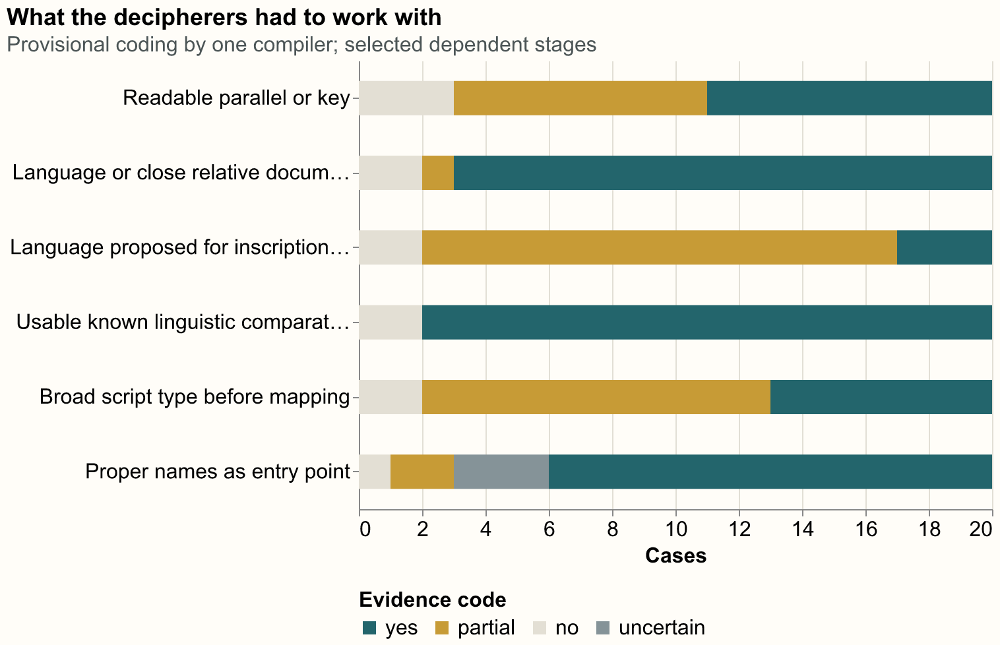
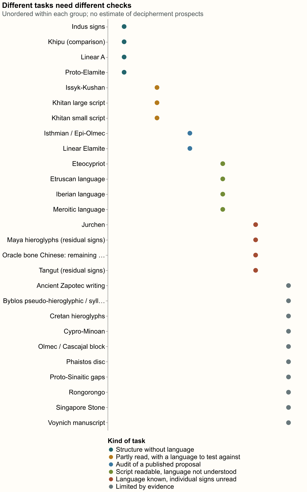
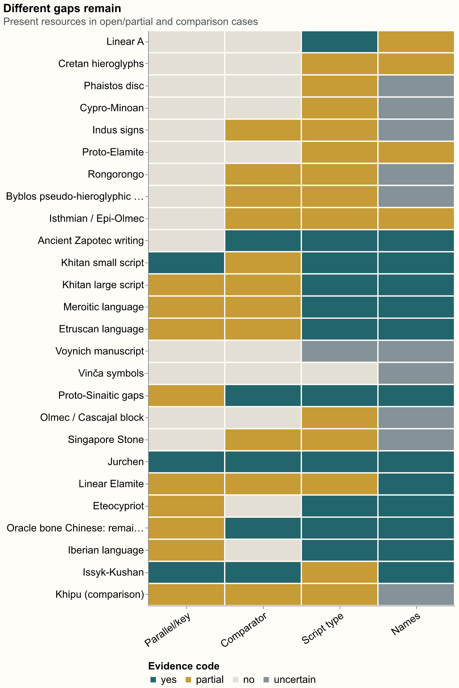

## The answer

### In short

Every accepted language recovery in this sample had a readable parallel or key, including names, or a known language or close relative, usually both. Names were the usual way in. This agrees with the standard account of decipherment: combine external clues with internal structure, then test readings against further evidence. The [Gelb and Whiting extract](https://doi.org/10.1017/S0035869X00132769) discusses the work around the key insight; [Daniels’s chapter excerpt](https://catalogimages.wiley.com/images/db/pdf/9781119193296.excerpt.pdf) gives the comparative history. Bibliographic orientation also includes [Daniels 1996](https://vergil.uni-tuebingen.de/keibi/Record/KEI00022394), and [Coe 1992 and Pope 1999 in Daniels’s bibliography](https://catalogimages.wiley.com/images/db/pdf/9781119193296.excerpt.pdf); access scopes are in the method.

An agent could organise narrow tests of signs, numerical systems, joins or published proposals. No agent has been run on any of these scripts here, and no advantage has been shown.

## The claim

### What was asked

While preparing for [Ars Inquirendi, Oxford, 20–22 November 2026](https://www.arsinq.com/), I asked what a tool-using agent could contribute to decipherment. A trained model would be one component. The comparison concerns the evidence decipherers used and the narrower results that can be checked today.

Three independent model reviews were run on the version underlying this revision, by GPT-6 Astra, Claude Fable 5.2 and Gemini 4 Neon; no human epigraphist has read it. The [item-by-item council response](data/REVIEW-RESPONSE-COUNCIL.md) records the corrections and remaining limits.

### Four different tasks

| Task | What is missing | What success establishes |
| --- | --- | --- |
| Reading hidden or damaged marks | Visible strokes or ink | Marks recovered; language may already be known. |
| Restoration | Lost parts of an understood text | A supported proposal for missing text. |
| Translation | An expression in another language | A rendering of a language already analysable. |
| Decipherment | Script-to-language mappings or an unknown language’s interpretation | Readings that extend consistently to independent evidence. |

## What the decipherers had to work with

### People and selected stages

Dates mark stages, including language recoveries within shared scripts. All coded evidence in a historical row uses that row’s selected stage; later evidence has a separate field in the download.

| Script / language | People and stages | Available evidence and method |
| --- | --- | --- |
| Egyptian hieroglyphs | Young; Champollion, 1819–1824 | Rosetta and Philae names; Coptic; thousands of facsimiles. Names → phonetic values → grammar and earlier royal names. [source](https://echoesofegypt.peabody.yale.edu/hieroglyphs/pr-cis-du-syst-me-hi-roglyphique-des-anciens) [2](https://www.britishmuseum.org/sites/default/files/2022-10/Hieroglyphs_unlocking_ancient_Egypt_large_print_guide_The_British_Museum.pdf) |
| Egyptian Demotic | Åkerblad, Young, Champollion, Brugsch and others, 1802–1855 | Rosetta Greek parallel; documentary papyri; Coptic. Early name values → cross-script and grammatical extension. Timeline marks Åkerblad 1802. [source](https://www.britishmuseum.org/sites/default/files/2022-10/Hieroglyphs_unlocking_ancient_Egypt_large_print_guide_The_British_Museum.pdf) [2](https://mnamon.sns.it/index.php?id=6&lang=en&page=Scrittura) |
| Old Persian cuneiform | Grotefend and successors; Rawlinson, 1802–1846 | De Sacy’s Sasanian royal formula and Herodotus supplied dynastic-name hypotheses in 1802; Iranian comparison and later Behistun extended them. The formula is a “virtual bilingual”, not a translated parallel. [source](https://cdli.earth/articles/cdlj/2011-1) |
| Akkadian / Babylonian / Assyrian | Hincks, Rawlinson, Oppert, Talbot, 1840s–1857 | Names, multilingual inscriptions, Semitic grammar and sign lists. Syllabic/polyphonic analysis → independent 1857 RAS translations. [source](https://cdli.earth/articles/cdlj/2011-1) [2](https://catalogimages.wiley.com/images/db/pdf/9781119193296.excerpt.pdf) |
| Sumerian cuneiform | Hincks, Oppert, Haupt and others, 1850s onwards | Akkadian–Sumerian bilinguals and lexical lists; later monolingual archives. No known relative; cumulative grammatical recovery. [source](https://catalogimages.wiley.com/images/db/pdf/9781119193296.excerpt.pdf) [2](https://cdli.earth/articles/cdlj/2011-1) |
| Elamite cuneiform | Westergaard, Hincks, Norris, 1844–1853; memoir in the 1855 JRAS volume | Parallel royal inscriptions and Behistun; proper names → syllabic mappings → interpretation. An isolate, distinct from Linear Elamite. [source](https://cdli.earth/articles/cdlj/2011-1) |
| Hittite language in cuneiform | Knudtzon 1902; Hrozný, 1915–1917 | Already readable cuneiform; Boğazköy archive. Bread logogram and water/eat forms → Indo-European hypothesis → grammar. [source](https://mnamon.sns.it/index.php?id=16&lang=en&page=Scrittura) [2](https://catalogimages.wiley.com/images/db/pdf/9781119193296.excerpt.pdf) |
| Luwian hieroglyphs | Gelb, Forrer, Bossert, Hrozný, Meriggi, Çambel; Laroche, Hawkins, Morpurgo Davies, Neumann and others | Selected 1930s sign-mapping stage (plotted at the decade midpoint, 1935): seals/names and Hittite comparison. Later Karatepe bilingual extended readings; Hawkins, Morpurgo Davies and Neumann’s 1973 revision corrected values and identification. [source](https://mnamon.sns.it/index.php?id=46&lang=en&page=Scrittura) |
| Ugaritic alphabetic cuneiform | Virolleaud, Bauer, Dhorme, 1929–1931 | Small consonantal inventory and word dividers; Semitic cognates/formulae. The three aleph forms belong to later refinement. No readable translated key needed at the breakthrough. [source](https://mnamon.sns.it/index.php?page=Scrittura&id=30&lang=en) [2](https://aclanthology.org/P10-1107/) |
| Linear B / Mycenaean Greek | Kober, Bennett, Ventris, Chadwick, 1940s–1953 | Kober’s inflection triplets and embryonic grid → Ventris’s grid, Cypriot comparisons and toponyms → Greek → new-text verification. No bilingual. [source](https://mnamon.sns.it/index.php?page=Scrittura&id=20&lang=en) [2](https://sites.utexas.edu/scripts/) |
| Cypriot syllabary (Greek texts) | Smith and others, 1871–1876 | Idalion Phoenician/syllabic bilingual and bronze tablet. Names → syllabic values → Greek grammar. Eteocypriot remains a separate problem. [source](https://mnamon.sns.it/index.php?id=4&lang=en&page=Scrittura) |
| Maya hieroglyphs | Förstemann’s nineteenth-century calendar/numeral work; Knorozov 1952; Berlin 1958; Proskouriakoff 1960; later epigraphers | Landa’s partial syllabic key and pictured common nouns → substitution tests. Later emblems/dynastic history → names and grammar; names were not the 1952 phonetic entry. [source](https://www.mesoweb.com/resources/handbook/IMH2020.pdf) |
| Phoenician | Barthélemy and predecessors, 1758 milestone | Coins, Greek epigraphs, Malta bilingual, Hebrew. Name and letter matching → Semitic comparison. [source](https://catalogimages.wiley.com/images/db/pdf/9781119193296.excerpt.pdf) |
| Palmyrene Aramaic | Barthélemy and Swinton, 1754; other contributors | Accurate Greek/Palmyrene copies; names; Syriac/Hebrew. Name/letter matching → Aramaic comparison. [source](https://catalogimages.wiley.com/images/db/pdf/9781119193296.excerpt.pdf) [2](https://upload.wikimedia.org/wikipedia/commons/c/cf/An_Explication_of_All_the_Inscriptions_in_the_Palmyrene_Language_and_Character_Hitherto_Publish%27d._In_Five_Letters_from_the_Reverend_Mr._John_Swinton%2C_M._A._of_Christ-Church%2C_Oxford_%28IA_jstor-105201%29.pdf) |
| Early Brahmi | Wilkins 1785 (published 1788); Prinsep, Lassen, Pandit Kamalakanta and collaborators, 1836–1838 | Greek/Brahmi coin names; repeated edicts and donation endings. Reading back through later scripts; letter values and dānam → Prakrit/Sanskrit comparison. [source](https://asiaticsociety.culture.gov.in/sites/default/files/2026-04/James%20Prinsep%20Journal%20for%20Net%20Version.pdf) |
| Kharosthi | Masson, Prinsep, Lassen, Norris and others, 1830s–1840s | Greek/Kharosthi coin names/titles are partial keys. Royal names → values → Prakrit grammar; subsequent correction and extension. [source](https://asiaticsociety.culture.gov.in/sites/default/files/2026-04/James%20Prinsep%20Journal%20for%20Net%20Version.pdf) |
| Old Turkic runiform | Thomsen; Radloff, 1893–1896 | Orkhon/Yenisei copies; Chinese commemorative parallels; Turkic. Distribution, vowels and names → grammatical tests. [source](https://acta.bibl.u-szeged.hu/38749/1/altaica_033.pdf) |
| Carian | Shevoroshkin; Ray, Schürr, Adiego and others, 1960s–1996 | Alphabetic/Anatolian identification; Egyptian/Carian names → revised values. Full 1996 Greek/Carian parallel confirmed earlier work, not an initial key. [source](https://mnamon.sns.it/index.php?id=56&lang=en&page=Scrittura) |
| Old South Arabian monumental script | Rödiger’s 1837 note; Gesenius, Rödiger and successors, 1841 milestone | Medieval Arabic musnad alphabet manuscripts, Ethiopic forms and Semitic philology → tentative values → corrected copies and further texts. [source](https://mnamon.sns.it/index.php?id=27&lang=en&page=Scrittura) |
| Tangut | Bushell and Morisse’s earlier work; Ivanov, Luo Fucheng, Nevsky and successors, selected 1909 dictionary stage | Morisse’s 1904 Lotus Sutra readings preceded Khara-Khoto manuscripts/prints and the Tangut–Chinese glossary, Tibetan glosses and parallel translations. Lexical keys → phonology and grammar. [source](https://www.degruyterbrill.com/document/doi/10.1515/9783110453959-003/pdf?licenseType=free) |

### A timeline of stages

### Provisional historical coding

These are one compiler’s provisional codings. The first review moved three cells, so “about half had a full bilingual” is as precise as this coding supports. “Documented” asks whether the language or a close relative was known to scholarship; “proposed” asks whether it had already been assigned to these inscriptions. The [cell rationales](data/decipherment-cell-evidence.csv) and [dated amendments](data/decipherment-authored-decisions-council.csv) keep the distinctions inspectable.

| Provisional code at the selected stage | Yes | Partial | No | Uncertain |
| --- | --- | --- | --- | --- |
| Readable parallel or key | 9 | 8 | 3 | 0 |
| Language or close relative documented at stage | 17 | 1 | 2 | 0 |
| Language proposed for inscriptions before breakthrough | 3 | 15 | 2 | 0 |
| Usable known linguistic comparator at stage | 18 | 0 | 2 | 0 |
| Broad script type before mapping | 7 | 11 | 2 | 0 |
| Proper names as entry point | 14 | 2 | 1 | 3 |

The rows form about eleven interpretive lineages, rather than twenty independent trials: the cuneiform key chain (including Luwian through seals and Hittitology), Egyptian/Demotic, Palmyrene/Phoenician, Brahmi/Kharosthi and Cypriot/Linear B share resources or methods. The [lineage table](data/9-historical-lineages.csv) makes the grouping explicit.

Old Persian, Linear B and Ugaritic had no readable translated key at the selected breakthroughs. Old Persian nevertheless used de Sacy’s royal formula and Herodotus: its “no” parallel code is contested because this can be called a virtual bilingual. Sumerian and cuneiform Elamite had parallel evidence without a known close relative. These comparisons establish no universal requirement.

### Not in the sample

Success here means recovering the language. Scripts that can be read without understanding the language sit outside the historical sample, making the known-comparator count partly definitional. Meroitic and Iberian particularly test any wider claim that no script recovery lacked both a parallel and a known language. They require their own dated coding; none is added to the denominator.

| Case outside the twenty | Verified basic history | What it would test |
| --- | --- | --- |
| Sasanian and Parthian inscriptions | De Sacy’s 1793 work on Sasanian Middle Persian; the Parthian identification required correction. | Tests dependence: royal formulae supplied the template for Old Persian. [source](https://www.iranicaonline.org/articles/epigraphy-i/) |
| Meroitic script | Griffith’s 1909–1911 script recovery left the language poorly understood. | Tests the definition of success and the role of name parallels without a known language. [source](https://assets.cambridge.org/97811070/08663/excerpt/9781107008663_excerpt.pdf) [2](https://mnamon.sns.it/index.php?page=Scrittura&id=69&lang=en) |
| Iberian script | Gómez-Moreno’s 1922 publication; Mnamon dates a further Greco-Iberian sign-reading step to 1925. | Tests script recovery without language recovery; names and cross-script evidence require separate coding. [source](https://mnamon.sns.it/index.php?id=13&lang=en&page=Esempi) [2](https://aclanthology.org/2021.tacl-1.5/) |
| Oracle-bone script | Chinese palaeographic continuity; many individual characters remain unresolved. | Tests sign recovery within a known language and inherited writing tradition. [source](https://aclanthology.org/2024.acl-long.831/) |
| Tocharian | Sieg and Siegling’s 1908 work; an unknown language in a Brahmi-derived script. | Tests language recovery with a readable writing system. [source](https://www.iranicaonline.org/articles/tocharian-language/) |
| Lycian | Greek-derived script, bilinguals and the later Letoon trilingual. | Tests the timing of parallel evidence versus linguistic identification. [source](https://mnamon.sns.it/index.php?id=55&lang=en&page=Scrittura) |
| Urartian | Hincks’s work on Van inscriptions used cuneiform; later language interpretation followed. | Tests another recovery in the dependent cuneiform chain. [source](https://cdli.earth/articles/cdlj/2011-1) |

## The open problems need different checks

### Groups by kind of task

The groups are unordered within each kind of task. They are proposals for checkable work, not predictions of decipherment. The six scores remain in the [downloadable tractability table](data/4-agent-ranking.csv), with the doubled-language sensitivity calculation. Missing audits remain missing. Vinča is retained only as a probably non-writing comparison.

| Kind of task | Cases (unordered) | Checkable result and obstacle |
| --- | --- | --- |
| Structure without language | Indus signs; Khipu (comparison); Linear A; Proto-Elamite | Accounting, numerals and sign inventories; no linguistic reading claimed. A repeatable accounting result, fraction constraint or corrected inventory. Proto-Elamite’s published Born, Kelley, Monroe and Sarkar pipeline already covers much of this work; the question is what remains. The khipu comparison uses Medrano and Urton’s colonial documentary match and the Open Khipu Repository. |
| Partly read, with a language to test against | Issyk-Kushan; Khitan large script; Khitan small script | Competing values can be checked against proposed languages. A fixed mapping predicts further names, forms or passages. Khitan needs corpus preparation and rights checks; its Langjun inscription of 1134 is a named Khitan–Chinese bilingual, not merely a contextual memorial. The research group’s 1977 and 1985 publications matter. |
| Audit of a published proposal | Isthmian / Epi-Olmec; Linear Elamite | Freeze published values before applying them to further texts. A discriminating prediction succeeds or a proposal is falsified; specialists grade texts the proposers did not use. Formulaic repetition, disputed signs and provenance limit independence. |
| Script readable, language not understood | Eteocypriot; Etruscan language; Iberian language; Meroitic language | Sounding out the script leaves grammar and vocabulary unresolved. A grammatical or lexical prediction survives independent comparison. A readable alphabet and a short parallel do not supply a language. |
| Language known, individual signs unread | Jurchen; Oracle bone Chinese: remaining character gaps; Maya hieroglyphs (residual signs); Tangut (residual signs) | Known languages with unresolved individual signs. One accepted new sign value, supported by independent contexts. Benchmarks on already-read characters do not test the unread ones. |
| Limited by evidence | Byblos pseudo-hieroglyphic / syllabary; Olmec / Cascajal block; Cretan hieroglyphs; Cypro-Minoan; Phaistos disc; Proto-Sinaitic gaps; Rongorongo; Singapore Stone; Voynich manuscript; Ancient Zapotec writing | At these corpus sizes, little can be added by more hypothesis search. A documented allograph, sign boundary or constrained rejection may be checkable; a fluent translation is insufficient. Zapotec and Proto-Sinaitic have strong language associations, but no machine-readable corpus was verified here. Voynich is a fifteenth-century codex, not an ancient script. |

The clearest audit task is to implement a published proposal as frozen rules, apply those rules to texts its proposers did not use, and have specialists grade the predictions. Linear Elamite and Justeson and Kaufman’s Isthmian proposal offer that kind of test. Rules that change for each new example cannot pass it.

### Issyk-Kushan: a developing partial reading

[Bonmann, Halfmann, Korobzow and Bobomulloev (2023)](https://doi.org/10.1111/1467-968X.12269) used the Almosi bilingual and Dašt-i Nāwur trilingual, starting with the royal name Vema Takhtu and the title “king of kings”. [Halfmann, Fries, Bobomulloev and Bobomulloev (2026)](https://doi.org/10.1111/1467-968x.70032), following Sims-Williams 2025, develop revised Bactrian readings. The 2023 identification of a previously unknown Middle Iranian language is therefore not settled. Competing mappings and further passages make this a recent application of the classic name-and-parallel method.

### Corpus evidence and access

These are dated source descriptions, not a current census. Counts use different units and inclusion rules. Linear A’s older selection is about 1,400 documents and about 7,400 signs; the computational review gives 1,370 documents, while a 1,427 convention remains unverified here. ICIT/Fuls 2022, *Etruskische Texte* (Meiser 2014) and Urcid 2001 are relevant corpus editions, but their proposed replacement totals were not verified from an opened primary text. Khitan and Meroitic totals remain dated estimates. [The corpus download](data/5-corpus-availability.csv) separates objects, inscriptions, tokens, signs, longest texts and rights.

| Case | Dated corpus description | Main limit | Sources |
| --- | --- | --- | --- |
| Linear A | About 1,400 documents in the older computational selection; later inventories exceed 1,500 | Unknown language; sparse, repetitive accounts; many sound values borrowed from Linear B are hypotheses | [source](https://mnamon.sns.it/index.php?page=Scrittura&id=19&lang=en) [2](https://aclanthology.org/2024.cl-2.7.pdf) [3](https://sigla.phis.me/) [4](https://ejournals.lib.uoc.gr/Ariadne/article/download/1841/1751) |
| Cretan hieroglyphs | over 360 | Very short seals; decoration/sign boundaries; variable direction; unknown language | [source](https://mnamon.sns.it/index.php?page=Scrittura&id=35&lang=en) [2](https://aclanthology.org/2024.cl-2.7.pdf) |
| Phaistos disc | 1 object | Unique short text with no independent comparable inscription | [source](https://mnamon.sns.it/index.php?page=Scrittura&id=22&lang=en) [2](https://aclanthology.org/2024.cl-2.7.pdf) |
| Cypro-Minoan | nearly 250 | Small corpus, short objects, uncertain sign inventory and subdivision | [source](https://mnamon.sns.it/index.php?page=Scrittura&id=34&lang=en) [2](https://aclanthology.org/2024.cl-2.7.pdf) [3](https://journals.plos.org/plosone/article?id=10.1371/journal.pone.0269544) |
| Indus signs | 2,906 texts in M77; 1,548 unique unambiguous single-line texts in EBUDS | Very short texts, no bilingual, uncertain language; linguistic versus non-linguistic dispute | [source](https://pmc.ncbi.nlm.nih.gov/articles/PMC2841631/) [2](https://www.cambridge.org/core/journals/journal-of-the-royal-asiatic-society/article/abs/tasks-methods-and-results-in-the-study-of-the-indus-script/E77A33DECB89FBB5327234211D83AE70) [3](https://epigraphica.de/indus/menueindus.htm) [4](https://pubmed.ncbi.nlm.nih.gov/19389998/) [5](https://richardsproat.com/newindex/publications.html) |
| Proto-Elamite | 1,399 usable texts in Born 2019; about 1,581 total in Born thesis 2023 | Uncertain allographs, many hapaxes, narrow accounting genre; no proven phonetic key | [source](https://aclanthology.org/W19-2516.pdf) [2](https://summit.sfu.ca/_flysystem/fedora/2023-12/etd22782.pdf) [3](https://aclanthology.org/2022.emnlp-main.620.pdf) [4](https://arxiv.org/pdf/2502.00090) [5](https://anoopsarkar.github.io/papers/pdf/IA57001.pdf) |
| Rongorongo | 27 wooden objects in Ferrara et al. | No secure reading key; compound segmentation; limited independent corpus | [source](https://www.nature.com/articles/s41598-024-53063-7) [2](https://kohaumotu.org/rongorongo_org/corpus/digit.html) |
| Byblos pseudo-hieroglyphic / syllabary | 10 core inscriptions (1945) plus 4 fragments added 1978 | Tiny corpus; unstable inventory; divergent readings have no independent validation | [source](https://mnamon.sns.it/index.php?page=Scrittura&id=3&lang=en) |
| Isthmian / Epi-Olmec | Small corpus; exact current count unverified | Few substantial independent texts; validation of the proposed solution contested | [source](https://doi.org/10.1126/science.259.5102.1703) [2](https://davidmm.web.unc.edu/wp-content/uploads/sites/400/2021/10/Mora-Mar%C3%ADn-2010-Epi-Olmec-Review.pdf) |
| Ancient Zapotec writing | Hundreds of glyphs/records studied; current inscription census unverified | Incomplete phonetic readings; calendrical, personal-name and place-name conventions; historical language distance | [source](https://research.famsi.org/zapotecwriting/index.html) |
| Khitan small script | 39 major inscriptions known in 2015 (plus smaller texts) | No surviving dictionary; many logograms lack pronunciation; many phonetic reconstructions uncertain | [source](https://real.mtak.hu/38020/1/062.2016.69.2.1.pdf) [2](https://www.unicode.org/L2/L2016/16113r-n4725r-khitan-small-script.pdf) [3](https://www.babelstone.co.uk/Khitan/) [4](https://doi.org/10.1556/AOrient.67.2014.1.5) [5](https://altaica.ru/LIBRARY/tungus/Kane_sino_jurchen_vocabulary.pdf) |
| Khitan large script | about 18 monumental inscriptions in West’s 2013 account; not current census | Logographic/phonetic mixture; uncertain readings; poorer digital standardisation | [source](https://babelstone.co.uk/Blog/2013/05/khitan-geography-part-1.html) [2](https://www.babelstone.co.uk/Khitan/) [3](https://www.unicode.org/L2/L2016/16113r-n4725r-khitan-small-script.pdf) [4](https://www.orientalstudies.ru/eng/images/pdf/a_zaytsev_2015.pdf) |
| Meroitic language | about 1,300 published plus about 900 unpublished in Rilly 2011; over 2,000 in Mnamon 2022 | Lack of extended bilingual; poorly constrained vocabulary/grammar despite readable signs | [source](https://journal.mu.edu.et/pdfs/ityopis/v1/ITYOPIS-I-Rilly.pdf) [2](https://mnamon.sns.it/index.php?page=Scrittura&id=69&lang=en) [3](https://assets.cambridge.org/97811070/08663/excerpt/9781107008663_excerpt.pdf) |
| Etruscan language | About 13,000 texts in Hemingway & Hemingway 2004; older Wallace account about 9,000; incompatible dated summaries, not a 2026 census | Large but formulaic funerary corpus; scarce long texts and extended translated parallels | [source](https://mnamon.sns.it/index.php?page=Scrittura&id=10&lang=en) [2](https://library.biblicalarchaeology.org/sidebar/how-to-read-etruscan/) [3](https://zenodo.org/records/13784774) [4](https://raw.githubusercontent.com/Eddy1919/openEtruscan/main/README.md) [5](https://www.metmuseum.org/essays/etruscan-art) |
| Voynich manuscript | One fifteenth-century codex; 102 surviving leaves; about 240 pages including fold-outs | No accepted external key; transcription choices; uncertain relation to language | [source](https://alumniacademy.yale.edu/sites/default/files/2021-07/The%20Linguistics%20of%20the%20Voynich%20Manuscript.pdf) [2](https://news.yale.edu/2025/02/21/deciphering-mysterious-manuscript) [3](https://pre1600ms.beinecke.library.yale.edu/docs/pre1600.ms408.HTM) [4](https://voynich.nu/descr.html) |
| Vinča symbols | 123 sources in Winn multi-symbol selection | No established glottographic system; pottery/ownership/decorative functions | [source](https://richardsproat.com/monograph.pdf) |
| Proto-Sinaitic gaps | over 30 in the narrowly defined Sinai corpus | Damaged signs; short unsegmented texts; uncertain dates and readings | [source](https://mnamon.sns.it/index.php?page=Scrittura&id=25&lang=en) |
| Olmec / Cascajal block | 1 block; separate from later Isthmian corpus | Single unstratified find; too little comparable text and insecure linguistic anchors | [source](https://www.mesoweb.org/reports/Cascajal.pdf) |
| Singapore Stone | 1 surviving fragment of a monolith; old copies of lost portions | Loss, weathering and inconsistent historical copies before language modelling | [source](https://www.mdpi.com/2409-9252/3/3/19) [2](https://www.roots.gov.sg/stories-landing/stories/the-singapore-story-through-60-objects/networks-through-time/singapore-stone/story) |
| Jurchen | 10 epigraphic source groups a–j in 2024 proposal, plus manuscripts, vocabulary and shorter objects | Fragmentary epigraphic material; dictionary/manuscript versus inscription variation; remaining unidentified characters | [source](https://www.unicode.org/L2/L2024/24139-n5261r-jurchen-ideographs.pdf) [2](https://www.babelstone.co.uk/Jurchen/) |
| Linear Elamite | about 40 inscriptions in Mnamon; 32 objects in another inventory | Small corpus; object provenance; uncertain values/validation; chronology of relationships | [source](https://www.degruyterbrill.com/document/doi/10.1515/za-2022-0003/html) [2](https://mnamon.sns.it/index.php?id=67&lang=en&page=Scrittura) [3](https://anoopsarkar.github.io/papers/pdf/IA57001.pdf) [4](https://centaur.reading.ac.uk/122518/1/Matthews_Richardson_FazeliNashli_deGroene_2025.pdf) [5](https://ora.ox.ac.uk/objects/uuid:51adb1c2-61de-438c-9b29-125addf3d2a1) [6](https://www.smithsonianmag.com/history/have-scholars-finally-deciphered-a-mysterious-ancient-script-180980497/) [7](https://amp.dw.com/en/archaeological-mystery-ancient-elamite-script-from-iran-deciphered/a-62849976) [8](https://www.livescience.com/ancient-linear-elamite-writing-deciphered) |
| Eteocypriot | a few score of texts | Very small formulaic corpus despite readable syllables and a bilingual | [source](https://mnamon.sns.it/index.php?id=4&lang=en&page=Scrittura) |
| Oracle bone Chinese: remaining character gaps | No harmonised inscription total checked here | Graphic evolution can suggest candidates but cannot establish a novel character value without linguistic/contextual evidence | [source](https://aclanthology.org/2024.acl-long.831/) [2](https://proceedings.iclr.cc/paper_files/paper/2025/file/ff7bf6014f7826da531aa50f4538ee19-Paper-Conference.pdf) |
| Iberian language | No harmonised inscription total checked | Readable signs do not identify the language; linguistic-comparator models may fail outside their assumptions | [source](https://aclanthology.org/2021.tacl-1.5/) [2](https://mnamon.sns.it/index.php?id=13&lang=en&page=Esempi) |
| Issyk-Kushan | Several dozen in the 2023 account; compatible 2026 total not audited | Competing sign/diacritic mappings; earlier Issyk/Ai Khanum texts remain problematic | [source](https://doi.org/10.1111/1467-968X.12269) [2](https://doi.org/10.1111/1467-968x.70032) |
| Khipu (comparison) | Open Khipu Repository exists; current corpus total not audited | Distinguish numerical/accounting structure from proposed phonetic or social coding | [source](https://doi.org/10.1215/00141801-4260638) [2](https://github.com/khipulab/open-khipu-repository) |

### Evidence matrix

### Linear Elamite: four separate disputes

Desset and colleagues proposed values for 72 signs in 2022; several Elamologists find the core readings convincing. The disputes concern whether the script is purely phonetic, whether it descends from proto-Elamite, the provenance of the vessels and how much can be translated. [The 2022 proposal](https://orbi.uliege.be/handle/2268/334018) distinguishes proposed sign readings from complete translation.

| Issue | Attributed position and evidence |
|---|---|
| Sign values and linguistic recovery | [Krebernik, Stolper and Steinkeller](https://www.smithsonianmag.com/history/have-scholars-finally-deciphered-a-mysterious-ancient-script-180980497/) expressed support. [Dahl in 2022](https://www.livescience.com/ancient-linear-elamite-writing-deciphered) doubted that decipherment had succeeded; his [2025 interview](https://www.nationalgeographic.com/history/article/decoding-ancient-languages-linear-elamite) also disputes how much is understood. |
| Pure phonography | [Mäder’s 2022 interview](https://amp.dw.com/en/archaeological-mystery-ancient-elamite-script-from-iran-deciphered/a-62849976) distinguishes 15 known values and 19 plausible proposals, and argues for logograms; Dahl’s 2025 interview also disputes a purely syllabic analysis. These are their assessments at those dates. |
| Descent from proto-Elamite | [Dahl 2023](https://ora.ox.ac.uk/objects/uuid:51adb1c2-61de-438c-9b29-125addf3d2a1) argues against continuous descent. [Kelley and colleagues](https://doi.org/10.2143/IA.57.0.3291506) test transfer of proposed values to proto-Elamite, not every Linear Elamite reading. |
| Provenance and authenticity | The vessels’ uncertain provenance limits contextual checks. Dahl’s reported concern about Konar Sandal/Jiroft must be distinguished from the central silver-vessel inscriptions; neither concern alone disproves every proposed sign value. |

[Partial values preceded 2022](https://orbi.uliege.be/handle/2268/334018) through the Puzur-Inshushinak bilinguals and work by Bork (1905), Hinz (1962) and Meriggi (1971). The Bern group’s [Elamicon catalogue](https://www.isw.unibe.ch/forschung/projekte_von_doktorierenden/entzifferungsprojekt_die_elamische_strichschrift_2200_vchr/index_ger.html) is a further resource. Press interviews record attributed positions and settle nothing.

## What an agent would have to demonstrate

### Existing computation already iterates

Snyder 2010, Berg-Kirkpatrick and Klein 2011, and Luo 2019 already use iterative inference or optimisation. The proposed difference is a fixed objective versus open-ended use of tools and sources, not the invention of iteration. [Sommerschield and colleagues’ survey](https://aclanthology.org/2023.cl-3.5/) maps the wider field; [Ferrara and Tamburini](https://doi.org/10.1418/105964) discuss advanced decipherment techniques (abstract/introduction scope here). [ML4AL 2024](https://aclanthology.org/volumes/2024.ml4al-1/) and [ALP 2025](https://aclanthology.org/volumes/2025.alp-1/) are dedicated publication venues.

| Work | Reported contribution | Boundary |
| --- | --- | --- |
| A Statistical Model for Lost Language Decipherment (2010) [source](https://aclanthology.org/P10-1107/) | Bayesian model recovered 29/30 letter mappings and about 60% of cognates | Known relative and retrospective answer key; not a new ancient decipherment |
| Neural Decipherment via Minimum-Cost Flow: from Ugaritic to Linear B (2019) [source](https://aclanthology.org/P19-1303/) | Cognate accuracy: 67.3% Linear B/names; 84.7% full Linear B condition (Table 3) | Full Linear B condition: curated segmented 919-word set with 919/919 cognates. Separate names condition uses 455 Greek proper nouns against 919 Linear B words. Neither is an unknown unsegmented corpus. |
| Simple Effective Decipherment via Combinatorial Optimization (2011) [source](https://aclanthology.org/D11-1029/) | Joint alphabet and lexicon matching optimised by coordinate descent | Requires correspondence assumptions and comparative word lists |
| Sign Clustering and Topic Extraction in Proto-Elamite (2019) [source](https://aclanthology.org/W19-2516.pdf) | Three clustering approaches and topics find sign groups for expert interpretation | Clustering does not establish phonetic values; variants and hapaxes matter |
| Compositionality of Complex Graphemes in the Undeciphered Proto-Elamite Script using Image and Text Embedding Models (2021) [source](https://aclanthology.org/2021.findings-acl.362.pdf) | Image/text embeddings test compositionality of complex signs | No semantic or phonetic decipherment claimed |
| Sequence Models for Document Structure Identification in an Undeciphered Script (2022) [source](https://aclanthology.org/2022.emnlp-main.620.pdf) | Unsupervised sequence models support header detection and annotation correction | Headers are a structural gain; not proof of their linguistic reading |
| Disambiguating Numeral Sequences to Decipher Ancient Accounting Corpora (2025) [source](https://arxiv.org/pdf/2502.00090) | Enumerates readings and tests structure/bootstrapped disambiguation | 2025 correction changes decimal values and strengthens baseline; no language decipherment |
| LINGOLY: A Benchmark of Olympiad-Level Linguistic Reasoning Puzzles in Low-Resource and Extinct Languages (2024) [source](https://proceedings.neurips.cc/paper_files/paper/2024/hash/2e43584b7d7b32fb6b2aa83b32dbbb20-Abstract.html) | Tests contextual pattern induction against a no-context baseline | Designed puzzles provide sufficient clues; they do not reproduce missing evidence in archaeological corpora. |
| A Computational Approach to Deciphering Unknown Scripts (1999) [source](https://aclanthology.org/W99-0906/) | Probabilistic mapping experiments with known-language information | No ancient unknown script deciphered; paper explicitly evaluates controlled modern-script tasks. |
| The mathematical values of fraction signs in the Linear A script: A computational, statistical and typological approach (2021) [source](https://cris.unibo.it/handle/11585/789546.1) | Combines palaeographical, statistical, computational and typological constraints on fraction values | Author abstract only inspected here; numerical values do not identify a language. |
| Electronic Babylonian Literature (eBL) (n.d.) [source](https://www.assyriologie.uni-muenchen.de/forschung/ebl/index.html) | AI-supported sign-sequence matching helps identify and join fragments | Uses surviving evidence and specialist editions; not an unknown-language decipherment. |

The [complete computational table](data/decipherment-computational-work.csv) includes the other papers and one grouped exploratory Daggumati–Revesz entry. Published results are reported, not rerun. Search, joins and imaging can bring surviving evidence into use: the [eBL Fragmentarium](https://www.assyriologie.uni-muenchen.de/forschung/ebl/index.html) already supports fragment matching. Finding surviving evidence differs from generating independent attestation.

### A fair comparison

Most open scripts are limited by evidence, not labour. Epigraphers establish sign lists, damaged readings and authenticity before code runs; digital transliterations already contain editorial decisions. The model inside an agent may have encountered the corpora and both scholarly and crank proposals during training. Published “withheld” texts are therefore not reliably withheld, and retrospective Linear B or Ugaritic tests need contamination controls. Many adaptive attempts on a few thousand signs can find an accidental fit; logging failures alone does not control that search.

A fair test compares a specialist with existing tools, a fixed scripted pipeline and an agent with the same tools on one narrow task. It needs an untouched final test set and explicit controls for prior exposure and repeated testing. Measure correct results, false discoveries, expert checking time and cost. A successful contribution could be one accepted new sign value, a falsified proposal, a corrected sign inventory, a verified join or measured time saved.

## Limits of this check

### What this does not show

The historical sample is selected and dependent; the codes are provisional judgements. Task groups do not measure the probability of a breakthrough. Unknown quantities and failed source access remain unknown. Recognition, restoration, translation and clue-supplied puzzles do not establish recovery of an unknown ancient language. No human epigraphic validation or agent experiment supports a stronger conclusion.

## How this was made

### Timeline

The initial session began at 14:12:35 UK on 19 November, measured from its transcript; its initial research/coding snapshot ended at 14:36. A source-review revision followed, then the three-model council reconciliation and this implementation. Human commissioning and reading time were not measured. The public [first response](data/REVIEW-RESPONSE.md) and [council response](data/REVIEW-RESPONSE-COUNCIL.md) retain distinct rounds.

### Data and method

Judgement steps are case selection, stage choice, two-question identity coding, lineage grouping, task classification and tractability scores. Every historical evidence code and existing score has a rationale; the [method](data/METHOD.md), [source register](data/decipherment-sources.csv) and [council amendments](data/decipherment-authored-decisions-council.csv) preserve scope. The deterministic code aggregates frozen cells only. Nine expected tables and four PNG/CSV/Vega-Lite triples can be rebuilt from the public package. A rerun checks arithmetic, not the history. The existing archive DOI predates this revision; use the package Git commit until a subsequent archive release includes it.

Gelb and Whiting was read only as a publisher extract; Gelb 1974 as an indexed abstract. Daniels 1996, Coe 1992 and Pope 1999 are bibliographic orientation, not books read. Rilly and de Voogt was inspected as a publisher excerpt; Issyk-Kushan papers at abstract/introduction scope; Corazza 2021 as an author abstract. Desset’s author postprint was retrieved in this round; its opening history (pp. 11–13) and the 72-sign proposal on p. 32 were inspected, not the full paper. Dahl’s 2023 accepted manuscript was retrieved and its relevant descent argument inspected. The response lists blocked sources and corpus totals still unverified.

### Models, tools and tokens

The site’s session-usage helper was run but expects Claude-format transcripts and returned no rows for this Codex session. The supplied Codex adapter instead counts distinct response usage records. The snapshot below runs through 14:36 UK, before drafting/publication checks, and excludes later work.

| Model | Role | Calls | Tokens read | Tokens written |
|---|---|---:|---:|---:|
| gpt-6.1-sol | Initial research/coding snapshot; later revision excluded | 54 | 13,221,241 | 55,111 |
| Requested: gemini-4-neon; returned: Gemini 4 Neon | Earlier independent source critique | Not supplied | Not supplied | Not supplied |
| GPT-6 Astra (gpt-6-astra) | Independent council review | Not supplied | Not supplied | Not supplied |
| Claude Fable 5.2 (claude-fable-5-2) | Independent council review | Not supplied | Not supplied | Not supplied |
| Gemini 4 Neon | Independent council review | Not supplied | Not supplied | Not supplied |
| gpt-6.1-sol | Council revision builder; later usage outside initial snapshot | Not supplied | Not supplied | Not supplied |

Tokens read include repeated cached history: 12,886,912 of the input tokens were reported as cached, a subset of the total, not an addition. Output includes 10,888 reported reasoning tokens. These are measured session-usage counts, not unique source words or a monetary cost. No ancient-text research model or agentic decipherment benchmark was run. The earlier source review returned Gemini 4 Neon. This round used three independently commissioned reviews: GPT-6 Astra (gpt-6-astra), Claude Fable 5.2 (claude-fable-5-2), and Gemini 4 Neon. This builder is gpt-6.1-sol; no other model was called by the builder. Calls and tokens for the council and this later revision were not supplied; the measured initial snapshot is unchanged. Other tools were primary-source web retrieval, Python, uv and Vega-Lite/vl-convert.
