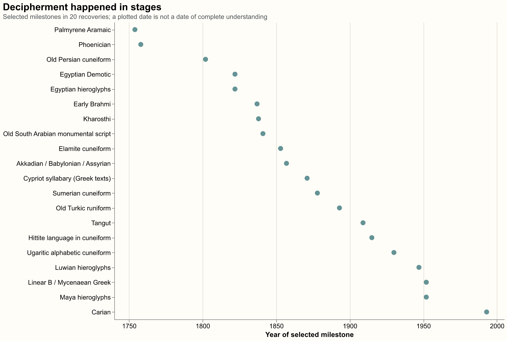

## The answer

### In short

Egyptian, the main cuneiform traditions, Linear B, Maya and many alphabetic scripts were recovered through different combinations of linguistic comparison, names, parallel texts and internal analysis. In this selected survey of 20 recoveries, 10 had a full bilingual, seven had partial parallels or keys, and three had neither; 18 used a known linguistic comparator. Their methods repeatedly constrained a proposed reading and checked whether it worked elsewhere, although the evidence was different in each case. The remaining problems include unknown languages, tiny or formulaic corpora, damaged surfaces and uncertain sign inventories; Meroitic, Etruscan and Jurchen have substantial readings already. My priority ranking for checkable agent work starts with Jurchen, Etruscan, proto-Elamite, Khitan small script and Meroitic, and it ranks narrower gains rather than the probability of complete decipherment. An agent can keep hypotheses, query corpora, run tests and record failures, but it cannot supply missing inscriptions or turn a plausible translation into an independent test.

## The claim

### What was asked

I asked for this survey while preparing to respond to a keynote at [Ars Inquirendi, Oxford, 20–22 November 2026](https://www.arsinq.com/). My question is what an agent that iterates over evidence could contribute: a trained model is one component of that system. The historical comparison below checks that proposal against what decipherers actually used.

### Where the comparison comes from

The starting list came from my questions. The figures below are agent codings of published accounts and corpus documentation, not a single external statistic.

This page was compiled by an AI agent from published sources within a few hours. I am not a specialist in these scripts. Ask a specialist before relying on any row.

### Four tasks that should stay separate

| Task | What is missing | What success establishes |
|---|---|---|
| Reading hidden or damaged marks | Visible strokes or ink | The marks can be recovered; the language may already be known. |
| Restoration | Lost portions of an otherwise understood text | A supported proposal for missing text. |
| Translation | An expression in another language | A rendering of a language whose writing and grammar can already be analysed. |
| Decipherment | The script-to-language mapping, or an unknown language’s interpretation | Readings that extend consistently to independent evidence. |

## Successful recoveries used different kinds of evidence

### Who, when, with what

Dates mark stages. They do not mean that every word was understood that year. Corpus quantities available to the original decipherers are often not established in the sources inspected here; they are marked unknown in the full data, rather than replaced with today’s much larger corpus.

| Script / language | People and stages | Available evidence and method |
| --- | --- | --- |
| Egyptian hieroglyphs | Young; Champollion, 1819–1824 | Rosetta and Philae names; Coptic; thousands of facsimiles. Names → phonetic values → grammar and earlier royal names. [source](https://echoesofegypt.peabody.yale.edu/hieroglyphs/pr-cis-du-syst-me-hi-roglyphique-des-anciens) [2](https://www.britishmuseum.org/sites/default/files/2022-10/Hieroglyphs_unlocking_ancient_Egypt_large_print_guide_The_British_Museum.pdf) |
| Egyptian Demotic | Åkerblad, Young, Champollion, Brugsch and others, 1802–1855 | Rosetta Greek parallel; documentary papyri; Coptic. Names and parallel phrases → links between Egyptian scripts → grammar. [source](https://www.britishmuseum.org/sites/default/files/2022-10/Hieroglyphs_unlocking_ancient_Egypt_large_print_guide_The_British_Museum.pdf) [2](https://mnamon.sns.it/index.php?id=6&lang=en&page=Scrittura) |
| Old Persian cuneiform | Grotefend and successors; Rawlinson, 1802–1846 | Royal formulae and dynastic names; Iranian/Indo-European comparison; later Behistun. Trilingual initially meant three unread versions. [source](https://cdli.earth/articles/cdlj/2011-1) |
| Akkadian / Babylonian / Assyrian | Hincks, Rawlinson, Oppert, Talbot, 1840s–1857 | Names, multilingual inscriptions, Semitic grammar and sign lists. Syllabic/polyphonic analysis → independent 1857 RAS translations. [source](https://cdli.earth/articles/cdlj/2011-1) [2](https://catalogimages.wiley.com/images/db/pdf/9781119193296.excerpt.pdf) |
| Sumerian cuneiform | Hincks, Oppert, Haupt and others, 1850s onwards | Akkadian–Sumerian bilinguals and lexical lists; later monolingual archives. No known relative; cumulative grammatical recovery. [source](https://catalogimages.wiley.com/images/db/pdf/9781119193296.excerpt.pdf) [2](https://cdli.earth/articles/cdlj/2011-1) |
| Elamite cuneiform | Westergaard, Hincks, Norris, 1844–1853 | Parallel royal inscriptions and Behistun; proper names → syllabic mappings → interpretation. An isolate, distinct from Linear Elamite. [source](https://cdli.earth/articles/cdlj/2011-1) |
| Hittite language in cuneiform | Hrozný, 1915–1917 | Already readable cuneiform; Boğazköy archive. Bread logogram and water/eat forms → Indo-European hypothesis → grammar. [source](https://mnamon.sns.it/index.php?id=16&lang=en&page=Scrittura) [2](https://catalogimages.wiley.com/images/db/pdf/9781119193296.excerpt.pdf) |
| Luwian hieroglyphs | Gelb, Meriggi, Forrer, Bossert, Çambel and successors, 1930s–1970s | Names and logograms; Karatepe Phoenician bilingual, 1946–1947; cuneiform Luwian. Proposed readings → parallel-text checks → corrections. [source](https://mnamon.sns.it/index.php?id=46&lang=en&page=Scrittura) |
| Ugaritic alphabetic cuneiform | Virolleaud, Bauer, Dhorme, 1929–1931 | Ras Shamra tablets, 30-letter inventory, word dividers; Semitic comparators. Frequency/position → cognates and formulae; no translated bilingual required. [source](https://aclanthology.org/P10-1107/) [2](https://mnamon.sns.it/index.php?page=Scrittura&id=30&lang=en) |
| Linear B / Mycenaean Greek | Kober, Bennett, Ventris, Chadwick, 1940s–1953 | Knossos/Pylos accounts. Kober’s inflection triplets → consonant/vowel grid → place names → Greek → new-text verification. No bilingual. [source](https://mnamon.sns.it/index.php?page=Scrittura&id=20&lang=en) |
| Cypriot syllabary (Greek texts) | Smith and others, 1871–1876 | Idalion Phoenician/syllabic bilingual and bronze tablet. Names → syllabic values → Greek grammar. Eteocypriot remains a separate problem. [source](https://mnamon.sns.it/index.php?id=4&lang=en&page=Scrittura) |
| Maya hieroglyphs | Knorozov, Proskouriakoff and many later epigraphers, 1952 onwards | Codices, Landa’s partial key, monuments and Mayan languages. Syllables/substitutions plus historical life-span patterns → names, verbs and further readings. [source](https://www.mesoweb.com/resources/handbook/IMH2020.pdf) |
| Phoenician | Barthélemy and predecessors, 1758 milestone | Coins, Greek epigraphs, Malta bilingual, Hebrew. Name and letter matching → Semitic comparison. [source](https://catalogimages.wiley.com/images/db/pdf/9781119193296.excerpt.pdf) |
| Palmyrene Aramaic | Barthélemy, 1754 | Accurate Greek/Palmyrene copies; Septimios and other names; Syriac/Hebrew. Matching names → alphabet → Aramaic comparison. [source](https://catalogimages.wiley.com/images/db/pdf/9781119193296.excerpt.pdf) |
| Early Brahmi | Prinsep, Lassen and collaborators, 1836–1838 | Greek/Brahmi coins; repeated edicts and Sanchi donation endings. Letter values and dānam → Prakrit/Sanskrit comparison. [source](https://asiaticsociety.culture.gov.in/sites/default/files/2026-04/James%20Prinsep%20Journal%20for%20Net%20Version.pdf) |
| Kharosthi | Prinsep, Lassen, Norris and others, 1830s–1840s | Greek/Kharosthi coins and inscriptions. Royal names → sign values → Prakrit grammar; later corrections/completion. [source](https://asiaticsociety.culture.gov.in/sites/default/files/2026-04/James%20Prinsep%20Journal%20for%20Net%20Version.pdf) |
| Old Turkic runiform | Thomsen; Radloff, 1893–1896 | Orkhon/Yenisei copies; Chinese commemorative parallels; Turkic. Distribution, vowels and names → grammatical tests. [source](https://acta.bibl.u-szeged.hu/38749/1/altaica_033.pdf) |
| Carian | Ray, Schürr, Adiego, 1981–1996 | Egyptian/Carian names → revised sound values → Anatolian comparison; 1996 Greek/Carian bilingual confirmed earlier results. [source](https://mnamon.sns.it/index.php?id=56&lang=en&page=Scrittura) |
| Old South Arabian monumental script | Gesenius, Rödiger and successors, 1841–late 1800s | Monumental copies; Ethiopic letters and Semitic vocabulary. About two-thirds of 29 letters in 1841; improved copies enabled corrections. [source](https://mnamon.sns.it/index.php?id=27&lang=en&page=Scrittura) |
| Tangut | Ivanov, Luo Fucheng, Nevsky and successors, 1909 onwards | Khara-Khoto manuscripts/prints; Tangut–Chinese glossary, Tibetan glosses and parallel translations. Lexical keys → phonology and grammar. [source](https://www.degruyterbrill.com/document/doi/10.1515/9783110453959-003/pdf?licenseType=free) |

### A timeline of stages

### What the successes had in common

| Coded precondition | Yes | Partial | No | Uncertain |
| --- | --- | --- | --- | --- |
| Bilingual / partial parallel | 10 | 7 | 3 | 0 |
| Target identified at outset | 2 | 7 | 11 | 0 |
| Usable known linguistic comparator | 18 | 0 | 2 | 0 |
| Broad script type before mapping | 7 | 11 | 2 | 0 |
| Proper names as entry point | 15 | 2 | 0 | 3 |

The denominator is 20 selected recoveries, including related cases, not 20 independent experiments. “Comparator” means usable known linguistic material in the successful test; finding that comparator could itself be part of the discovery. “Script type” is the broad alphabetic/syllabic/mixed hypothesis before assigning the decisive values. The [cell evidence](data/decipherment-cell-evidence.csv) gives the sources and qualifications behind every code.

There is no full-bilingual requirement: Linear B, Ugaritic and Old South Arabian are the three coded cases without one. Maya’s Landa key is partial, not a translated running text. Sumerian and Elamite cuneiform show that a demonstrated linguistic relative is not necessary when other constraints exist. Linear B does not refute the broader slogan “a bilingual or a known language helps”: Greek was available to test, even though identifying it was an achievement. This sample cannot prove an “always” claim about all decipherments.

The common practice was iterative constraint and correction: compare alternatives, propagate a reading, and check it against grammar, context or another text. [Cathcart’s reconstruction](https://cdli.earth/articles/cdlj/2011-1) also shows why the familiar story of Behistun as the one key to Akkadian is too simple.

## The open problems have different missing evidence

### Corpus and blocker survey

These are dated literature snapshots, not a fresh census. A dash means an unverified quantity, never zero. The [full corpus table](data/5-corpus-availability.csv) records inscription counts, tokens, sign inventories, longest texts, candidate languages, bilinguals, datasets, access and licences separately.

| Case | Dated evidence | Main gap and digital route |
| --- | --- | --- |
| Linear A | Over 1,500 inscriptions; older selection about 7,400 syllabic signs. KN Zg 57: about 119 positions, 84 preserved/partial. | Unknown language; no bilingual. SigLA is CC BY-NC-SA; GORILA is an edition, not automatically open data. [source](https://mnamon.sns.it/index.php?page=Scrittura&id=19&lang=en) [2](https://aclanthology.org/2024.cl-2.7.pdf) [3](https://sigla.phis.me/) [4](https://ejournals.lib.uoc.gr/Ariadne/article/download/1841/1751) |
| Cretan hieroglyphs | Over 360 inscriptions; 96 syllabic signs in the guide. Token total/longest —. | Short seals, uncertain sign/decoration boundaries; no sound key. CHIC/INSCRIBE rights and coverage need checking. [source](https://mnamon.sns.it/index.php?page=Scrittura&id=35&lang=en) [2](https://aclanthology.org/2024.cl-2.7.pdf) |
| Phaistos disc | One object; 241 tokens, 45 types. | No comparable independent text; proposed readings cannot be adequately checked. [source](https://mnamon.sns.it/index.php?page=Scrittura&id=22&lang=en) [2](https://aclanthology.org/2024.cl-2.7.pdf) |
| Cypro-Minoan | Nearly 250 inscriptions; under 4,000 syllabograms; about 100 types. Longest —. | Unknown language(s); disputed inventory/subdivision; no bilingual or verified complete open text corpus. [source](https://mnamon.sns.it/index.php?page=Scrittura&id=34&lang=en) [2](https://aclanthology.org/2024.cl-2.7.pdf) |
| Indus signs | M77: 2,906 texts, 417 types. EBUDS: 1,548 texts. Longest continuous: 17 signs. | Very short texts; no bilingual; language and linguistic status debated. ICIT requires application; CISI is not an open bulk licence. [source](https://pmc.ncbi.nlm.nih.gov/articles/PMC2841631/) [2](https://www.cambridge.org/core/journals/journal-of-the-royal-asiatic-society/article/abs/tasks-methods-and-results-in-the-study-of-the-indus-script/E77A33DECB89FBB5327234211D83AE70) [3](https://epigraphica.de/indus/menueindus.htm) [4](https://pubmed.ncbi.nlm.nih.gov/19389998/) [5](https://richardsproat.com/newindex/publications.html) |
| Proto-Elamite | 2019 usable selection: 1,399 texts; 1,623 non-numeric types including variants; maximum 724 readable signs. | Accounting/numerals partly understood; phonetic language key absent. CDLI text reuse and image rights differ. [source](https://aclanthology.org/W19-2516.pdf) [2](https://summit.sfu.ca/_flysystem/fedora/2023-12/etd22782.pdf) [3](https://aclanthology.org/2022.emnlp-main.620.pdf) [4](https://arxiv.org/pdf/2502.00090) [5](https://anoopsarkar.github.io/papers/pdf/IA57001.pdf) |
| Rongorongo | 27 wooden objects in Ferrara et al. 2024; compatible token/type totals and longest —. | No secure key; compounds/allographs and origins debated. CEIPP transliteration is available to researchers; open reuse not established. [source](https://www.nature.com/articles/s41598-024-53063-7) [2](https://kohaumotu.org/rongorongo_org/corpus/digit.html) |
| Byblos pseudo-hieroglyphic / syllabary | Ten core inscriptions plus four later fragments; Dunand lists 114 types. Token maximum —. | Very small corpus; allographs unstable; competing Northwest Semitic readings unvalidated. [source](https://mnamon.sns.it/index.php?page=Scrittura&id=3&lang=en) |
| Isthmian / Epi-Olmec | Small corpus including La Mojarra and Tuxtla; harmonised totals —. | Justeson/Kaufman Zoquean proposal contested; applying fixed values to independent text remains decisive. [source](https://doi.org/10.1126/science.259.5102.1703) [2](https://davidmm.web.unc.edu/wp-content/uploads/sites/400/2021/10/Mora-Mar%C3%ADn-2010-Epi-Olmec-Review.pdf) |
| Ancient Zapotec writing | Substantial monuments, genealogies and calendars; audited totals/longest —. | Zapotecan comparison helps, but many readings remain partial. Urcid’s public text/images retain copyright. [source](https://research.famsi.org/zapotecwriting/index.html) |
| Khitan small script | 39 major inscriptions in 2015; possibly 100,000 graphs; inventories 437/448, before resolving variants. | Para-Mongolic comparison, names/dates; no dictionary. Unicode mappings and sample texts are not a complete licensed corpus. [source](https://real.mtak.hu/38020/1/062.2016.69.2.1.pdf) [2](https://www.unicode.org/L2/L2016/16113r-n4725r-khitan-small-script.pdf) [3](https://www.babelstone.co.uk/Khitan/) |
| Khitan large script | About 18 monuments in a 2013 account; current token/type totals and longest —. | Partly understood; weaker digital coverage; no full dictionary. Dated count is not a current census. [source](https://babelstone.co.uk/Blog/2013/05/khitan-geography-part-1.html) [2](https://www.babelstone.co.uk/Khitan/) [3](https://www.unicode.org/L2/L2016/16113r-n4725r-khitan-small-script.pdf) |
| Meroitic language | About 1,300 published plus 900 unpublished in 2011; longest royal stela 161 lines; 23 characters. | Griffith’s readable script leaves language gaps. Proposed Northern East Sudanic affiliation and short parallels need specialist testing. [source](https://journal.mu.edu.et/pdfs/ityopis/v1/ITYOPIS-I-Rilly.pdf) [2](https://mnamon.sns.it/index.php?page=Scrittura&id=69&lang=en) |
| Etruscan language | Older account about 9,000 inscriptions; Liber Linteus about 1,200 words. | Readable alphabet, substantial known grammar, limited lexicon/long texts. ETP, concordances and claimed open corpora have different coverage. [source](https://mnamon.sns.it/index.php?page=Scrittura&id=10&lang=en) [2](https://library.biblicalarchaeology.org/sidebar/how-to-read-etruscan/) [3](https://zenodo.org/records/13784774) [4](https://raw.githubusercontent.com/Eddy1919/openEtruscan/main/README.md) |
| Voynich manuscript | One codex, 116 surviving folios/232 pages in Bowern–Lindemann; 21–22 common glyphs. | Contested artefact: language/cipher/nonlinguistic text hypotheses. Public scans and transliterations do not supply a plaintext key. [source](https://alumniacademy.yale.edu/sites/default/files/2021-07/The%20Linguistics%20of%20the%20Voynich%20Manuscript.pdf) [2](https://news.yale.edu/2025/02/21/deciphering-mysterious-manuscript) |
| Vinča symbols | Winn selection: 123 sources, over 800 tokens, about 200 types. | Probably not writing. Test pottery/ownership/decorative notation before presuming language; excluded from decipherment rank. [source](https://richardsproat.com/monograph.pdf) |
| Proto-Sinaitic gaps | Over 30 Sinai inscriptions in the narrow corpus; broader inclusions differ. Longest —. | Early alphabet partly read; damaged, short, unsegmented texts and chronology gaps. Semitic acrophony constrains possibilities. [source](https://mnamon.sns.it/index.php?page=Scrittura&id=25&lang=en) |
| Olmec / Cascajal block | One block; 62 signs, 28 types. | Possible early writing; no substantial comparable corpus. Keep separate from later Isthmian. [source](https://www.mesoweb.org/reports/Cascajal.pdf) |
| Singapore Stone | One surviving fragment; about 50 original lines, largely lost. | Museum identifies Kawi/Sanskrit elements; weathering and contradictory copies obstruct reading before translation. [source](https://www.mdpi.com/2409-9252/3/3/19) [2](https://www.roots.gov.sg/stories-landing/stories/the-singapore-story-through-60-objects/networks-through-time/singapore-stone/story) |
| Jurchen | 2024 proposal: 914 characters; glossary 759+158 entries; 1185 stele about 1,500 surviving characters. | Substantially readable; Manchu and Chinese glosses help. Remaining problems concern coverage, variants and epigraphy. [source](https://www.unicode.org/L2/L2024/24139-n5261r-jurchen-ideographs.pdf) [2](https://www.babelstone.co.uk/Jurchen/) |
| Linear Elamite | About 40 inscriptions / 32 objects in different inventories; about 100 signs. Token maximum —. | Desset et al. 2022 claim and reception contested; small corpus and provenance/validation questions. Elamite cuneiform supplies a comparator. [source](https://www.degruyterbrill.com/document/doi/10.1515/za-2022-0003/html) [2](https://mnamon.sns.it/index.php?id=67&lang=en&page=Scrittura) [3](https://anoopsarkar.github.io/papers/pdf/IA57001.pdf) [4](https://www.degruyterbrill.com/document/doi/10.1515/janeh-2024-0027/html) |
| Eteocypriot | A few score of texts in readable Cypriot syllabary; Amathus bilingual. | A short bilingual does not supply a full grammar; language remains poorly understood. [source](https://mnamon.sns.it/index.php?id=4&lang=en&page=Scrittura) |

### Compare the same preconditions

Two limits matter for conference discussion. [Kelley and colleagues](https://doi.org/10.2143/IA.57.0.3291506) test transferring proposed Linear Elamite values backwards into proto-Elamite; this is not a blanket refutation of the Linear Elamite decipherment. [Ferrara and colleagues](https://doi.org/10.1038/s41598-024-53063-7) report early wood for one Rongorongo tablet, while explicitly recognising that reused wood can predate its carving. Neither finding supplies an independent linguistic reading.

## Agents can test hypotheses and preserve the failures

### A ranking of useful work

This is my agent’s judgement, not a specialist consensus or a probability forecast. Six criteria score 0–3: corpus (C), digital access (D), linguistic comparator (L), external anchors (A), automatable tests (T), independent verification (V). The total is /18. Ties favour D, then V, then alphabetical case ID; tied totals should be read as tied prospects. The [method](data/METHOD.md) gives every score boundary and a sensitivity calculation.

| Rank / case | C | D | L | A | T | V | Total |
| --- | --- | --- | --- | --- | --- | --- | --- |
| 1. Jurchen [source](https://www.unicode.org/L2/L2024/24139-n5261r-jurchen-ideographs.pdf) | 2 | 2 | 3 | 3 | 3 | 3 | 16 |
| 2. Etruscan language [source](https://mnamon.sns.it/index.php?page=Scrittura&id=10&lang=en) | 3 | 2 | 1 | 3 | 3 | 3 | 15 |
| 3. Proto-Elamite [source](https://aclanthology.org/W19-2516.pdf) | 2 | 3 | 0 | 3 | 3 | 3 | 14 |
| 4. Khitan small script [source](https://real.mtak.hu/38020/1/062.2016.69.2.1.pdf) | 2 | 2 | 2 | 2 | 3 | 2 | 13 |
| 5. Meroitic language [source](https://journal.mu.edu.et/pdfs/ityopis/v1/ITYOPIS-I-Rilly.pdf) | 2 | 1 | 2 | 2 | 3 | 2 | 12 |
| 6. Ancient Zapotec writing [source](https://research.famsi.org/zapotecwriting/index.html) | 1 | 1 | 3 | 2 | 3 | 2 | 12 |
| 7. Linear A [source](https://mnamon.sns.it/index.php?page=Scrittura&id=19&lang=en) | 2 | 2 | 0 | 2 | 3 | 2 | 11 |
| 8. Khitan large script [source](https://babelstone.co.uk/Blog/2013/05/khitan-geography-part-1.html) | 1 | 1 | 2 | 2 | 3 | 2 | 11 |
| 9. Proto-Sinaitic gaps [source](https://mnamon.sns.it/index.php?page=Scrittura&id=25&lang=en) | 1 | 1 | 3 | 2 | 2 | 2 | 11 |
| 10. Isthmian / Epi-Olmec [source](https://doi.org/10.1126/science.259.5102.1703) | 1 | 1 | 2 | 2 | 3 | 1 | 10 |
| 11. Linear Elamite [source](https://www.degruyterbrill.com/document/doi/10.1515/za-2022-0003/html) | 1 | 1 | 2 | 2 | 3 | 1 | 10 |
| 12. Indus signs [source](https://pmc.ncbi.nlm.nih.gov/articles/PMC2841631/) | 2 | 1 | 1 | 1 | 3 | 1 | 9 |
| 13. Rongorongo [source](https://www.nature.com/articles/s41598-024-53063-7) | 1 | 1 | 2 | 1 | 3 | 1 | 9 |
| 14. Voynich manuscript [source](https://alumniacademy.yale.edu/sites/default/files/2021-07/The%20Linguistics%20of%20the%20Voynich%20Manuscript.pdf) | 3 | 2 | 0 | 0 | 2 | 1 | 8 |
| 15. Byblos pseudo-hieroglyphic / syllabary [source](https://mnamon.sns.it/index.php?page=Scrittura&id=3&lang=en) | 1 | 1 | 1 | 1 | 2 | 1 | 7 |
| 16. Cretan hieroglyphs [source](https://mnamon.sns.it/index.php?page=Scrittura&id=35&lang=en) | 1 | 1 | 0 | 1 | 3 | 1 | 7 |
| 17. Cypro-Minoan [source](https://mnamon.sns.it/index.php?page=Scrittura&id=34&lang=en) | 1 | 1 | 0 | 1 | 3 | 1 | 7 |
| 18. Eteocypriot [source](https://mnamon.sns.it/index.php?id=4&lang=en&page=Scrittura) | 1 | 1 | 0 | 2 | 2 | 1 | 7 |
| 19. Singapore Stone [source](https://www.mdpi.com/2409-9252/3/3/19) | 0 | 1 | 2 | 1 | 2 | 1 | 7 |
| 20. Olmec / Cascajal block [source](https://www.mesoweb.org/reports/Cascajal.pdf) | 0 | 1 | 0 | 1 | 1 | 0 | 3 |
| 21. Phaistos disc [source](https://mnamon.sns.it/index.php?page=Scrittura&id=22&lang=en) | 0 | 1 | 0 | 0 | 1 | 0 | 2 |
| — Vinča symbols [source](https://richardsproat.com/monograph.pdf) | 1 | 1 | 0 | 0 | 2 | 0 | 4 |

### What the first five could deliver

| Case | What an agent loop adds | What it cannot supply |
| --- | --- | --- |
| Jurchen | Cross-link dictionary entries, phonetic Chinese glosses and rubbings; test Manchu correspondences; flag unanalysed forms | Destroyed text or certainty from dictionary coverage alone; this is completion/correction, not starting decipherment [source](https://www.unicode.org/L2/L2024/24139-n5261r-jurchen-ideographs.pdf) |
| Etruscan language | Test morphology and onomastic networks; align Pyrgi/Phoenician and Latin parallels; reject inconsistent lexical claims | A surviving extensive bilingual grammar or close well-known relative; a new model cannot invent lost literature [source](https://mnamon.sns.it/index.php?page=Scrittura&id=10&lang=en) |
| Proto-Elamite | Reconcile numeral systems and totals; validate headers; compare sign inventories, joins and name hypotheses; retain negative tests | No securely related language or missing phonetic/bilingual anchor; numerical success is not linguistic decipherment [source](https://aclanthology.org/W19-2516.pdf) |
| Khitan small script | Parse clusters; align names/dates and Chinese historical records; test morphology and sound correspondences across epitaphs | An exact pronunciation key or full lexicon; parallel memorials are not necessarily translations [source](https://real.mtak.hu/38020/1/062.2016.69.2.1.pdf) |
| Meroitic language | Normalise funerary formulae; compare suffix distributions; cross-check names, kinship and language-family predictions | New lexical anchors or proof of family membership simply from short word resemblance [source](https://journal.mu.edu.et/pdfs/ityopis/v1/ITYOPIS-I-Rilly.pdf) |

Jurchen and Etruscan score highly because useful corrections and extensions can be tested against existing knowledge. Proto-Elamite’s anchor/verification scores reward arithmetic and document structure, not known sound values. If the task is complete language recovery, double the linguistic-comparator weight: Zapotec rises from sixth to fourth, proto-Elamite drops from third to fifth and Meroitic drops to sixth. A new bilingual, longer independent texts, licensed digitisation or corrected sign identifications could change this order.

### The loop to try

Freeze a versioned corpus and sign list, including uncertain readings. State competing hypotheses and their archaeological/linguistic constraints. Let the agent query occurrences, run distributional and combinatorial tests, compare inventories, and use a trained model where it helps. Require it to record settings, rejected hypotheses and counterexamples, then revise. Evaluate on texts, sites or hands withheld from hypothesis formation; ask a specialist to check the surviving proposal. Test proposed allograph merges, joins, numerical systems, formulae and names separately from sound values and translations.

That procedure can also test published claimed decipherments: implement their rules, freeze them, and apply them to further texts. Allowing the rules to change for every example defeats the check.

### What computation has already shown

| Work | Task and reported contribution | Boundary |
| --- | --- | --- |
| A Statistical Model for Lost Language Decipherment (2010) [source](https://aclanthology.org/P10-1107/) | retrospective decipherment: Bayesian model recovered 29/30 letter mappings and about 60% of cognates | Known relative and retrospective answer key; not a new ancient decipherment |
| Neural Decipherment via Minimum-Cost Flow: from Ugaritic to Linear B (2019) [source](https://aclanthology.org/P19-1303/) | retrospective decipherment: Neural correspondences plus minimum-cost flow; 67.3% of Linear B cognates in reported task | Not 67.3% of all texts translated; known relative and prepared word data |
| Deciphering Undersegmented Ancient Scripts Using Phonetic Prior (2021) [source](https://aclanthology.org/2021.tacl-1.5/) | segmentation and language relatedness: Phonetic prior joins segmentation with cognate alignment; compares candidate affinities | No accepted Iberian decipherment; rejection/ranking depends on candidate set |
| Simple Effective Decipherment via Combinatorial Optimization (2011) [source](https://aclanthology.org/D11-1029/) | combinatorial decipherment: Joint alphabet and lexicon matching optimised by coordinate descent | Requires correspondence assumptions and comparative word lists |
| The Copiale Cipher (2011) [source](https://aclanthology.org/W11-1202/) | cryptanalysis: Transcription, frequency tests, treating Roman letters as nulls/spaces, human interpretation | Cipher of a recoverable known language; not an unknown archaeological language |
| Entropic evidence for linguistic structure in the Indus script (2009) [source](https://pubmed.ncbi.nlm.nih.gov/19389998/) | structural classification: Conditional entropy argued to support linguistic structure | Contested by Sproat; language-like statistics do not recover sound or meaning |
| A statistical comparison of written language and nonlinguistic symbol systems (2014) [source](https://richardsproat.com/newindex/publications.html) | critique / null comparison: Broader comparisons challenge statistical diagnostics of writing | Criticism does not itself supply an Indus interpretation or disprove every linguistic hypothesis |
| Statistical Analysis of the Indus Script Using n-Grams (2010) [source](https://pmc.ncbi.nlm.nih.gov/articles/PMC2841631/) | sequence modelling: Positional patterns, n-grams and held-out restoration tests | Restoring a sign sequence is not assigning words, sounds or meanings |
| Restoring and attributing ancient texts using deep neural networks (2022) [source](https://www.nature.com/articles/s41586-022-04448-z) | restoration / attribution: Joint gap restoration and geographical/chronological attribution; historian collaboration | Known script and language, not decipherment |
| Contextualizing ancient texts with generative neural networks (2025) [source](https://www.nature.com/articles/s41586-025-09292-5) | context retrieval / restoration / attribution: Retrieves useful parallels and supplies contextual predictions for historians | Known Latin; generative context is not an unknown-script solution |
| Fabricius (2020) [source](https://k8s.experiments.withgoogle.com/fabricius) | sign recognition / workflow: Auto-classification supports a scholar’s transcription/translation workflow | Egyptian already deciphered; no new decipherment evaluation located |
| DeepScribe: Localization and Classification of Elamite Cuneiform Signs Via Deep Learning (2025) [source](https://arxiv.org/pdf/2306.01268) | localisation / recognition: Object detection and top-k sign suggestions | Not Proto-Elamite; sign recognition is not language discovery |
| ProtoSnap: Prototype Alignment for Cuneiform Signs (2025) [source](https://arxiv.org/html/2502.00129v1) | palaeographic alignment / recognition: Aligns sign skeletons and generates training examples for recognition | Prototype and known sign categories supplied; no unknown language recovered |
| Translating Akkadian to English with neural machine translation (2023) [source](https://academic.oup.com/pnasnexus/article/2/5/pgad096/7147349) | translation: Neural translation with reported automatic evaluation | Already deciphered language; translation quality and hallucination remain separate checks |
| Restoration of Fragmentary Babylonian Texts Using Recurrent Neural Networks (2020) [source](https://arxiv.org/pdf/2003.01912) | restoration: Recurrent models propose missing signs in fragmentary text | Missing known-language signs, not unknown sound values |
| Sign Clustering and Topic Extraction in Proto-Elamite (2019) [source](https://aclanthology.org/W19-2516.pdf) | structural analysis: Three clustering approaches and topics find sign groups for expert interpretation | Clustering does not establish phonetic values; variants and hapaxes matter |
| Compositionality of Complex Graphemes in the Undeciphered Proto-Elamite Script using Image and Text Embedding Models (2021) [source](https://aclanthology.org/2021.findings-acl.362.pdf) | grapheme structure: Image/text embeddings test compositionality of complex signs | No semantic or phonetic decipherment claimed |
| Sequence Models for Document Structure Identification in an Undeciphered Script (2022) [source](https://aclanthology.org/2022.emnlp-main.620.pdf) | document structure: Unsupervised sequence models support header detection and annotation correction | Headers are a structural gain; not proof of their linguistic reading |
| Disambiguating Numeral Sequences to Decipher Ancient Accounting Corpora (2025) [source](https://arxiv.org/pdf/2502.00090) | numeral disambiguation: Enumerates readings and tests structure/bootstrapped disambiguation | 2025 correction changes decimal values and strengthens baseline; no language decipherment |
| A Computational Framework for the Analysis of Ancient Scripts (2019) [source](https://digitalcommons.unl.edu/dissertations/AAI13861605/) | computational framework: Framework for sign/allograph analysis | Thesis abstract inspected; no accepted decipherment demonstrated |
| A method of identifying allographs in undeciphered scripts and its application to the Indus Valley Script (2021) [source](https://www.nature.com/articles/s41599-021-00713-0) | allograph analysis: Computational proposals for merging variant signs | Must validate merges palaeographically and distributionally; not language identification |
| Convolutional Neural Networks Analysis Reveals Three Possible Sources of Bronze Age Writings between Greece and India (2023) [source](https://www.mdpi.com/2078-2489/14/4/227) | visual sign comparison: CNN similarities used to propose possible sources of scripts | Visual likeness cannot establish descent, linguistic family or a decipherment |
| Vesuvius Challenge: 2023 Grand Prize (2024) [source](https://scrollprize.org/grandprize) | reading damaged/hidden text: Segmentation, ink detection and virtual unwrapping recover readable Greek | The script/language were known; physical visibility was missing |
| The DescryptTool: agentic LLM-based workbench for decipherment of historical ciphers (2026) [source](https://www.tandfonline.com/doi/full/10.1080/01611194.2026.2693460) | agentic cryptanalysis: LLM orchestrates existing solvers, files, logs and human permissions | Historical ciphers and language models; no demonstrated ancient unknown-language decipherment |
| Glossa-Lab (2026) [source](https://raw.githubusercontent.com/BitConcepts/glossa-lab/main/README.md) | agentic hypothesis platform: Public hypothesis/test records; README explicitly withdraws defective checks | Unreviewed readings and code not independently audited; not accepted decipherment |
| Deciphering Rongorongo (2026) [source](https://zenodo.org/records/19355299) | claimed LLM decipherment: 2026 deposit claims broad token coverage | Coverage is author-claimed; no independent validation inspected; excluded from successes |

The search covered ACL, arXiv, publisher and project pages for 2024–2026 LLM/agent work. DescryptTool supplies a relevant agentic architecture for historical ciphers. The Glossa-Lab repository and the 2026 Rongorongo deposit make recent work visible, but their claims were not independently validated here. This search found no specialist-validated new ancient decipherment by an autonomous LLM agent; that is a bounded search result, not proof that no such work exists.

Useful known-language resources also include [ORACC](https://oracc.museum.upenn.edu/), [TLA](https://thesaurus-linguae-aegyptiae.de/), [DĀMOS](https://damos.hf.uio.no/) and the [Text Database and Dictionary of Classic Mayan](https://www.classicmayan.org/portal/). Their corpus scope and per-item licences need checking; a sign catalogue, metadata concordance or EpiDoc encoding standard is not automatically a licensed complete text corpus.

## Limits of this check

### What this does not show

This survey does not establish a sufficient condition for decipherment or benchmark an agent on an unknown script. The sample is selected and historically dependent, and its coding reflects interpretation of uneven sources. Many historical corpus sizes, current global counts, sign-token totals and longest texts remain unverified; the data marks them explicitly. Counts from different editions or sign-variant conventions are not interchangeable.

Only relevant sections were inspected. Pope, Robinson, Coe, Chadwick, Daniels & Bright and Houston’s books were not read in full and are not quoted. Desset 2022, Justeson/Kaufman 1993, Parpola 2011 and Daggumati’s 2019 thesis were available only at abstract or metadata scope here; those limits are retained in the source register. Some primary pages were read through indexed extracts after direct access failed. Computational papers' reported results were checked as published claims, not rerun.

No independent specialist or outside-model review was run for this compilation. Corpus-provider licence assertions and recent repository claims require checking before a real experiment. A passing data rerun verifies arithmetic from the saved judgements; it does not make those judgements correct.

## How this was made

### Timeline

All times below are UK time (UTC on 19 November). The session began at 14:12:35, measured from its transcript. The initial brief supplied the four questions, coverage, agent-loop proposal and publication instructions. No additional human intervention occurred during this worker’s run; commissioning and subsequent reading time were not measured.

| Time | Work and questions that arose |
|---|---|
| 14:12–14:21 | Read the supplied context and workflow; located primary accounts and corpus providers. Distinguished cuneiform Elamite, Linear Elamite and proto-Elamite. |
| 14:21–14:31 | Coded the cases, corpus gaps and computational work. Followed up the bilingual slogan, the Linear A ivory inscription and recent agentic cryptanalysis. |
| 14:31–14:37 | Rebuilt counts, matrix, ranking/sensitivity and four charts. Checked bibliography against source headers and available DOI metadata. |
| 14:37–14:47 | Drafted and audited sources/coding. Corrected three short name/coin keys from full to partial; final counts 10/7/3. Build, types, nine tests and full headless release checks passed; tables and citation block inspected. |
| After 14:47 | Fresh remote-clone data verification and clean-main production publication. The coordination log records publication completion separately. |

The original draft wrongly labelled some paper titles from memory; the source-header and metadata pass corrected them before publication. Several direct downloads failed, and one returned empty content: these were recorded as access failures, not as source reading. The early estimate of the session start was replaced with its transcript timestamp.

### Data and method

The judgement steps are case selection, milestone choice, temporal coding, method reconstruction, corpus-unit normalisation and ordinal prioritisation. Each case has source links; the cell-evidence file records the source/locator, coding and uncertainty for each substantive cell. Unknown stays unknown. The full method, rubric and source-sharing decisions are included with the data.

The deterministic checker rebuilds seven expected CSVs, checks source IDs and evidence-to-cell agreement, and reports differences. A fresh-clone check is required before production publication; the public checking package records its exact checked commit and result. The four charts each have their exact plotted CSV, PNG and Vega-Lite specification. The checking repository’s existing Zenodo archive predates this snack; use the Git commit for this entry until a later archive release includes it. Rebuilding the frozen coding does not independently verify history or scientific validity.

### Models, tools and tokens

The site’s session-usage helper was run but expects Claude-format transcripts and returned no rows for this Codex session. The supplied Codex adapter instead counts distinct response usage records. The snapshot below runs through 14:36 UK, before drafting/publication checks, and excludes later work.

| Model | Role | Calls | Tokens read | Tokens written |
|---|---|---:|---:|---:|
| gpt-6.1-sol | Research, coding, analysis and chart preparation | 54 | 13,221,241 | 55,111 |

Tokens read include repeated cached history: 12,886,912 of the input tokens were reported as cached, a subset of the total, not an addition. Output includes 10,888 reported reasoning tokens. These are measured session-usage counts, not unique source words or a monetary cost. No research model, agentic decipherment benchmark or outside-model review was run. Other tools were primary-source web retrieval, Python, uv, Vega-Lite/vl-convert, Astro/bun, Git, Cloudflare Pages and headless Chromium.
