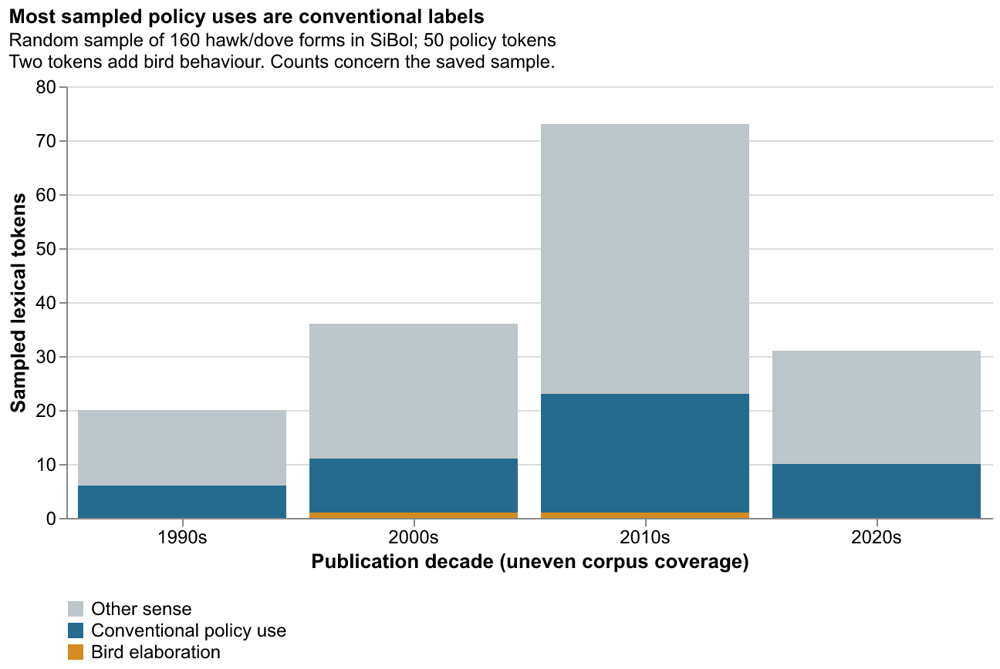
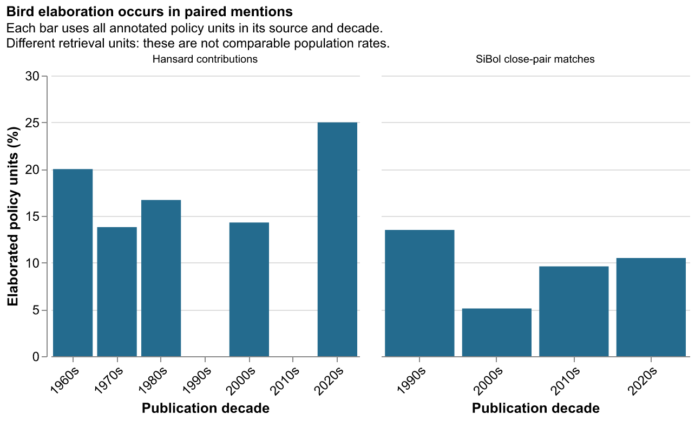

---
{
  "id": "2026-11-19-hawks-and-doves",
  "title": "Do political hawks kill political doves?",
  "date": "2026-11-19",
  "author": "Dominik Lukeš",
  "category": "linguistics",
  "tags": [
    "linguistics",
    "metaphor",
    "politics",
    "corpus-linguistics",
    "monetary-policy"
  ],
  "claim": "Political hawks and doves never acquire other bird behaviour, especially hawks hunting or killing doves; this is unusual because most public metaphors are elaborated.",
  "claim_source": "https://metaphorhacker.net/2011/04/why-dont-metaphorical-hawks-kill-metaphorical-doves/",
  "verdict": "My 2011 post overstated the lack of elaboration: feathers, calls, flight and a chase image existed. Killing or eating political doves remains unfound here, and the claim about most metaphors is untested.",
  "time_taken": "24.1 minutes of recorded research and drafting on 19 November 2026; later verification and publication excluded.",
  "human_time": "Estimated zero minutes of additional human research during the recorded run; time preparing the question and brief was not measured.",
  "tools": [
    "Codex (gpt-6.1-sol)",
    "Sketch Engine",
    "Python",
    "Hansard API",
    "govinfo API",
    "Google Books Ngram",
    "Vega-Lite",
    "Astro",
    "bun",
    "headless Chromium"
  ],
  "data_sources": [
    "Hansard spoken contributions",
    "SiBol newspapers (licensed access)",
    "US Congressional Record",
    "Google Books Ngram 2019 English",
    "Federal Reserve Board",
    "European Central Bank"
  ],
  "summary": "In 2011 I could not find political hawks hunting or killing political doves and thought the metaphor stopped at aggression and peacefulness. This check finds older cooing, fluttering, plumage, talons and a 2005 chase analogy. A random newspaper sample has two elaborated tokens among fifty policy uses. No clear killing or eating case was recovered; comparison with most other metaphors remains untested.",
  "references": [
    {
      "type": "post",
      "authors": [
        "Dominik Lukeš"
      ],
      "title": "Why don't metaphorical hawks kill metaphorical doves?",
      "date": "2011-04-03",
      "url": "https://metaphorhacker.net/2011/04/why-dont-metaphorical-hawks-kill-metaphorical-doves/"
    },
    {
      "type": "webpage",
      "authors": [
        "UK Parliament"
      ],
      "corporate": true,
      "title": "Hansard, Foreign Affairs",
      "url": "https://hansard.parliament.uk/Commons/1964-12-17/debates/a4250773-1293-4eb8-8c01-f2eaa13d89e0/"
    },
    {
      "type": "webpage",
      "authors": [
        "US Government Publishing Office"
      ],
      "corporate": true,
      "title": "Congressional Record, 5 April 1966, p. 7625: reprinted John S. Knight column",
      "url": "https://www.govinfo.gov/content/pkg/GPO-CRECB-1966-pt6/pdf/GPO-CRECB-1966-pt6-6-1.pdf",
      "date": "1966-04-05",
      "note": "Newspaper reprint; paraphrased, not redistributed."
    },
    {
      "type": "webpage",
      "authors": [
        "UK Parliament"
      ],
      "corporate": true,
      "title": "Hansard, Trade Description",
      "url": "https://hansard.parliament.uk/Commons/1968-05-08/debates/8800a3f8-43bc-4552-9adf-a520c97ffe41/"
    },
    {
      "type": "webpage",
      "authors": [
        "UK Parliament"
      ],
      "corporate": true,
      "title": "Hansard, East–West Relations",
      "url": "https://api.parliament.uk/historic-hansard/commons/1980/jan/28/east-west-relations"
    },
    {
      "type": "webpage",
      "authors": [
        "Sketch Engine"
      ],
      "corporate": true,
      "title": "The Times, SiBol P067",
      "url": "https://app.sketchengine.eu/"
    },
    {
      "type": "webpage",
      "authors": [
        "Sketch Engine"
      ],
      "corporate": true,
      "title": "SiBol corpus of English broadsheets",
      "url": "https://www.sketchengine.eu/sibol-corpus/",
      "note": "Newspaper concordances withheld. Counts and token locators are our annotation, not a redistribution licence."
    },
    {
      "type": "webpage",
      "authors": [
        "Sketch Engine"
      ],
      "corporate": true,
      "title": "Sketch Engine",
      "url": "https://www.sketchengine.eu/documentation/methods-documentation/"
    },
    {
      "type": "webpage",
      "authors": [
        "Sarah Bloom Raskin"
      ],
      "corporate": false,
      "title": "Monetary Policy and Job Creation",
      "url": "https://www.federalreserve.gov/newsevents/speech/raskin20110926a.htm",
      "date": "2011-09-26"
    },
    {
      "type": "webpage",
      "authors": [
        "Christine Lagarde"
      ],
      "corporate": false,
      "title": "Interview with Helsingin Sanomat",
      "url": "https://www.ecb.europa.eu/press/inter/date/2023/html/ecb.in230225~043f187a63.en.html",
      "date": "2023-02-25"
    },
    {
      "type": "webpage",
      "authors": [
        "Google Books"
      ],
      "corporate": true,
      "title": "Google Books Ngram",
      "url": "https://books.google.com/ngrams"
    },
    {
      "type": "webpage",
      "authors": [
        "US Government Publishing Office"
      ],
      "corporate": true,
      "title": "US Congressional Record / govinfo",
      "url": "https://api.govinfo.gov/docs/"
    },
    {
      "type": "webpage",
      "authors": [
        "GDELT Project"
      ],
      "corporate": true,
      "title": "GDELT",
      "url": "https://blog.gdeltproject.org/gdelt-doc-2-0-api-debuts/"
    },
    {
      "type": "webpage",
      "authors": [
        "Quora"
      ],
      "corporate": true,
      "title": "Quora short link",
      "url": "https://qr.ae/c3td"
    },
    {
      "type": "webpage",
      "authors": [
        "Google Books"
      ],
      "corporate": true,
      "title": "Google Books Ngram Viewer: FAQ, citation and licensing",
      "url": "https://books.google.com/ngrams/info"
    },
    {
      "type": "webpage",
      "authors": [
        "UK Parliament"
      ],
      "corporate": true,
      "title": "Hansard API",
      "url": "https://hansard-api.parliament.uk/swagger/ui/index"
    },
    {
      "type": "webpage",
      "authors": [
        "UK Parliament"
      ],
      "corporate": true,
      "title": "Open Parliament Licence",
      "url": "https://www.parliament.uk/site-information/copyright-parliament/open-parliament-licence/"
    },
    {
      "type": "webpage",
      "authors": [
        "Google"
      ],
      "corporate": true,
      "title": "CC BY 3.0",
      "url": "https://storage.googleapis.com/books/ngrams/books/datasetsv3.html"
    }
  ]
}
---

## The claim

### What was said

In [a post on 3 April 2011](https://metaphorhacker.net/2011/04/why-dont-metaphorical-hawks-kill-metaphorical-doves/), I asked why political hawks never hunted or killed political doves. I said I had searched without finding an extension of the metaphor beyond aggression and peacefulness. I also claimed that “most metaphors in public discourse get dissected every which way”, citing Iraq as Vietnam, Saddam as Hitler and Sarah Palin’s crosshairs.

Those are different claims. A record of what I failed to find does not establish what nobody had written. And examples of elaborated metaphors cannot establish what happens to *most* metaphors.

### Where the number seems to come from

There was no number. The post reports a search, but gives no sources, queries, dates or denominator. This check cannot reconstruct that search. It can look for counterexamples and count what appears in defined retrieval sets.

## The answer

### In short

**I overstated the absence of elaboration. Political hawks and doves already cooed, fluttered, changed plumage and grew talons before 2011.** A 2005 newspaper passage even maps hawks driving doves out of the White House onto real birds of prey driving pigeons away at Wimbledon.

**I still have no clear example here of a political hawk killing or eating a political dove.** Chasing, frightening and defeating are different from killing. The searches below do not prove that the narrower image never occurs.

### Was the absence unusual?

**That part is untested.** This check did not assemble a matched sample of Iraq–Vietnam or Saddam–Hitler comparisons. It therefore cannot say that hawks and doves are elaborated less often than those metaphors, or that most public metaphors are elaborated at all.

## The birds had more than attitudes

### Examples older than the post

These examples separate the additional bird property from the ordinary policy label. The [annotation file](data/annotations.csv) records the decisions and source locators.

| Date | Source | What the passage does | Judgement |
|---|---|---|---|
| 17 December 1964 | [Hansard, Foreign Affairs](https://hansard.parliament.uk/Commons/1964-12-17/debates/a4250773-1293-4eb8-8c01-f2eaa13d89e0/) | Zilliacus says Britain should coo with doves rather than squawk after hawks. | Calls; not predation |
| 5 April 1966 | [Congressional Record, p. 7625, PDF p. 61](https://www.govinfo.gov/content/pkg/GPO-CRECB-1966-pt6/pdf/GPO-CRECB-1966-pt6-6-1.pdf#page=61) | A reprinted John S. Knight column describes Johnson soothing doves’ feathers and sharpening hawks’ claws and beaks. | Plumage and weapons; not hawks attacking doves |
| 8 May 1968 | [Hansard, Trade Description](https://hansard.parliament.uk/Commons/1968-05-08/debates/8800a3f8-43bc-4552-9adf-a520c97ffe41/) | Two MPs may become fluttering doves when the vote comes. | Flight; not predation |
| 28 January 1980 | [Hansard, East–West Relations](https://api.parliament.uk/historic-hansard/commons/1980/jan/28/east-west-relations) | Cranborne describes doves darkening their feathers and developing talons. | Plumage and claws; not predation |
| 23 January 1993 | [The Times, SiBol P067](https://app.sketchengine.eu/#concordance?corpname=preloaded%2Fsibol_corpus) | Doves emerge from hawks’ plumage in a discussion of political and monetary conversions. | Plumage; not predation |
| 25 June 2005 | [The Guardian, SiBol P095](https://app.sketchengine.eu/#concordance?corpname=preloaded%2Fsibol_corpus) | White House hawks drive out doves; the next sentences describe Wimbledon’s real birds of prey. | Explicit chase/displacement analogy; no killing |
| 11 January 2010 | [The Daily Telegraph, SiBol P134 / S096](https://app.sketchengine.eu/#concordance?corpname=preloaded%2Fsibol_corpus) | Hawks gather overhead while doves cry about the Monetary Policy Committee. | Flight and calls; not predation |

Newspaper passages are paraphrased. Their full contexts are withheld because a redistribution licence was not established. Licensed readers can use the newspaper, date and token positions in the annotation file to find them in [SiBol](https://www.sketchengine.eu/sibol-corpus/).

### What counts as an extension?

Calling someone a hawk, saying hawks won, or describing a hawk becoming a dove does not by itself add another bird property. This check counts specific bird behaviour or anatomy, a bird scene, or a deliberate expansion of the political aviary to other species.

That distinction matters. The 2005 Wimbledon passage explicitly connects political displacement with real predatory birds. By contrast, a 2013 passage about doves driving hawks out of the White House has no further bird behaviour in the saved context. It was counted as ordinary political displacement. A joke about hawks and doves nesting at Armageddon was left uncertain between literal birds and a political pun, and excluded from the policy denominator.

## Conventional labels dominate the small sample

### The newspaper denominator

The agent asked [Sketch Engine](https://www.sketchengine.eu/documentation/methods-documentation/) for a random sample of 160 tokens from *hawk, hawks, dove, doves, hawkish* and *dovish* in SiBol. It then read contexts and classified the senses. **Fifty tokens concerned public policy; two added bird behaviour: 4% of those fifty.** The others included birds, aircraft, names, brands and sports teams.

| Publication decade | All sampled lexical tokens | Policy tokens | Tokens with bird elaboration | Share of policy tokens |
|---|---:|---:|---:|---:|
| 1990s | 20 | 6 | 0 | 0.0% |
| 2000s | 36 | 11 | 1 | 9.1% |
| 2010s | 73 | 23 | 1 | 4.3% |
| 2020s | 31 | 10 | 0 | 0.0% |
| Total | 160 | 50 | 2 | 4.0% |

These are token counts in a small saved sample. They are not article counts or estimates of historical change. [SiBol contains selected years and changing newspaper coverage](https://www.sketchengine.eu/sibol-corpus/); its date span is not a continuous annual series.

### Searches designed to find both birds

Two further searches looked for both labels: *hawks doves* in Hansard spoken contributions, and either bird within twenty intervening tokens of the other in SiBol. The denominator below is **all policy-sense units in each retrieved set**, after annotation. These searches omit one-sided uses; neither denominator represents all political uses in the whole archive.

| Source and decade | Retrieved units | Policy units | Elaborated policy units | Elaborated share |
|---|---:|---:|---:|---:|
| Hansard, 1960s | 25 | 25 | 5 | 20.0% |
| Hansard, 1970s | 29 | 29 | 4 | 13.8% |
| Hansard, 1980s | 25 | 24 | 4 | 16.7% |
| Hansard, 1990s | 15 | 15 | 0 | 0.0% |
| Hansard, 2000s | 7 | 7 | 1 | 14.3% |
| Hansard, 2010s | 3 | 3 | 0 | 0.0% |
| Hansard, 2020s | 4 | 4 | 1 | 25.0% |
| SiBol pairs, 1990s | 38 | 37 | 5 | 13.5% |
| SiBol pairs, 2000s | 42 | 39 | 2 | 5.1% |
| SiBol pairs, 2010s | 102 | 83 | 8 | 9.6% |
| SiBol pairs, 2020s | 39 | 38 | 4 | 10.5% |

Hansard returned 111 contributions, including three nineteenth-century animal allegories excluded from this policy-stance definition. Its policy denominator is 107, with fifteen elaborated contributions. SiBol returned 221 pair matches, of which 197 were policy uses and nineteen were elaborated. Overlapping matches and repeated headlines remain separate matches. The charts therefore do not compare independent articles, and the two sources’ percentages should not be treated as comparable population rates.

No annotated unit clearly depicted a hawk killing or eating a political dove. One SiBol pair depicted hawks driving doves away. A separate narrow query for a predation verb between the two bird terms returned no matches. Its word order and distance restrictions leave many possible formulations unsearched.

## Monetary policy adds another domain

### Hawks and doves at central banks

Of the fifty policy tokens in the random newspaper sample, 22 concerned monetary policy, six fiscal or price policy, and 22 other public policy. Monetary policy supplied one circling-hawk example in 2005 and the overhead-hawks headline in 2010.

Later official sources also extend the aviary. In [a speech on 26 September 2011](https://www.federalreserve.gov/newsevents/speech/raskin20110926a.htm), Federal Reserve governor Sarah Bloom Raskin rejected both labels in favour of wise owls. In [a 25 February 2023 interview](https://www.ecb.europa.eu/press/inter/date/2023/html/ecb.in230225~043f187a63.en.html), Christine Lagarde extended her owl label to looking around the Governing Council table. These are later examples. They cannot refute a claim specifically about what was available before April 2011.

### What the other searches supplied

| Source | Outcome | Political-use denominator |
|---|---|---|
| [Google Books Ngram](https://books.google.com/ngrams) | Seven phrases queried for 1900–2019; series returned for *hawks and doves* and *cooing doves*. No series for the other five phrases. | Unavailable: literal and political senses are mixed |
| [US Congressional Record / govinfo](https://api.govinfo.gov/docs/) | API search succeeded; selected 1966 and 1999 records were read. The 1966 reprint elaborates feathers, claws and beaks. | Not established; archive search results are not annotated policy uses |
| [GDELT](https://blog.gdeltproject.org/gdelt-doc-2-0-api-debuts/) | A failed request, then HTTP 429. | Unavailable |
| [Quora short link](https://qr.ae/c3td) | HTTP 403; exact-link and title searches recovered no answers. | Unavailable; the answer count is unknown |

The [Ngram query-status table](data/ngram-query-status.csv) preserves missing series as missing. [Google’s FAQ](https://books.google.com/ngrams/info) describes a publication threshold and possible missing results under load. A missing line cannot establish that a phrase was never written. Nor does *cooing doves* establish a political reading without its context.

## Limits of this check

### What this does not show

This is a search for counterexamples and a small annotated corpus check. It does not establish first uses, a complete inventory, or the frequency of elaboration across all public discourse. The historical account of my own search remains unreconstructed.

All 492 annotation decisions were made by one AI agent. No person or independent second model adjudicated them. Political sense, the boundary of elaboration, and the interpretation of puns are judgement steps. The public checker recounts these saved decisions; it does not validate their meanings. Some deliberately broad elaborations add another bird species rather than predation. Ambiguous puns are excluded from the positive count.

The random sample counts tokens, including repeated mentions within coverage of the same event. The paired searches favour discussion of the contrast and can contain overlapping matches. Neither the sample nor the selected primary examples licenses the claim that hawks and doves are unusually resistant to extension. Quora’s inaccessible answers and the failed GDELT requests remain gaps.

The defensible revision of my 2011 post is therefore limited: **the metaphor did extend beyond aggression and peacefulness. A chase image existed. Killing or eating political doves remains unfound in this check, and the claim about most metaphors remains untested.**

## How this was made

### Timeline

The recorded research and drafting window was **11:19:14–11:43:21 UK time on 19 November 2026**, or **24.1 minutes**. Later data checks, site checks and publication are outside that snapshot. Estimated additional human research during this window: **zero minutes**; time spent preparing the question and brief was not measured.

The follow-up questions were whether a political chase counts as predation, whether the monetary-policy domain changes the result, and whether the comparison claim had a denominator. The answer to the first was to code chase separately from killing; the second led to a monetary-policy split and official Fed/ECB examples; the third remained untested. Quora answers were sought but not recovered.

### Data and method

The searches used the [Hansard API](https://hansard-api.parliament.uk/swagger/ui/index), historic Hansard pages, [govinfo](https://api.govinfo.gov/docs/), [SiBol through Sketch Engine](https://www.sketchengine.eu/sibol-corpus/), [Ngram](https://books.google.com/ngrams) and public web search. Exact queries, locators, source dates, context hashes and confidence labels are preserved. Python groups the saved annotation, calculates shares and generates the charts. All plotted values have CSV and Vega-Lite versions.

Short Hansard paraphrases and references are attributed under the [Open Parliament Licence](https://www.parliament.uk/site-information/copyright-parliament/open-parliament-licence/). Newspaper concordances and Congressional Record reprints are withheld. Ngram data retains [CC BY 3.0](https://storage.googleapis.com/books/ngrams/books/datasetsv3.html). The [source-rights record](data/DATA-SOURCES.md) explains each decision. The rerun checks the page’s arithmetic from the published annotations, not the completeness of retrieval or the correctness of the linguistic judgements.

### Models, tools and tokens

| Model | Role | Calls recorded | Tokens read | Tokens written |
|---|---|---:|---:|---:|
| gpt-6.1-sol (Codex) | Search, annotation, analysis, prose and chart code | 52 | 11,196,791 | 43,866 |

The count uses distinct cumulative usage events in the Codex transcript. The site's supplied usage script handles Claude transcripts, so a Codex adapter exported the [usage snapshot](data/usage-snapshot.json).

Tokens read include cached history, counted within input rather than added twice. Tokens written include reasoning. The usage snapshot covers this research and drafting session up to its stated timestamp; later checks and publication are excluded. Other tools were Python, Sketch Engine, public APIs, web search, Vega-Lite, Astro, bun, headless Chromium, Git and Cloudflare Pages.
