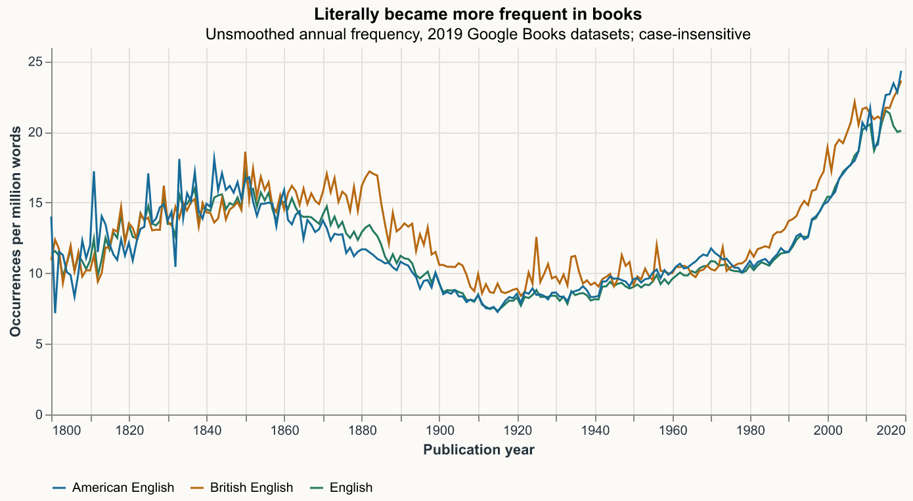
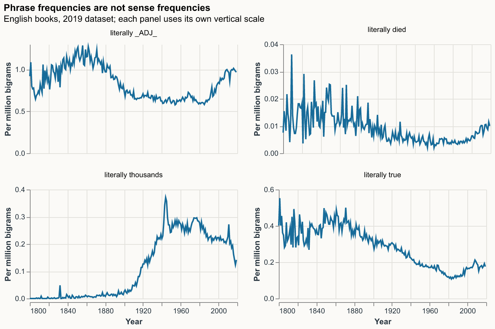
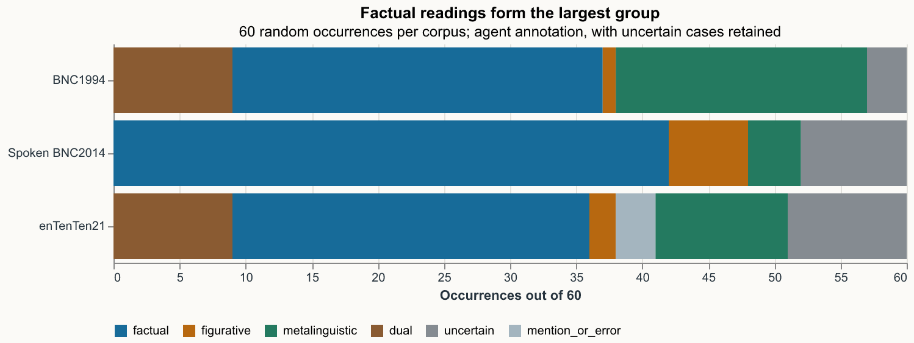
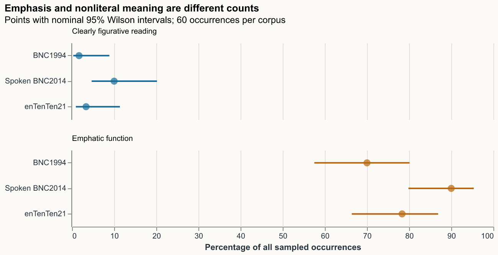

## The claim

### What was said

In [my 2011 post](https://metaphorhacker.net/2011/02/literally-triumph-of-pet-peeve-over-matter/) I wrote: **“Literally” is primarily an intensifier and secondarily a disambiguator.** I included factually true statements among intensifier uses. I also argued that the use was established in edited English and that complaints about overuse and confusion lacked evidence.

### Where the numbers came from

I used the BNC, COCA and TIME corpora, then added Google search-result estimates. The post preserves examples and some counts, but no complete exports or versioned queries. I explicitly said I had not counted the historical proportions. A claim about the word's frequency, a claim about its function, and a claim about people's reactions need different evidence.

## The answer

### In short

**I was close on the linguistic argument and less careful with the measurements.** Emphasis is common in the new samples, including statements presented as factually true. The emphatic use is old. But my grammatical exclusions were too categorical, and my Google counts could not rank people's pet peeves. The old TIME trend and COCA rankings remain unreproduced.

### Emphasis does not mean falsehood

The distinction I made in 2011 matters. A statement can emphasise an actual quantity or an unusual event. Counting only impossible or figurative statements would test a narrower claim than the one I made. Conversely, calling something emphatic does not show that literal interpretation has become secondary or irrelevant.

## Old usage, later growth

### The history holds up

[Merriam-Webster](https://www.merriam-webster.com/dictionary/literally) dates exaggerated usage to the mid-eighteenth century and documents it in published literature. Its entry also recognises emphasis on a statement's truth. That supports the historical argument. Its exaggerated sense is marked **informal**, however. Established literary use does not settle suitability in every formal context.

[Kostadinova's 2018 corpus study](https://doi.org/10.1017/S0266078418000366) reports the OED's 1769 attestation. Direct access to the OED was blocked during this check, so that date is cited through the study. The study's own classification finds dual uses most frequent and clearly nonliteral uses least frequent. Its categories overlap with mine imperfectly; its results are separate evidence, not a rerun of this analysis.

### Books do not reproduce the TIME decline

The new [Google Books check](https://books.google.com/ngrams/info) uses the fixed 2019 datasets. These are mean annual occurrences per million words, with all capitalisations combined. Each row averages annual rates; it is not a token-weighted decade rate.

| Book collection | 1950–1959 | 1980–1989 | 2000–2009 | 2010–2019 |
|---|---:|---:|---:|---:|
| English | 9.290 | 10.816 | 17.298 | 20.295 |
| British English | 10.041 | 12.161 | 19.869 | 21.829 |
| American English | 9.785 | 11.038 | 17.237 | 21.710 |

The word became more frequent in books after the 1980s. This does not refute an observation about TIME magazine, which is a different collection. It does show why that magazine could not establish that the word's wider frequency was stable. The country labels concern publication collections, not a controlled comparison of national speakers.

### A phrase is not a sense label

The same check follows adjacent adjectives and three fixed phrases. **“Literally died” cannot automatically count as hyperbole.** Someone may actually have died, or a fictional character may die within the story. The book series have no contextual sense annotation.

These are frequencies per million bigrams. The adjective panel uses Google's part-of-speech tags. OCR, tagging errors and changing book composition remain possible explanations for some variation.

## Emphasis is common; clear hyperbole is a minority

### What was searched

An agent retrieved case-insensitive *literally* from three documented corpus versions and read sixty randomly selected contexts from each.

| Collection | Period | Words | All hits | Hits per million words |
|---|---|---:|---:|---:|
| BNC1994, CLAWS | Late twentieth century | 96,052,598 | 1,936 | 20.156 |
| Spoken BNC2014 | 2012–2016 | 10,495,185 | 2,067 | 196.947 |
| enTenTen21 | Web collection, 2021–early 2022 | 52,268,286,493 | 1,837,887 | 35.163 |

These are different mixtures of text and speech. The high conversational rate cannot be read as a tenfold historical increase. The BNC version used here also differs from the retagged version described on Sketch Engine's current public page; the table uses the actual API denominator.

### Reading and function were annotated separately

**Factual** means presented as actually true, including within a hypothetical or fictional world. **Figurative** means the context supports a nonliteral or hyperbolic reading. **Metalinguistic** covers translation, word meanings and interpretation. **Dual** deliberately invokes an actual situation and a conventional figure. Unresolved cases remain **uncertain**. Mentions of the word and an apparent typing error are retained separately.

These labels concern how the statement is presented. They do not verify its truth. A second label asks whether *literally* adds emphasis; that can be true of any of the first four readings.

| Reading | BNC1994 | Spoken BNC2014 | enTenTen21 |
|---|---:|---:|---:|
| Factual | 28 | 42 | 27 |
| Clearly figurative | 1 | 6 | 2 |
| Metalinguistic | 19 | 4 | 10 |
| Dual | 9 | 0 | 9 |
| Uncertain | 3 | 8 | 9 |
| Mention or error | 0 | 0 | 3 |
| Total sampled | 60 | 60 | 60 |

### The broad 2011 claim fares better than a narrow one

| Collection | Emphatic function | Clearly figurative reading | Figurative share, nominal 95% interval |
|---|---:|---:|---:|
| BNC1994 | 42/60, 70.0% | 1/60, 1.7% | 0.3–8.9% |
| Spoken BNC2014 | 54/60, 90.0% | 6/60, 10.0% | 4.7–20.1% |
| enTenTen21 | 47/60, 78.3% | 2/60, 3.3% | 0.9–11.4% |

This supports broad intensification as a frequent function in these samples. It would contradict a claim that most tokens clearly describe impossible events, but I did not make that narrower claim in 2011. Many emphatic examples concern an actual number, duration or action. Interpretation and translation also remain substantial uses.

Even if every uncertain reading were figurative, the corresponding shares would be at most **6.7%, 23.3% and 18.3%**. That sensitivity check leaves dual uses in their stated category; it does not resolve disagreements about where conventional metaphor ends.

## The strongest claims needed better evidence

### Grammar and exclusive phrases

I marked **“literally a crowd of people”** as ungrammatical. The targeted enTenTen21 search returns seven adjacent *literally a crowd* matches. The agent read the first five; the first describes an actual supportive crowd around a person. This weakens my categorical exclusion. It does not establish a population-wide acceptability judgement.

The search for *literally twelve/12 feet tall* returns one match, about a disc-golf basket. It provides no counterexample involving a person's height. It also cannot turn my unsuccessful Google search into a grammatical rule.

I said *figuratively* occurred exclusively in **“literally and figuratively”**, although my own example 9 placed the two words in separate descriptions. That was already too strong. A new reverse-order corpus query timed out; it supplies no additional count.

### Search hits did not measure annoyance

These are my reported 2011 Google estimates, not fresh measurements:

| Search as reported | Estimated results |
|---|---:|
| +literally +misuse | 910,000 |
| preposition at the end of a sentence | 1,620,000 |
| +passive +misuse writing | 6,630,000 |

I acknowledged their weakness but still called the ranking suggestive. **They could not rank annoyance.** The queries describe their topics differently, relevant complaints were not counted, and the estimates had no common population denominator. No dated search snapshots survive in the post. The claim that *literally* appeared in none of the ten inspected grammar-list results is similarly unreproducible.

### What remains untested

The [complete claim inventory](data/2011-claim-inventory.csv) records 56 groups, including ancillary empirical assertions, reported searches and interpretations. The [49 Update 2 collocation values](data/2011-historical-collocates.csv) and [nine other reported counts](data/2011-other-reported-numbers.csv) are preserved as historical claims. They have not become verified measurements merely by being copied into a CSV.

The missing TIME and COCA snapshots prevent an exact check of the old decade counts, ranks and the 1920s-versus-2000s proportion. More importantly, neither the new frequencies nor the original examples establish what speakers know, whether *literally* is an effective intensifier, or how often ambiguity causes consequential misunderstanding. My confidence on those questions exceeded my evidence.

## Limits of this check

### What this does not show

The samples contain sixty occurrences per collection, with repeated documents and speakers possible. The Wilson intervals describe binomial sampling uncertainty only. They do not account for clustering, corpus selection or annotation error. The broad emphasis label is a pragmatic judgement, not an independently measured psychological property.

One agent interpreted all contexts. It then reread a seeded subset of thirty-six with the first labels hidden from the display and changed one reading to uncertain. This was a hand-read consistency check by the same agent, **not independent or human validation**. No human hand-check was available. The [annotation file](data/literally-annotations.csv) records every position, label, confidence and reason; the [second-reading record](data/literally-second-reading.csv) preserves the correction. Restricted corpus text is withheld.

The book data end in 2019, and the web collection was gathered in 2021–early 2022. These are not measurements of conversation in 2026. The book endpoint supplies normalised series; version-specific annual corpus totals were not obtained, so no pooled count or claim about total book-corpus size is made. The new samples cannot establish a history of functions or settle the old register-independent phrase “primary function in English”.

## How this was made

### Timeline

The measured session ran from **11:18:47 to 11:40:11 UK time on 19 November 2026** at this snapshot (21.4 minutes). This covers research, collection, annotation, drafting and the initial offline check. Later clean-clone, headless release and publication checks are outside that interval. Human preparation time is an agent estimate, not a timed observation.

The post prompted follow-ups about grammatical exclusions, numeral scales and literal/figurative coordination. Two narrow searches completed; the broader reverse-order search timed out. An initial unfinished web count and incorrect context-window parameters were rejected before annotation. The corrected searches waited for completion and retrieved up to fifty tokens on each side.

### Data and method

The agent read the entire source, including both updates, and separated empirical claims from polemic. Python preserved the reported numbers, retrieved the new counts and selected the samples. BNC samples used a complete hit list and seed **20110223**. enTenTen21 used Sketch Engine's documented random-sample operation, with all selected positions saved; its server-side draw was not seed-controlled.

The judgement steps were defining reading categories, interpreting each context, deciding whether emphasis was present, reviewing uncertain cases, and assessing what each result could support. Meaning was never assigned by keyword matching. The second reading used seed **20110224**, twelve contexts per collection, and retained both decisions. The full method and provider redistribution decisions are in the linked checking repository.

Google requests used unsmoothed, case-insensitive 2019 datasets for 1800–2019. Python combined the provider's capitalisation totals, computed mean annual decade rates and Wilson intervals, and prepared the chart data. Every figure has the exact plotted CSV and a Vega-Lite specification. The offline checker reconstructs nine tables from saved inputs; it cannot independently validate the corpus judgements. Provider citations are retained [verbatim](data/provider-citations.md).

### Models, tools and tokens

| Model | Role | Calls | Tokens read | Tokens written |
|---|---|---:|---:|---:|
| gpt-6.1-sol (Codex) | Source reading, retrieval, annotation, writing and verification | 44 | 6,822,797 | 44,884 |

The site's Claude-transcript usage script produced no rows for this Codex transcript. A supplementary parser counted distinct cumulative Codex usage events from the measured interval above. Calls mean recorded model-completion events. Tokens read include cached history; cached input is already included, not added again. Tokens written include reasoning. Counts cover this implementation session to the snapshot, excluding later verification and deployment. The underlying transcript and account records are private.

Python, Sketch Engine, Google Books Ngram Viewer and Vega-Lite supplied retrieval and analysis. Astro and bun built the page; headless Chromium checked rendering; Cloudflare Pages published it. No separate writer or independent research reviewer took part.
