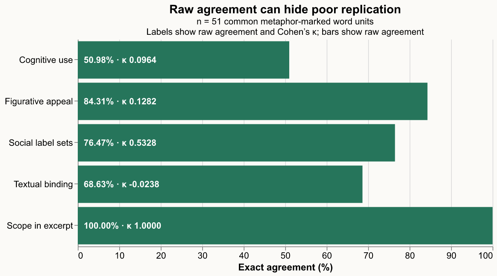

## The claim

### What was said

My [2005 paper](https://dominiklukes.net/research/towards-a-classification-of-metaphor-use/) proposed distinguishing what metaphor does cognitively, socially and textually. It presented the classification as a heuristic, allowing overlapping functions: “it is rather a heuristic device, to help structure the context of inquiry.”

I asked an agent to apply those distinctions to six modern passages as a first step towards a fuller study. Do they still help describe differences? Can separate annotation passes apply them consistently? **The annotations, findings and recommendations below were generated by agents and have not been checked by me.**

### Where the number seems to come from

There is no inherited headline statistic to verify. The numbers come from two annotation passes over the same passages using a frozen [codebook](data/CODEBOOK.md). Counting the labels again checks the arithmetic; it cannot establish that the interpretations are correct.

## The answer

### In short

**Identification agreed much more than cognitive-use classification.** The passes agreed on metaphor, literal or uncertain status for 380 of 402 units (94.53%). Among the 51 units both called metaphorical, they agreed on cognitive use for 26 (50.98%).

### What holds up

The distinctions help describe specific differences: whether wording supplies an inference, expresses an appeal, or links parts of a passage. Their application remains disputed. The agents’ proposed next step is to specify observable source-to-target inferences for constitutive use, give contrasting examples, and test the revised instructions on held-out passages with independent human annotators. I have not checked or approved this proposed revision.

## Six short passages from six genres

### Sample selection and sources

The sample contains **402 orthographic units**, with hyphenated forms and apostrophes retained. Each excerpt ends at the first paragraph boundary after 50 whitespace words; headings, salutations and figures are excluded. Hansard contributes three short paragraphs. The two counting conventions produce different totals.

| Passage | Units | Metaphor A / B | Reuse terms |
|---|---:|---:|---|
| [King’s Speech, Hansard, 17 July 2024](https://hansard.parliament.uk/Commons/2024-07-17/debates/d8718426-82b4-429c-82e5-bf8ebf27e08e/CommonsChamber) | 87 | 11 / 11 | [Open Parliament Licence v3.0](https://www.parliament.uk/site-information/copyright-parliament/open-parliament-licence/) |
| [AI Opportunities Action Plan, ministerial foreword](https://www.gov.uk/government/publications/ai-opportunities-action-plan/ai-opportunities-action-plan) | 68 | 10 / 9 | [Open Government Licence v3.0](https://www.nationalarchives.gov.uk/doc/open-government-licence/version/3/) |
| [Wikipedia contributors, AI hallucination](https://en.wikipedia.org/w/index.php?title=Hallucination_(artificial_intelligence)&oldid=1384607133) | 50 | 13 / 13 | [CC BY-SA 4.0](https://creativecommons.org/licenses/by-sa/4.0/) |
| [Wikinews, English local elections](https://en.wikinews.org/w/index.php?title=Competitive_local_elections_held_in_England&oldid=4880760) | 52 | 7 / 9 | [CC BY 4.0](https://creativecommons.org/licenses/by/4.0/) |
| [NASA, greenhouse effect](https://science.nasa.gov/climate-change/faq/what-is-the-greenhouse-effect/) | 80 | 9 / 8 | [NASA reuse permission](https://www.nasa.gov/nasa-brand-center/images-and-media/) |
| [Python 3.14 tutorial](https://docs.python.org/3.14/tutorial/appetite.html) | 65 | 9 / 8 | [PSF Licence v2](https://docs.python.org/3.14/license.html) |
| Total | 402 | 59 / 58 | Source-specific terms apply. |

These passages were chosen purposively for genre, topic, access and reuse terms. They cannot estimate metaphor frequency in any genre. The [source table](data/corpus-summary.csv) preserves each denominator.

Contains Parliamentary information licensed under the Open Parliament Licence v3.0. The policy excerpt contains public sector information under the Open Government Licence v3.0, © Crown copyright 2025. Neither implies official endorsement. Wikipedia’s excerpt and numbered transformation retain CC BY-SA 4.0. NASA’s terms are reuse permission, with no Creative Commons designation. The Python excerpt retains “Copyright © 2001 Python Software Foundation. All rights reserved.” and the PSF notice. [Source terms and transformations](data/DATA-SOURCES.md) record these exceptions to the report’s CC BY 4.0 licence.

## Cognitive use depends on the inference being counted

### Cognitive counts

*Constitutive* use supplies source relations or inferences that organise an account. *Attributive* use transfers selected properties or associations without developing that structure. The paper treats this as a continuum. The pilot permits mixed and uncertain labels, though neither pass assigned them to a unit marked metaphorical.

| Cognitive category | A | B | Example of the coding question |
|---|---:|---:|---|
| Attributive | 19 | 39 | Does “field” merely associate a discipline with an area? |
| Constitutive | 40 | 19 | Does “falling behind” organise national AI progress through relative positions? |
| Mixed | 0 | 0 | Both uses would need identifiable evidence. |
| Uncertain | 0 | 0 | Available when the passage cannot distinguish them. |

These totals use each pass’s own metaphor set: **59 units for A, 58 for B**. Constitutive uses were all classified as *explanative*, using available mappings; none was *generative*, visibly producing a new proposal or inference. These nested counts are in the [category table](data/use-counts.csv).

### Social and textual functions

Social functions can overlap:

| Social function | A | B | What the label records |
|---|---:|---:|---|
| Declarative | 59 | 58 | Sharing an account. |
| Figurative | 3 | 7 | Adding expressive appeal; disputed for “falling behind”. |
| Innovative | 0 | 0 | Proposing a new view. |
| Exegetic | 6 | 6 | Interpreting another formulation, as with AI “hallucination”. |
| Performative | 9 | 4 | Enacting a position or commitment, as in the speech. |
| Prevaricative | Not assessed | Not assessed | Requires independent evidence of deceptive intent. |

Prevaricative intent was not assessed without independent evidence. Zero assigned labels do not establish an absence of deception.

Textual *binding* asks whether an expression has an identifiable earlier, later or outside anchor. Scope asks how much of the selected passage the metaphor organises. Binding labels can overlap; these counts use each pass’s own metaphor set.

| Dimension | Category | A | B |
|---|---|---:|---:|
| Binding | Anaphoric: earlier anchor | 1 | 6 |
| Binding | Cataphoric: later development | 0 | 11 |
| Binding | Exophoric: outside anchor | 0 | 0 |
| Binding | No specific tie | 58 | 43 |
| Scope | Local | 54 | 53 |
| Scope | Passage-wide | 5 | 5 |

The [full counts](data/use-counts.csv) also preserve uncertain categories.

## Agreement leaves specific coding questions unresolved

### Agreement across dimensions

| Identification | A | B |
|---|---:|---:|
| Metaphorical | 59 | 58 |
| Uncertain | 7 | 13 |
| Literal | 336 | 331 |

Either pass marked 66 units metaphorical, with 51 in common. **These are word-unit counts, including separate words of multiword expressions.**

| Dimension | Agreement | Percentage | Cohen’s kappa |
|---|---:|---:|---:|
| Identification: metaphor / literal / uncertain | 380/402 | 94.53% | 0.8113 |
| Cognitive use, common metaphor units | 26/51 | 50.98% | 0.0964 |
| Elaboration, nested under cognitive use | 26/51 | 50.98% | 0.0964 |
| Social functions, exact label sets | 39/51 | 76.47% | 0.5328 |
| Binding, exact label sets | 35/51 | 68.63% | −0.0238 |
| Scope: local / passage-wide | 51/51 | 100% | 1.0000 |

Kappa adjusts agreement for the category frequencies of these two readings. It is descriptive here, with no validity threshold or population inference. Words cluster within passages and cannot be treated as independent samples. Scope agreement concerns these excerpts; full-document global organisation was not assessed. The [agreement table](data/agreement.csv) includes per-label results; constant margins can leave kappa undefined despite 100% raw agreement. Excluding every unit marked uncertain gives supplementary identification agreement of 377/385 (97.92%; kappa 0.9152).

### Competing readings

There were 22 identification disagreements. Of the 51 common metaphor units, 42 had a functional disagreement. The [disagreement register](data/disagreements.csv) contains 64 unique units with any scored disagreement; several dimensions can differ on one unit.

| Case | Pass A | Pass B | Unresolved rule |
|---|---|---|---|
| AI | “Hallucination” is attributive: the passage calls it a loose analogy and imports no human mental mechanism. | Constitutive/explanative: the next sentence explicitly relates false AI output to false human percepts. | How much source structure is enough? Both assign exegetic, declarative and passage-wide use. |
| Base | “Cornerstone” is constitutive; links back to “based upon”. | Constitutive; no specific textual tie. | When does shared support imagery create binding? B also adds figurative use. |
| Race | “Falling behind” is constitutive and declarative. | Constitutive, declarative and figurative. | Familiarity does not settle expressive function. |
| NASA | “Blanket” is constitutive/explanative; no binding. | Same cognitive reading, plus figurative and cataphoric use because heat retention follows. | What counts as subsequent development? |
| Files | “Files” is constitutive, without binding. | Constitutive, with a forward tie followed by a backward tie. | Distinguish repetition from metaphorically organised cohesion. |

Some uncertainty precedes functional coding. B questioned whether “mission” and “home” have ordinary contemporary senses sufficient for their contexts. NASA’s “enveloping” can describe gases physically surrounding Earth. The final human “hallucination” was literal for A and uncertain for B because it names the source of an overt comparison. Use, mention and analogy need clearer separation.

## Limits of this check

### What this does not show

Both passes used separate contexts of the same configured model family. Shared biases can produce agreement. There was no human annotator, systematic dictionary audit or adjudicated gold standard. Both readings remain available.

The sample mixes dated publications with current web editions. Update dates do not establish when an individual paragraph was composed; this is not a historical comparison with 2005. Short opening windows cannot test whole-document organisation. No generative or innovative uses were assigned, so this sample cannot establish those categories’ usefulness. Reader salience, recoverability, psychological processing and causal effects were not measured. NASA’s blanket comparison does not establish that gases operate exactly like a blanket or glass greenhouse.

## How this was made

### Timeline

The [transcript-derived timeline](data/timeline-metaphor-pilot.json) records the following milestones in UK time on 19 November 2026.

| Time | Recorded step |
|---|---|
| 11:19:27 | Session record begins. |
| 11:22:42 | Source capture starts. |
| 11:24:27 | Selected excerpts and fixed units written. |
| 11:25:48 | Fresh-context pass B starts. |
| 11:27:17 | Pass A saved before B result. |
| 11:30:57 | Pass B completes. |
| 11:31:27 | Comparison tables rebuilt. |
| 11:32:49 | Both PNG charts rendered. |
| 11:36:22 | Fresh-clone data rerun recorded. |

The usage snapshot ends at 11:41:02 UK time, 21.6 minutes after the session record began. Subsequent source-review completion, release checks, deployment and live checks are excluded. Human minutes were not measured or estimated; the human supplied the question and publication brief, and no human annotated this sample.

### Data and method

Identification was informed by [MIP](https://www.lancaster.ac.uk/staff/eiaes/Pragglejaz_Group_2007.pdf): read the context, compare contextual and basic current meanings, and ask whether comparison supports the contextual reading. Model linguistic knowledge supplied senses. MIP lexical units can differ from these fixed word forms. Orthographic units and a declared extension for overt comparisons make this an adapted, unvalidated procedure.

Each pass read all 402 units, explained metaphor/uncertain decisions and explicitly declared the remainder literal. A was frozen before B returned; B saw only the codebook, excerpts and fixed units. Python counted the frozen labels without adjudication. [Method](data/METHOD.md), [annotations and code](https://github.com/techczech/research-snacks-data/tree/main/snacks/2026-11-19-metaphor-use-pilot) allow inspection; the chart CSVs and Vega-Lite specifications preserve the plotted values.

Direct Hansard retrieval returned 403, so web retrieval supplied the excerpt. An [OpenStax candidate](https://assets.openstax.org/oscms-prodcms/media/documents/Psychology2e_WEB.pdf) had a licence mismatch and was replaced with the Python tutorial before annotation. The requested dataviz skill was unavailable; existing chart conventions were used.

### Models, tools and tokens

| Model or run | Role | Calls | Tokens read | Tokens written |
|---|---|---:|---:|---:|
| Configured gpt-6.1-sol | Coordinator and pass A | 64 | 11,409,136 | 44,253 |
| Configured gpt-6.1-sol | Fresh-context pass B | 8 | 360,226 | 10,714 |
| Configured gpt-6.1-sol | Writer | 25 | 1,953,408 | 13,920 |
| Gemini 4 Neon, requested | Independent source review | Not reported | Not reported | Not reported |

The [usage snapshot](data/usage-metaphor-pilot.json) comes from the Codex transcript exporter supplied with this entry. The site’s Claude-only usage script does not parse these transcripts. Calls count distinct cumulative usage events. Tokens read include cached history, already included in the input total; tokens written include reasoning. The three Codex contexts are reported separately. The later source critic uses a different model family and does not supply a third annotation pass. Its usage is unavailable to this exporter. No counterfactual human time saving was measured. Other tools were Python/uv, Vega-Lite/vl-convert, Astro/bun, headless Chromium and Cloudflare Pages.
