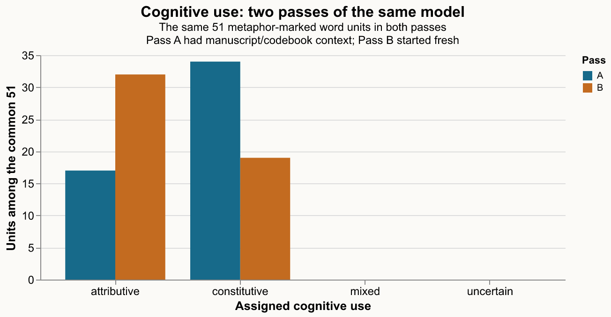

## The claim

### What was said

My [2005 paper](https://dominiklukes.net/research/towards-a-classification-of-metaphor-use/) proposed distinguishing what metaphor does cognitively, socially and textually. It called the scheme “a heuristic device, to help structure the context of inquiry”, allowing overlapping uses.

I asked an agent to try it on six current passages. Could the use labels be reproduced, and what would need changing before a full study? **These are pilot annotations, findings and recommendations generated by agents. They have not been checked by me.**

### Where the numbers come from

The numbers come from two passes over the same fixed excerpts, using a [frozen codebook](data/CODEBOOK.md). Both used the same configured `gpt-6.1-sol` model. Pass A had read the manuscript and planning notes and written the codebook in its coordinator context. Pass B started fresh with that codebook, excerpts and numbered units; it did not see A’s labels. These are asymmetric separate-context passes, not independent models or raters.

## The answer

### In short

**Identification reproduced within this run; the main use judgements did not.** The identification decisions had κ = 0.81. On the units both passes marked metaphor-related, κ was 0.10 for cognitive use, 0.13 for figurative appeal and −0.02 for textual binding. These figures do not validate either metaphor inventory.

### What holds up

The unchecked agent run produced questions about the use categories, but did not reproduce their application on those three dimensions. It does not show that the 2005 scheme holds up as a reproducible classification. Nor is this a direct test of the complete original scheme: the codebook changed or omitted several categories, and the passes had unequal preparation.

Before a full study, the agents recommend specifying observable source-to-target inferences for constitutive use, reconciling the adapted categories with the paper, and testing revised instructions with symmetric preparation and independent human annotators on held-out passages. No such validation has happened here.

## Six short passages, with uncertainty retained

### Selection and counting

The rule was to take opening prose until the first paragraph boundary with **at least 50 whitespace-separated tokens**, excluding headings, salutations and figures. Wikipedia stops at exactly 50; Hansard contributes three paragraphs. The documents were chosen purposively for genre, topic, access and reuse terms. This cannot estimate genre frequencies.

There are two counting conventions. The policy excerpt contains two standalone ASCII hyphens; whitespace splitting counts them, while the orthographic-word pattern does not.

| Material | Whitespace tokens | Orthographic units |
|---|---:|---:|
| Whole sample | 404 | 402 |
| Policy excerpt | 70 | 68 |

All other excerpts have identical counts under both conventions. The revised [per-passage summary](data/corpus-summary.csv) contains both denominators. Apostrophes, internal hyphens and numbers are retained in the 402 numbered forms; these need not equal MIP lexical units.

M means metaphor-related, U uncertain, and **L means not metaphor-related**. L includes proper names and metonymy excluded by the pilot rules; it does not establish literal use.

### Passages, dates and permissions

| Source or edition | Units | M: A / B | U: A / B | Source terms |
|---|---:|---:|---:|---|
| [Hansard, King’s Speech, 17 July 2024](https://hansard.parliament.uk/Commons/2024-07-17/debates/d8718426-82b4-429c-82e5-bf8ebf27e08e/CommonsChamber) | 87 | 11 / 11 | 1 / 1 | [Open Parliament Licence v3.0](https://www.parliament.uk/site-information/copyright-parliament/open-parliament-licence/) |
| [AI Opportunities Action Plan, 13 January 2025](https://www.gov.uk/government/publications/ai-opportunities-action-plan/ai-opportunities-action-plan) | 68 | 10 / 9 | 1 / 4 | [Open Government Licence v3.0](https://www.nationalarchives.gov.uk/doc/open-government-licence/version/3/) |
| [Wikipedia contributors, AI hallucination, fixed revision](https://en.wikipedia.org/w/index.php?title=Hallucination_%28artificial_intelligence%29&oldid=1384607133) | 50 | 13 / 13 | 1 / 1 | [CC BY-SA 4.0](https://creativecommons.org/licenses/by-sa/4.0/) |
| [Wikinews, English local elections, 6 May 2025](https://en.wikinews.org/w/index.php?title=Competitive_local_elections_held_in_England&oldid=4880760) | 52 | 7 / 9 | 0 / 0 | [CC BY 4.0](https://creativecommons.org/licenses/by/4.0/) |
| [NASA, greenhouse effect, updated 23 October 2024](https://science.nasa.gov/climate-change/faq/what-is-the-greenhouse-effect/) | 80 | 9 / 8 | 1 / 4 | [US government-work rule and exceptions](https://sti.nasa.gov/disclaimers/) |
| [Python tutorial, footer updated 18 November 2026, 23:07 UTC](https://docs.python.org/3.14/tutorial/appetite.html) | 65 | 9 / 8 | 3 / 3 | [Python Software Foundation License Version 2](https://docs.python.org/3.14/license.html) |
| Total | 402 | 59 / 58 | 7 / 13 | Source-specific terms apply. |

Current editions do not establish when an individual paragraph was composed. This is not a historical comparison with 2005.

Contains Parliamentary information licensed under the Open Parliament Licence v3.0. The official terms were verified and [archived](data/open-parliament-licence-v3-capture.md). © Crown copyright 2025. Contains public sector information licensed under the Open Government Licence v3.0. Neither provider endorses this analysis.

Wikipedia contributors’ excerpt and numbered representation retain CC BY-SA 4.0, with [history and contributors](https://en.wikipedia.org/w/index.php?title=Hallucination_%28artificial_intelligence%29&action=history) credited. Changes: the opening paragraph was selected, numeric reference markers [1]–[6] removed, whitespace normalised and units numbered. Wikinews is credited under CC BY 4.0; its opening paragraph was selected, whitespace normalised and units numbered. Neither endorses this work.

NASA is the source of its excerpt and does not endorse this analysis or the annotations. The [NASA copyright statement](https://sti.nasa.gov/disclaimers/) describes government works as generally not protected by copyright in the United States, with third-party exceptions. Its [Images and Media Usage Guidelines](https://www.nasa.gov/nasa-brand-center/images-and-media/) concern media and are not a blanket licence for prose. No separate third-party prose credit was found for this excerpt; no Creative Commons licence or worldwide grant is asserted. The opening HTML paragraph was selected, whitespace normalised and units numbered.

Copyright © 2001 Python Software Foundation; All Rights Reserved. The [PSF terms and notice](data/PSF-LICENCE.txt) are retained. Changes: the opening prose paragraph was selected, whitespace normalised and units numbered separately; no substantive wording or code changed. These [source notices](data/SOURCE-NOTICES.md) and [sharing decisions](data/DATA-SOURCES.md) override the report’s general CC BY 4.0 notice for third-party material.

## Use counts depend on the codebook

### Cognitive counts on different sets

*Constitutive* use was intended to mean that source relations or inferences organise an account. *Attributive* use transfers selected properties or associations without developing that structure. The paper describes a continuum; the pilot used discrete labels.

| Category | A: all 59 M | B: all 58 M | A: common 51 M | B: common 51 M |
|---|---:|---:|---:|---:|
| Constitutive | 40 | 19 | 34 | 19 |
| Attributive | 19 | 39 | 17 | 32 |
| Mixed | 0 | 0 | 0 | 0 |
| Uncertain cognitive label | 0 | 0 | 0 | 0 |

The full-pass sets differ. **Chart 1 now compares the same 51 units**; the [common-unit marginals](data/common-cognitive-counts.csv) separate this comparison from identification differences.

The [use counts](data/use-counts.csv) include M identifications only. Their zero uncertain-label rows do not preserve the excluded U cases or show that uncertainty was absent. A’s seven and B’s thirteen U annotations remain in the raw records and [uncertainty table](data/uncertain-annotations.csv).

### Social and textual counts

Social labels overlap. Passage counts show where rare labels occur, not genre prevalence.

| Social label | A units | B units | Passages A / B |
|---|---:|---:|---:|
| Declarative | 59 | 58 | 6 / 6 |
| Figurative | 3 | 7 | 2 / 3 |
| Innovative | 0 | 0 | 0 / 0 |
| Exegetic | 6 | 6 | 1 / 1 |
| Performative | 9 | 4 | 1 / 1 |
| Prevaricative | Not assessed | Not assessed | Not assessed |

All exegetic labels come from the Wikipedia passage; all performative labels come from Hansard. Both passes made declarative an always-on baseline for M units. That implementation differs from the paper’s default that can be superseded by other uses.

| Textual label | A units | B units | Passages A / B |
|---|---:|---:|---:|
| Anaphoric | 1 | 6 | 1 / 5 |
| Cataphoric | 0 | 11 | 0 / 4 |
| Exophoric | 0 | 0 | 0 / 0 |
| No binding tie assigned | 58 | 43 | 6 / 6 |
| Local scope | 54 | 53 | 6 / 6 |
| Passage-wide scope | 5 | 5 | 2 / 2 |

Passage-wide scope occurs only in Wikipedia and NASA. It does not measure global organisation of the source documents. Binding labels may overlap.

### What changed from the 2005 scheme

The codebook’s restrictions matter when interpreting this result.

| Component | Paper’s account | Pilot change or omission |
|---|---|---|
| Cataphoric | Opens a mental space for possible later reference, potentially over a book. | Required realised later development within the excerpt. |
| Exophoric | Connects with surrounding discourse and associations. | Required an identifiable outside discourse or allusion; familiarity excluded. |
| Conceptual/declarative | A default that other functions can supersede. | Applied to every M unit by both passes. |
| Exegetic | A new reading of somebody else’s position, discussed with deliberate/generative use. | Applied to the Wikipedia terminology and synonym explanation, largely attributive. |
| Conventionality | Salience and recoverability discussed separately, with individual knowledge affecting recovery. | Neither measured. |
| Explanative | Includes structural, ontological and orientational subtypes. | Those subtypes omitted. |
| Prevaricative | The paper already doubts its separability and warns about imputed intent. | Deceptive intent left unassessed without external evidence. |

The frozen instructions remain available as a historical record. The [revised method](data/METHOD.md) explains these departures; they prevent a direct verdict on the complete original scheme.

## High raw agreement hides failed use judgements

### Agreement and its baselines

| Dimension | Agreement | Raw agreement | Cohen’s κ |
|---|---:|---:|---:|
| Identification: M / L / U | 380/402 | 94.53% | 0.8113 |
| Cognitive use | 26/51 | 50.98% | 0.0964 |
| Elaboration: same recoding | 26/51 | 50.98% | 0.0964 |
| Figurative appeal: one social label | 43/51 | 84.31% | 0.1282 |
| Social functions: exact label sets | 39/51 | 76.47% | 0.5328 |
| Binding: exact label sets | 35/51 | 68.63% | −0.0238 |
| Scope: local / passage-wide | 51/51 | 100% | 1.0000 |

Use agreement includes only common M units. Kappa adjusts for the two passes’ category frequencies; it is descriptive here, without population inference. Elaboration is mechanically identical to cognitive use in this sample: every constitutive label becomes explanative, every attributive label becomes not applicable. It is not a second agreement finding.

All binding agreements are “none/none”; **no positive textual link was agreed**. Figurative appeal was tagged by both passes on only one of the nine units tagged by either. The relatively high social-set agreement includes a large baseline:

| Matched social set | Units among the common 51 |
|---|---:|
| Declarative only | 30 |
| Declarative + exegetic, in Wikipedia | 6 |
| Other matching sets | 3 |

The [per-label results](data/agreement.csv) differ: declarative has undefined κ because it is constant; exegetic has κ = 1.0000 and performative κ = 0.6277, each concentrated in one passage. Figurative appeal has κ = 0.1282. Neither these values nor perfect excerpt-scope agreement establish cross-genre reliability.

### Identification uncertainty is not a side issue

| Pass A status | B: L | B: M | B: U |
|---|---:|---:|---:|
| L | 326 | 6 | 4 |
| M | 2 | 51 | 6 |
| U | 3 | 1 | 3 |

Of the identification disagreements, fourteen involve U and eight are direct M/L clashes. The three joint-U units—*array*, *feedback* and *small*—are excluded from functional scoring. They still have social disagreements, and *feedback* has a binding disagreement. Their labels are retained, not adjudicated away.

The supplementary calculation excluding every unit marked U gives 377/385 agreement (97.92%, κ = 0.9152). Dropping uncertainty changes the question; it is not the headline result.

## The disagreements have a dominant direction

### Representative competing readings

Twenty of the 25 cognitive disagreements run A=constitutive, B=attributive, mostly on conventional or grammatical wording. Five run the other way. A’s serializer supplied a default cognitive label of constitutive to 24 unit records; its role in the split is not separable from preparation and judgement here.

| Pass A | Pass B | Coding question |
|---|---|---|
| *Field* (W003; one unit): constitutive. | Attributive. | Does a conventional area term organise an account, or merely attribute an association? This represents the dominant direction. |
| AI *hallucination* (W009/W012; two units): attributive; no binding. | Constitutive/explanative; W009 cataphoric, W012 anaphoric and cataphoric. | How much source structure is enough, and does a definition create a later-reference framework? This is the less common reverse split. |
| *Cornerstone* (H034; one unit): constitutive; backward tie to “based upon”. | Constitutive; no binding tie; adds figurative use. | Does shared support imagery create a textual tie? |
| *Falling behind* (P056/P057; two units): constitutive and declarative. | Same, plus figurative. | Does the wording add expressive appeal? |
| *Blanket* (S027; one unit): constitutive/explanative, no tie. | Same cognitive reading, plus figurative and cataphoric. | Does the ensuing heat-retention explanation count as later development? |
| *Files* (E034/E043; two units): constitutive, no binding. | Constitutive, first forward then backward binding. | Is repetition enough to establish metaphor-dependent cohesion? |

For *mission* (H016), *home* (P014) and *enveloping* (S028), A=M while B=U. B considered ordinary contemporary senses or the physical surrounding of Earth. Human-source *hallucination* (W046) is A=L, B=U: use, mention and direct comparison need a clearer rule.

The [scored disagreement register](data/disagreements.csv) has 64 unit rows: 22 identification differences and 42 functional differences among common M units. Several dimensions can differ on one unit. Multiword rows above are illustrations, not extra independent observations.

## Limits of this check

### What this does not show

Both passes used the same configured model, with unequal context. Pass B inherited that configuration without an independently exposed provider model ID. No human annotator, dictionary audit or gold standard checked either pass.

Pass A had written the codebook after reading the paper. Its [serialization script](code/annotate-metaphor-pass-a.py) supplied constitutive, explanative, declarative, no-binding and local-scope defaults when omitted; it did not require each choice to be explicit. The resulting labels are preserved, with that limitation disclosed.

Short purposive excerpts, changed category definitions and correlated word units prevent a general conclusion about modern genres or the 2005 theory. No generative or innovative uses were assigned. Reader salience, recoverability and audience effects were not measured. The NASA comparison is linguistic evidence, not a claim that gases operate exactly like a blanket or glass greenhouse.

## How this was made

### Timeline

| UK time, 19 November 2026 | Recorded step |
|---|---|
| 11:19:27 | Session record begins. |
| 11:24:27 | Excerpts and units saved. |
| 11:25:48 | Fresh-context B starts. |
| 11:27:17 | A saved before B’s result. |
| 11:30:57 | B completes. |
| 11:31:27 | First comparison tables rebuilt. |
| 11:36:22 | Original fresh-clone data check passes. |
| 11:41:02 | Research/draft usage snapshot ends. |
| 12:47 | Approval-blocked source-critic attempt receives cancellation at the coordinator’s instruction. |
| 13:05 | Review findings checked against frozen data; revision under way. |

The [usage snapshot](data/usage-metaphor-pilot.json) covers 21.6 minutes to 11:41:02, not the full elapsed publication process. The approval stall, replacement review, corrections, release checks and deployment occur later. Human briefing, coordination and approval time were not measured or estimated.

The coordinator requested a replacement source critique through T3 provider `antigravity`, requesting `gemini-4-neon` with full access. The review reports **Gemini 4 Neon (High)**. It checked source fidelity and arithmetic, not a third metaphor annotation pass. All eleven material findings were accepted after checking their evidence. This revision changes the verdict, exposes asymmetry/defaults and uncertainty, distinguishes the adapted categories, redraws the charts and corrects dates and licence notices. No A/B label was changed. The [review response](data/REVIEW-RESPONSE.md) records each item.

### Data and method

[MIP](https://www.lancaster.ac.uk/staff/eiaes/Pragglejaz_Group_2007.pdf) asks whether the contextual meaning **contrasts with** a more basic contemporary meaning but can be understood through comparison with it. It begins with the entire text-discourse and uses binary decisions. This pilot used excerpts, orthographic forms, U and overt comparisons; model linguistic knowledge supplied senses without dictionary verification. Its original short instruction under-specified the contrast criterion. The clarified account does not retroactively rerun or validate the labels.

Pass B saw only the codebook, excerpts and units, plus configuration metadata. A had the manuscript and codebook-writing context. Python counts these frozen judgements; it never infers meaning from keywords. Original labels, units and instructions remain unchanged. Corrected date/licence metadata is separate from the exact [frozen original input](data/pilot-texts-frozen-v1.json). The [method](data/METHOD.md) records every denominator, default and omitted category.

Direct Hansard retrieval returned 403; web retrieval supplied its excerpt and subsequently the archived licence. The [OpenStax candidate](https://assets.openstax.org/oscms-prodcms/media/documents/Psychology2e_WEB.pdf) had different current terms from an older search snippet and was replaced before annotation. The named dataviz skill was unavailable; the existing Vega-Lite/PNG/CSV route was used.

### Models, tools and tokens

| Model or run | Role | Calls | Tokens read | Tokens written |
|---|---|---:|---:|---:|
| gpt-6.1-sol, configured | Coordinator context and A | 64 | 11,409,136 | 44,253 |
| gpt-6.1-sol, same configuration | Fresh-context B; provider ID not independently exposed | 8 | 360,226 | 10,714 |
| gpt-6.1-sol, configured | Writer | 25 | 1,953,408 | 13,920 |
| Requested gemini-4-neon; no returned identity established | Cancelled approval-blocked critic; no completed review used | Not reported | Not reported | Not reported |
| Requested gemini-4-neon; returned Gemini 4 Neon (High) | Completed source critique via antigravity, coordinator-started at full access | Not reported | Not reported | Not reported |

The Codex counts come from the supplied transcript exporter through the stated research/draft snapshot. Calls count distinct usage-bearing events. Read tokens include cached history already included in input totals; written tokens include reasoning. Later source-review, revision, build and publication usage is excluded, and both Neon attempts’ usage is unavailable. The source critique provides no human validation. Python/uv and Vega-Lite/vl-convert were the other tools. No counterfactual human time saving was measured.
