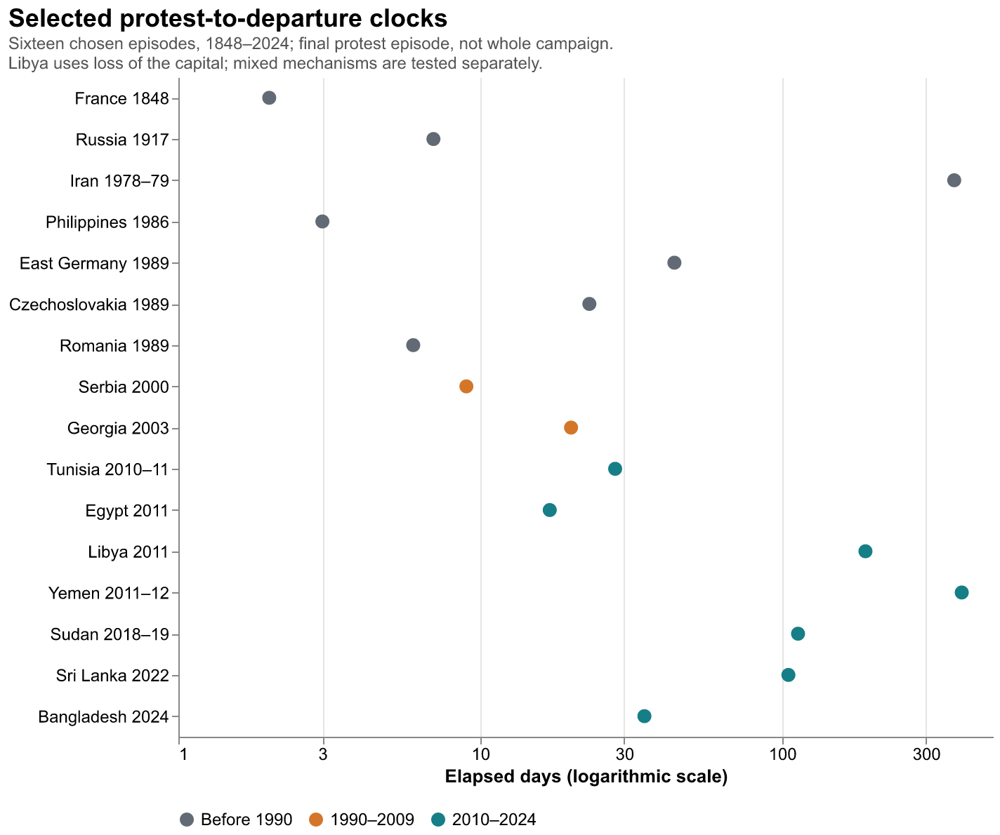
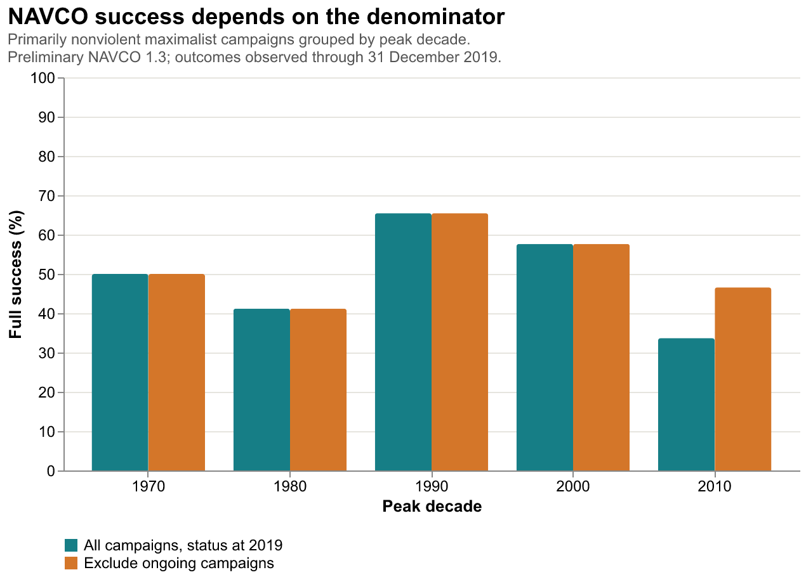

## The claim

### What was said

In [a post I wrote in May 2011](https://metaphorhacker.net/2011/05/the-natural-logistics-of-life-the-internet-really-changes-almost-nothing/), I compared the Velvet Revolution with the fall of Hosni Mubarak:

> The Egyptians have the Czechs beat in their demonstration to resignation time by 5 days (17 v 23).

I used that comparison to question the idea of a ‘Twitter revolution’. The broader claim was that faster communication changes little about the time people and institutions need to act: ‘the communication will happen at a human speed’.

### Where the number seems to come from

The post supplies its own endpoints. In Czechoslovakia, it starts with the student demonstration on 17 November 1989 and ends with President Gustáv Husák’s resignation on 10 December. In Egypt, it starts with the demonstrations on 25 January 2011 and ends with Mubarak’s resignation on 11 February. Those dates are supported by the [Czech Institute for the Study of Totalitarian Regimes](https://www.ustrcr.cz/uvod/listopad-1989/chronologie/) and the [Congressional Research Service’s contemporary account of Egypt](https://www.everycrsreport.com/files/20110211_RL33003_db7b105c210af3966a794ef1f73ba0268f00e7b4.html).

## The answer

### In short

**The two elapsed intervals were right. My subtraction was wrong: Egypt was six days quicker, not five.** Counting both the first and last dates adds a day to each interval and leaves the difference unchanged.

My warning against assuming that faster messages produce faster political change holds up. The stronger claim that communication technology made no difference went beyond the evidence. A comparison of two successful endings cannot establish that. Neither does the wider check below establish a fixed ‘human speed’.

### Communication and political outcomes need separate tests

A [survey by Zeynep Tufekci and Christopher Wilson](https://doi.org/10.1111/j.1460-2466.2012.01629.x) provides evidence about how protesters heard about and joined the Egyptian demonstrations. Among its respondents, face-to-face contact was the largest first source, but Facebook and telephones also mattered.

| First source of information about the protests | Share of respondents |
|---|---:|
| Face-to-face conversation | 48.4% |
| Facebook | 28.3% |
| Telephone | 13.1% |
| Satellite television | 4.0% |

The researchers retained 1,050 valid questionnaires. They used street recruitment followed by referrals, and could not establish how representative the sample was. These observations do not tell us how many days any medium saved. They do make it hard to treat digital communication as irrelevant, or to infer its role from the total time until a president left. They also do not isolate Twitter’s causal contribution.

## Dates depend on what counts as an ending

### Elapsed and inclusive days

| Episode | Start | End | Elapsed days | Both dates included |
|---|---|---|---:|---:|
| Czechoslovakia | 17 November 1989 | 10 December 1989 | 23 | 24 |
| Egypt | 25 January 2011 | 11 February 2011 | 17 | 18 |
| Difference | — | — | **6** | **6** |

Elapsed days means the end date minus the start date. The familiar description of Egypt’s ‘18 days’ uses inclusive counting. Mixing conventions could manufacture five, but it would conflict with the post’s stated 17-versus-23 comparison.

### A president leaving is one possible endpoint

The [Czech chronology](https://www.ustrcr.cz/uvod/listopad-1989/chronologie/) supplies several defensible dates, each answering a different question.

| Endpoint after 17 November | Date | Elapsed days |
|---|---|---:|
| Party leadership, including Miloš Jakeš, resigns | 24 November | 7 |
| Constitutional leading role of the Communist Party removed | 29 November | 12 |
| Husák resigns the presidency | 10 December | 23 |
| Václav Havel elected president | 29 December | 42 |

Husák’s departure was the endpoint I named. It was not the only moment at which we might say the regime fell. In Egypt, Mubarak transferred power to the army. Removing the incumbent, ending a political system and establishing a democracy are different outcomes.

## Selected exits do not establish a technology effect

### Sixteen explicitly chosen episodes

This is a small, selected set of well-known departures from the historical periods in the question. It is **not a representative sample of revolutions**. The clock starts at a named event in the final protest episode, which may follow years of organisation. Every start, endpoint and inclusion decision is recorded in the [checking material](https://github.com/techczech/research-snacks-data/tree/main/snacks/2026-11-19-revolution-speed-2011-redo).

| Episode and source | Chosen start | Chosen end | Elapsed days |
|---|---|---|---:|
| [France 1848](https://www2.assemblee-nationale.fr/decouvrir-l-assemblee/histoire/le-suffrage-universel/la-republique-et-le-suffrage-universel/1848-la-deuxieme-republique-met-en-place-le-suffrage-universel-masculin) | 22 February 1848, banquet protest | 24 February, abdication | 2 |
| [Russia 1917](https://history.state.gov/historicaldocuments/frus1917/d1454) | 8 March 1917, bread demonstrations | 15 March, abdication | 7 |
| [Iran 1978–79](https://www.iranicaonline.org/articles/chronology-of-iranian-history-part-4/) | 9 January 1978, Qom protest | 16 January 1979, Shah’s departure | 372 |
| [Philippines 1986](https://www.lawphil.net/executive/proc/proc1987/proc_59_1987.html) | 22 February 1986, final EDSA mobilisation | 25 February, loss of presidency | 3 |
| [East Germany 1989](https://www.hdg.de/lemo/jahreschronik/1989.html) | 4 September 1989, first Monday demonstration | 18 October, Honecker removed as party leader | 44 |
| [Czechoslovakia 1989](https://www.ustrcr.cz/uvod/listopad-1989/chronologie/) | 17 November 1989, student demonstration | 10 December, Husák resigns | 23 |
| [Romania 1989](https://1989.rrchnm.org/exhibits/unique-experience-of-romania/introduction.html) | 16 December 1989, Timișoara demonstrations | 22 December, Ceaușescu deposed | 6 |
| [Serbia 2000](https://www.rferl.org/a/1142249.html) | 27 September 2000, mass post-election rally | [6 October, concession](https://www.nonviolent-conflict.org/wp-content/uploads/2016/03/nonviolent_eng5.pdf) | 9 |
| [Georgia 2003](https://electionguide.org/elections/id/1372/) | 3 November 2003, resignation protests | 23 November, Shevardnadze resigns | 20 |
| [Tunisia 2010–11](https://2009-2017.state.gov/outofdate/bgn/tunisia/196390.htm) | 17 December 2010, trigger and local protests | 14 January 2011, Ben Ali flees | 28 |
| [Egypt 2011](https://www.everycrsreport.com/files/20110211_RL33003_db7b105c210af3966a794ef1f73ba0268f00e7b4.html) | 25 January 2011, protest day | 11 February, Mubarak resigns | 17 |
| [Libya 2011](https://digitallibrary.un.org/record/766468/files/A_HRC_19_68-EN.pdf) | 15 February 2011, Benghazi protest | 23 August, loss of Tripoli compound, **proxy** | 189 |
| [Yemen 2011–12](https://www.everycrsreport.com/files/20120410_RL34170_b67faa7e7c65c81c776612e3ed4c444d4fb80225.html) | 27 January 2011, large Sana’a demonstration | 25 February 2012, successor inaugurated | 394 |
| [Sudan 2018–19](https://spcommreports.ohchr.org/TMResultsBase/DownLoadPublicCommunicationFile?gId=24348) | 19 December 2018, protest wave | [11 April 2019, military removes al-Bashir](https://www.securitycouncilreport.org/monthly-forecast/2019-06/sudan-darfur-5.php) | 113 |
| [Sri Lanka 2022](https://www.ohchr.org/en/press-releases/2022/04/sri-lanka-un-experts-condemn-crackdown-protests) | 31 March 2022, presidential-residence protest | [14 July, resignation effective](https://www.parliament.lk/uploads/documents/minutesofparliament/1669809562054006.pdf) | 105 |
| [Bangladesh 2024](https://spcommreports.ohchr.org/TMResultsBase/DownLoadPublicCommunicationFile?gId=29229) | 1 July 2024, student protest wave | [5 August, Hasina flees](https://www.ohchr.org/sites/default/files/documents/countries/bangladesh/ohchr-fftb-hr-violations-bd.pdf) | 35 |

Some departures were quick long before mobile phones. That is a counterexample to the idea that rapid collapse requires social media. It does not establish that social media cannot accelerate a particular campaign.

### Changing the inclusion rule changes the comparison

The broad comparison gives longer median intervals after 1990. Removing armed and military cases changes the direction.

| Selection | Before 1990, n | Median days | 1990–2024, n | Median days |
|---|---:|---:|---:|---:|
| All selected departures and the Libya proxy | 7 | 7 | 9 | 35 |
| Exclude France, Russia, Romania, Libya and Yemen for armed revolt, mutiny or war | 4 | 33.5 | 7 | 28 |
| Also exclude Philippines’ military split and Sudan’s coup | 3 | 44 | 6 | 24 |

These exclusions are recorded judgements, not labels imported from a coup dataset. The [Powell–Thyne project](https://jonathanmpowell.com/coups/) distinguishes coups by attempts from within the state apparatus; protest followed by military removal needs special care. Even the last row leaves mixed mechanisms, including the army’s role in Egypt and elite replacement in East Germany.

The technology periods are also crude. Splitting the selected cases into three eras gives:

| Onset period | Selected episodes | Median days |
|---|---:|---:|
| Before 1990 | 7 | 7 |
| 1990–2009 | 2 | 14.5 |
| 2010–2024 | 7 | 105 |

Those periods do not measure access to telephones, the internet or a particular platform. **This check cannot distinguish a technology effect from case selection and political context.**

## Success became less common in NAVCO

### Count campaigns that did not win as well

A list of fallen leaders cannot tell us the chance that a movement succeeds. The [NAVCO 1.3 campaign list and codebook](https://doi.org/10.7910/DVN/ON9XND) provide a broader denominator. This preliminary release contains 622 campaigns, including 320 classified as primarily nonviolent. They pursue maximalist objectives such as regime change, independence or secession.

NAVCO’s full success requires achievement of the stated goals within a year of peak activity, with a direct campaign contribution. Its `EYEAR` field is the **peak year**, not an exact departure date. It therefore supports this success-rate check, but cannot supply comparable daily clocks.

| Peak decade | Campaigns | Full successes | Ongoing at end of 2019 | Success / all | Success / resolved only |
|---|---:|---:|---:|---:|---:|
| 1970s | 16 | 8 | 0 | 50.0% | 50.0% |
| 1980s | 34 | 14 | 0 | 41.2% | 41.2% |
| 1990s | 55 | 36 | 0 | 65.5% | 65.5% |
| 2000s | 59 | 34 | 0 | 57.6% | 57.6% |
| 2010s | 101 | 34 | 28 | 33.7% | 46.6% |

This broadly reproduces the decline described in [Erica Chenoweth’s 2020 article](https://www.journalofdemocracy.org/articles/the-future-of-nonviolent-resistance-2/). It does not reproduce every count in her analysis: the article describes a slightly different campaign total from this preliminary public file.

### Unfinished campaigns change the size of the decline

NAVCO codes ongoing campaigns as failures at its cutoff. In the 2010s row, excluding those cases changes 34 out of 101 to 34 out of 73. The decline remains relative to the 1990s and 2000s, but is smaller. Excluding unfinished cases also selects on how quickly campaigns resolve; neither denominator fixes unequal follow-up.

Grouping by onset instead of peak gives another check on the cutoff:

| Onset cohort | Campaigns | Full successes | Ongoing at end of 2019 | Success / all | Success / resolved only |
|---|---:|---:|---:|---:|---:|
| 2010–14 | 45 | 18 | 6 | 40.0% | 46.2% |

The checking material also repeats the analysis for regime-change campaigns alone. These are sensitivity checks, not evidence that internet use caused failure.

## Limits of this check

### What this does not show

The historical list was selected for this question. It combines local protest triggers, national mobilisation, resignation, abdication and loss of effective power. It has no common crowd-size threshold. Libya’s loss of the capital is explicitly a proxy. The exclusions can reverse the era comparison. There is no defensible causal estimate of days saved here, and no test of all the things humans do.

The [1989 chronology](https://libraries.indiana.edu/revolutions-1989-chronology) also includes Poland, Hungary and Bulgaria. They remain in the decision register, not the daily comparison: negotiated transitions and leadership changes do not yield the same protest-to-personal-exit clock. Ukraine’s [Orange Revolution](https://www.nonviolent-conflict.org/blog_post/resisting-stolen-elections-lessons-from-the-philippines-serbia-ukraine-and-gambia/) illustrates another boundary: defeating an attempted electoral succession is different from making an incumbent resign early. France is an illustration of 1848, not a census of that revolutionary wave.

NAVCO starts Egypt’s anti-Mubarak campaign in 2007. Its longer campaign is compatible with a seventeen-day final episode. Its classification of East Germany in 1989 and the Orange Revolution as limited successes also differs from an everyday list of ‘successful revolutions’. These definitions must remain visible. NAVCO’s observations end in 2019, so the recent case dates do not update its success rates.

[Archigos 4.1](https://rochester.edu/college/faculty/hgoemans/data.htm) supplies leadership histories only through 2015. It was inspected as a possible cross-check, but no Archigos merge or complete Mass Mobilization Project analysis was performed. No internet-penetration regression was performed. The era comparison cannot separate changes in communication from repression, organisation, wars or international support.

## How this was made

### Timeline

Research started at **11:19 UK time on 19 November 2026**. The agent read the complete 2011 post, checked its dates and obtained the NAVCO list and codebook. Initial calculations exposed the difference between counting ongoing campaigns as unsuccessful and excluding them.

The next checks concerned the clocks themselves: Georgia’s election day versus protest onset; Sri Lanka’s effective resignation versus its announcement; Yemen’s agreement, inauguration and handover; and the start of Bangladesh’s protests versus the later demand for the prime minister to leave. These were agent follow-up questions within the original brief. No additional human research question arrived before the draft snapshot.

The final timing and usage snapshot below ends at the saved draft. Build, browser checks and publication followed. Failed source requests and the selected alternatives remain in the private research record.

### Data and method

The agent transcribed and judged the historical boundaries, calculated Gregorian elapsed dates, compared era medians and changed inclusion rules. A second calculation counted NAVCO success by peak and onset cohorts, with and without unfinished campaigns and with a regime-change-only restriction. The checking repository reruns the arithmetic from saved inputs; it cannot independently validate a chosen historical boundary.

The NAVCO provider’s citation is reproduced verbatim in References. Its campaign list is published under CC0. Only limited factual observations from the chronologies and survey are shared; complete articles, PDFs and respondent data are withheld. The checking folder records the source terms, alternative clocks and excluded cases. Both charts have matching CSV and Vega-Lite downloads.

### Models, tools and tokens

| Model | Role | Calls / usage records | Tokens read | Tokens written |
|---|---|---:|---:|---:|
| Codex, gpt-6.1-sol | Research, calculations, charts, draft and self-review | 44 | 8,145,979 | 35,241 |

Snapshot: **2026-11-19 11:35:40 UTC**, 16.7 minutes after session start.

Tokens read include cached history already counted within the Codex input total; the cached subset is not added again. Counts cover this research session through the recorded snapshot, including its supplied context and tools. Output tokens include reasoning where the runtime reports it. The Claude transcript counter supplied by the site does not parse Codex records, so a small Codex adapter reads the session’s reported cumulative usage. Transcripts and account records are not published.

Other tools were web search, public-source downloads, Python, Poppler, Vega-Lite, vl-convert, Astro, bun, headless Chromium and Cloudflare Pages. The agent performed the source checks, calculations, draft and a separate self-review; no independent reviewer was used. Human time is an estimate for specifying the task, not a measured research session.
