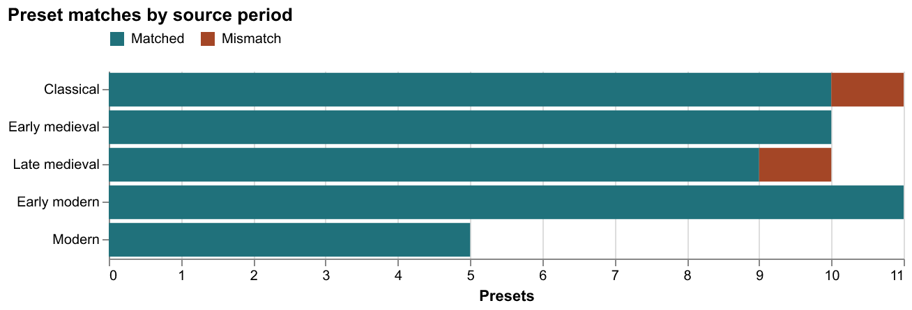

## The request

### What Dominik asked for

> a calculator for translating roman numerals across historical periods so that I can reliably enter a roman numeral and get various possible translations into arabic numerals depending on the likely period and possible idiosyncrasies

In the follow-up Dominik asked to publish it

> as a research snack with the calculator embedded and the research results ... as an illustration of how it is possible to make more complex tools based on evidence - report all the steps you took in response to the initial request and the follow up research - I want to illustrate both what is possible and also to help me and others understand the complexity behind roman numeral conversion which is why the tool should have many preset examples - run this by a very small model council

## The answer

### In short

Enter a numeral as written and choose its source period. Roman inscriptions sometimes subtract groups of letters. Medieval accounts can count in twenties. A horizontal bar can identify a number or multiply its value. The reader calculates the alternatives and shows the conventions each reading requires.

### Try the calculator

Enter `MCMXCIX`, `2026` or `Henry VIII`, or choose one of eight **Start here** examples. The answer card shows the leading reading with a short explanation. Open the reading details to compare alternatives, then open **Evidence and sources** on a reading to see what supports it. You can copy a reading and its references as a note.

Open **More tools** to choose a source period or date reckoning. The **Read as** menu also has **Passage** for texts with more than one numeral and **Chronogram** for dates made from selected letters. **Browse all examples** gives you 97 presets to filter by period, convention or origin. The glossary explains terms such as *vinculum* and *indiction*.

The reader has three layers for four kinds of reader. Someone checking a date on a building, film or clock can stop at the **answer**. Students and curious readers can open **readings** to see how the result changes with the convention. Researchers checking a transcription can open the **evidence**, follow the sources and keep a note.

[Open the Roman Numeral Reader full-page](/tools/roman-numeral-reader/ "Embed interactive tool")

## Why one numeral can have several values

### Subtract, add or multiply

In `IIX`, the two Is can act together. Subtract both from ten and you get 8. Subtract only the I immediately before X, then add the first I and you get 10. Add everything and you get 12. The reader puts 8 first in the Classical Roman period, where the form occurs in imperial titulature. [Egbert, pp. 72–77](https://upload.wikimedia.org/wikipedia/commons/4/47/Introduction_to_the_study_of_Latin_inscriptions_%28IA_cu31924075494371%29.pdf)

A bar over `V` can give 5,000 if it multiplies by a thousand, or leave the value at 5 if it identifies the character as a numeral. In `Mᵒiiijᶜlvj`, the raised o is an ordinal ending. The raised c multiplies the four immediately before it. The result is one thousand plus four hundred plus fifty-six. [Cappelli’s English translation, §§7.51–7.73](https://bms-du-chatillonnais.e-monsite.com/medias/files/latin-abreviations-medievales-pour-la-paleographie.pdf), [Cappelli’s German edition, p. 434](https://archive.org/stream/lexiconabbreviat00capp/lexiconabbreviat00capp_djvu.txt)

### A number and a date answer different questions

An Augsburg colophon uses `XCij` for the year 1492. The numeral itself can be read as 92. The century comes from other evidence in the book. For the Spanish era, the Córdoba epitaph's `DCLXXXIII` gives era year 683, which converts to 645 CE. An indiction, a position in a repeating 15-year cycle, gives several possible years if the range includes several cycles. [Pollard, p. 183](https://www.gutenberg.org/files/56628/56628-h/56628-h.htm), [Santiago Fernández, pp. 632–634](https://revistas.ucm.es/index.php/GERI/article/download/71951/4564456554709/4564456599554), [Cheney and Jones, pp. 1–5](https://assets.cambridge.org/97805217/70958/sample/9780521770958wsc00.pdf)

## Where the ratings come from

### What a rating is for

The same marks can produce several values, and the reader has to put them in some order. It uses a starting assumption, or prior, about how usual each convention was in the source period you choose. Open the readings to see the ratings next to each candidate. The source still determines which reading fits.

- **Typical** means usual in the period and kind of writing named in the evidence.
- **Attested** means the sources document it in that context.
- **Rare** means usage appears limited, or the evidence supports it as a possible exception.
- **Unlikely** means the available evidence gives reason to prefer a different reading.
- **No evidence found** means the search left the question open. The convention may still have been used.

If a reading needs more than one convention, its weakest convention sets its rating. For sorting, **no evidence found** has the same weight as **rare**. With no period selected, the reader uses each candidate’s best period rating.

### How the ratings were made

1. **09:31–09:38 GMT.** The coordinating model, Claude Opus 5.5, wrote the first ratings from general knowledge and marked them unverified in the reader. [First-version ratings](data/first-version-ratings.json)
2. **09:50–10:06.** GPT-6.2 Sol searched handbooks, editions and catalogues. It proposed a rating for each convention in each period and recorded citations and dated examples. [Proposed ratings](data/ratings.json), [Sourced examples](data/examples.json)
3. **10:08–10:28.** The model council reviewed the research proposals. The two completed reviews came back separately.
4. **10:35.** The coordinator compared the reviews and recorded decisions, including why a gap in searching should have its own label and why some ratings needed local or genre-specific notes. [Council reconciliation](data/council/reconciliation.md)
5. **10:42.** The build turned those decisions into a data file. Each reading links to the sources for the conventions it uses through **Evidence and sources**. [Convention data](data/conventions.json), [Reference register](data/references.json)

| Convention and period | First version | Revised | Why it changed |
|---|---|---|---|
| Repeated subtraction, Classical | Rare | Attested | Inscriptions support the forms `IIX` and `XIIX`. |
| Two numbers run together, all periods | Attested | No evidence found | A final j can mark the end of a numeral, but the research found too little support for treating it as a general separator. |
| Raised multiplier, late antiquity and early Middle Ages | Rare | No evidence found | The research found too little evidence for a rating in this period. |
| Omitted millennium, late Middle Ages | Typical | Attested | The reader permits the reading provisionally. The León fragment remains unverified, and several apparent examples spell out the thousand. |

The ratings are editorial judgements based on partial reading. Only two of the 43 listed references were read in full. No corpus counts underpin the ratings. A specialist should revise them as better examples or frequency evidence become available.

### What a model council is

A model council is a small panel of other AI models, drawn from different model families where possible, asked the same question independently. Here the council checked the research before it went into the reader so the research model would not grade its own work.

Each member got the research question, the same files and five tasks. Were the ratings supported? Could they check five claims against the sources? What was missing? Which additions belonged in the next build? What would a sceptical palaeographer object to? Members could not see each other’s answers. Gemini 4 Neon and Claude Haiku 5.5 completed the review. A seat started with Claude Sonnet 5.5 on the wrong plan and was cancelled before it answered. [Council packet](data/council/packet.md)

The panel gave advice. The coordinator compared the two answers, kept points both raised and decided each disagreement on the evidence, recording the reasons. Even when the models agreed, they could share an error, so the task included spot-checks against the sources. [Council reconciliation](data/council/reconciliation.md)

## What the council caught

### Changes to the readings and ratings

Claude Haiku 5.5 found that several proposed ratings of **typical** rested on at most one example in the relevant period. It also caught the mix-up between 196 and the document date 1231, and found no support for calling the late six Merovingian. [Haiku’s review](data/council/claude-haiku-5-5.md)

Gemini 4 Neon found that the reader applied the raised c in `Mᵒiiijᶜlvj` to the preceding thousand as well as to the four. It gave 100,456 instead of 1,456. Gemini also found evidence for W = VV in a [chronogram source already cited](https://www.maphistory.info/chronograms.html), flagged an unconfirmed `XLVIII` transcription and identified two unofficial book-copy links. [Gemini’s review](data/council/gemini-4-neon.md)

The build fixed the multiplier, removed the unconfirmed `XLVIII` preset and changed how gaps in the evidence are rated. It also distinguishes a bar that marks a number from one that multiplies it, and puts chronograms behind an explicit mode. [Council reconciliation](data/council/reconciliation.md)

## What the sources show across periods

### Five periods, different kinds of records

| Period used in the reader | Example | What the source adds |
|---|---|---|
| Classical Roman, to c. 300 CE | `ↀↀↀↀ C XLI` = 4,141 | Four old thousand signs give a distance in feet. The same inscription uses familiar subtraction in `XLI`. [RIB 2205](https://romaninscriptionsofbritain.org/inscriptions/2205) |
| Late antique and early medieval, c. 300–1000 | `ↅ` = 6 | An eighth-century specimen preserves the late six. The visually similar Unicode character `ↆ` stands for an early form of fifty. [Perry, fig. 16](https://www.unicode.org/wg2/docs/n3218.pdf) |
| High and late medieval, c. 1000–1500 | `IX.XX.XVI` = 196 | Nine scores plus sixteen. The document is dated 1231. This reading is reported through a secondary source the Haiku reviewer could not access. [Chrisomalis, table 4.13](https://www.cambridge.org/core/books/numerical-notation/4C3107573159D539D04DD7307423FA36) |
| Early modern, c. 1500–1800 | `Lxxxxj` = 91 | Terminal j is the last i in a Scottish inventory. The same record also uses subtractive notation in other amounts. [National Records of Scotland, document 4](https://scottishrecordsassociation.org/documents/NRS-Scottish_handwriting_self-help_kit-web.pdf) |
| Modern, 1800 onwards | `MDCCCCX` = 1910 | The Admiralty Arch inscription uses additive hundreds. Monumental lettering preserves a practice seen much earlier. [Royal Parks](https://www.royalparks.org.uk/visit/parks/st-jamess-park/monuments) |

### How ratings vary by period

These are some of the ratings the reader uses. A dash marks a gap in the evidence consulted.

| Selected convention in v2 | Classical | Early medieval | Late medieval | Early modern | Modern |
|---|---:|---:|---:|---:|---:|
| Additive fours and nines | 3 | 3 | 3 | 2 | 1 |
| Repeated subtraction | 2 | 1 | 2 | 1 | 0 |
| Raised multiplier | 0 | – | 3 | 2 | 0 |
| Counting in scores | 0 | – | 3 | 2 | 0 |
| Spanish-era reckoning, in Iberian documents | – | 3 | 2 | 0 | 0 |
| Chronograms, in deliberate letter-dates | – | – | 1 | 3 | 1 |

Even within a period, check the type of document. A 3 for counting in scores refers especially to French and British accounts and some French-language print. The Spanish-era ratings refer to Iberian inscriptions and charters. [Conventions and evidence notes](data/conventions.json)

### What the presets check

The reader returned the reported value somewhere among the candidates for **46 of 48 examples reported in sources**. The remaining 49 presets were constructed to illustrate conventions. They are outside this check.

The new sourced preset comes from the 1954 film *The Last Time I Saw Paris*. Its copyright notice reads `MCMXLIV`, or 1944. The example links to the film frame. [Copyright frame](https://www.copyrightdata.com/chart/LastParis.jpg)

| Preset | Reported value | Reader outputs | Where the reading breaks down |
|---|---:|---|---|
| `IIII CĐXI` | 4,411 | 113, 107, 411, 115 | The inscription needs a source-specific reading of the struck Đ and the implied thousands. [RIB 2208](https://romaninscriptionsofbritain.org/inscriptions/2208) |
| `IIIIˣˣ et huit` | 88 | 83, 86 | The four scores give 80 and the final eight is written out in French. The reader does not add the word as a number. [Chrisomalis, table 4.13](https://www.cambridge.org/core/books/numerical-notation/4C3107573159D539D04DD7307423FA36) |

## Limits of this check

### Partial reading and selected examples

The two references read in full were Scotland’s People’s date guide and the National Park Service’s Statue of Liberty page. Other records were consulted through passages, search excerpts, scans or catalogue entries. Haiku could not retrieve three sources on the day. The 14 presets that depend on those sources carry a note about that review. Gemini reported reaching some evidence Haiku could not. Neither review was by a human specialist. [Reference register](data/references.json), [Preset sources and access notes](data/examples.json)

The source material leans towards Roman inscriptions, English, Scottish and French records, Iberian inscriptions and early printing. Several presets come from one source. Matching a value checks coverage of the selected examples, including examples used to design the reader. It says little about which candidate should come first, how common a convention was, or whether the tool will read a fresh transcription correctly.

### The document supplies the context

The reader takes transcribed characters. Reading the strokes on a stone or manuscript, deciding which letters are highlighted, and identifying the date reckoning still require the source. Regional year starts and calendar reforms can change the modern date. Regnal years need a named ruler and a start rule. Byzantine Anno Mundi, automatically scored medieval letter numerals and prose amounts using words remain outside the tested reader.

## How this was made

### Timeline

Times are UK time (GMT), rounded to the minute. Searches and build work overlapped with coordination and review.

| Time | Step |
|---|---|
| 09:31 | Dominik asked for a calculator that offers several readings, with the period and the form of the numeral as clues. |
| 09:31–09:38 | Claude Opus 5.5 built a first reader from general knowledge and marked its period ratings unverified. It handled additive and subtractive readings, Unicode and marked forms, basic dates and chronograms. |
| 09:38–09:39 | The first 22 tests passed but the outputs exposed three judgement bugs. A reading that dropped the n in `xin` ranked 11 above the minim reading 13. A late medieval example put 75 CE first. The year 1075 appeared twice. The coordinator added a feature for dropped letters, checked period bounds and deduplicated years. The agent inspected a headless screenshot and committed the result. |
| 09:48 | Dominik asked for validation against sources, many presets, a small model council and this Research Snack. He approved work on regnal years, medieval letter numerals and passage reading. |
| 09:50–10:06 | GPT-6.2 Sol logged searches from 09:50. The coordinator’s log places the delegation at about 09:55 and the return at 10:05. The research reviewed 20 rules, retaining one vector, proposing 16 revisions and finding three generalisations unsupported. It assembled 48 examples, 45 references and 273 logged search or retrieval actions. The research commit followed at 10:06. [Search log](data/search-log.md), [Research findings](data/findings.md) |
| 10:08–10:16 | Gemini 4 Neon and Claude Sonnet 5.5 were given the same packet independently. At 10:15 Dominik said Claude models should run only on Claude plans. The Sonnet request had been routed via Google, so the coordinator cancelled it before an answer and sent the same packet to Claude Haiku 5.5 on Claude. At 10:16 Dominik confirmed Codex could be used freely and Haiku could take research tasks. [Council packet](data/council/packet.md) |
| 10:21 | Haiku returned its review. It challenged the ratings, noted three inaccessible sources behind 14 examples, corrected the 196/1231 mix-up and called for an explicit date selector. |
| 10:28 | Gemini returned its review. It reported six matches in eight source spot checks, flagged the multiplier bug and the unconfirmed `XLVIII`, and questioned several ratings of either zero or typical. |
| 10:29–10:35 | GPT-6.2 Sol started v2 at 10:29. The coordinator recorded the combined decisions at 10:35. Add explicit AUC, Spanish-era and indiction selectors. Give medieval letter numerals a sourced gloss. Offer a simple passage finder. Defer automatic regnal years and Byzantine Anno Mundi. |
| 10:42 | The v2 commit fixed the multiplier, distinction bar, framed apostrophus, dotted scores, and the treatment of W in chronograms and the two historic signs for fifty and six. The build included 84 presets. It passed 40 regression and data checks and matched 45 of 47 reported examples. The agent checked file and iframe use headlessly at phone and desktop widths. |
| 10:42 | Dominik asked how the reader could serve quick converters, students, researchers and people curious about numerals. |
| 10:43–10:54 | GPT-6.2 Sol drafted the article, packaged the v2 checking data, generated the chart and checked the first preview headlessly. |
| 10:44 | Dominik chose the first option. It put a short answer, Arabic-to-Roman conversion, names with numerals, everyday examples, a glossary and copyable notes in this build. Practice exercises and list conversion could wait. |
| 10:45 | Dominik confirmed that the snack should help people understand numerals and that the embedded reader should ease them into more detail. |
| 10:45–10:56 | GPT-6.2 Sol built v3 with an answer card, eight starter examples and a gradual reveal of readings and evidence. It added 12 constructed examples and the sourced film misprint. Node passed 44 of 44 checks and the builder’s headless run passed 72 of 72 assertions. The reader matched 46 of 48 reported examples. It had 97 presets in all, including 49 constructed examples. |
| From 10:57 | GPT-6.2 Sol swapped in the committed v3 reader, updated this article and chart, and regenerated the checking package for the revised preview. |
| 11:58 | Dominik asked for a clearer explanation of the ratings, their purpose and the model council. GPT-6.2 Sol added that account, reconciled the bibliography with the reader, linked the film example to the copyright frame and fixed the embed spacing and phone placeholder. |

### Data and method

The research judgement steps were selecting sources and examples, transcribing or normalising signs, identifying the date of the writing and the date or quantity the writing refers to, mapping each case to a period and convention, and assigning ratings. The council checked some of those choices and the coordinator reconciled the reviews. The source register records the part consulted for each work.

The engine calculates candidate values and merges equivalent readings. The check reruns each documented preset with its saved settings and asks whether the documented value appears. The checking repository preserves the v3 reader, its settings and all expected and returned values. The chart counts presets by period and outcome.

### Models, tools and tokens

| Model | Role | Calls | Tokens read | Tokens written |
|---|---|---:|---:|---:|
| Claude Opus 5.5 | Coordinator and first build | 59 | 9,907,999 | 88,657 |
| GPT-6.2 Sol | Source research | not measured | not measured | not measured |
| Claude Haiku 5.5 | Council review | not measured | not measured | not measured |
| Gemini 4 Neon | Council review | not measured | not measured | not measured |
| Claude Sonnet 5.5 | Cancelled council seat | not measured | not measured | not measured |
| GPT-6.2 Sol | v2 build and checks | 29 | 3,130,079 | 33,706 |
| GPT-6.2 Sol | v3 audience update and checks | 37 | 4,081,499 | 30,752 |
| GPT-6.2 Sol | Article, checking package and revisions, pre-deployment snapshot | 63 | 10,265,890 | 38,413 |

The Claude Code count covers the coordinator’s available session log. The Codex v2 and v3 counts cover their respective runs. The article count is a snapshot before the revised preview deployment. These counts exclude separate approval-review sessions. Tokens read include cached history. The table gives the available counts, so it is not a project-wide token total. Other research tools were web search and source retrieval, JavaScript and Node.js for the reader and tests, Python for the comparison tables, and Vega-Lite and vl-convert for the chart.
