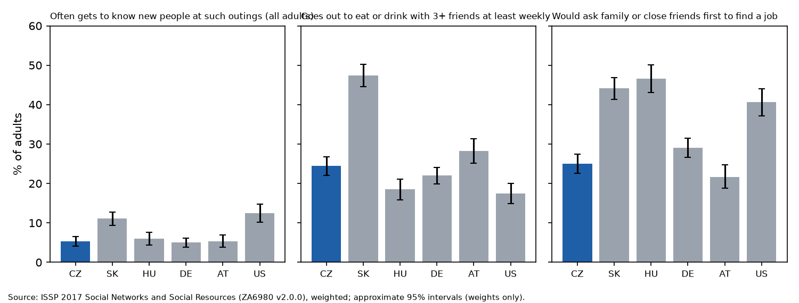

## The claim

### What the guides say

Dominik keeps a set of old culture guides for visitors to the Czech Republic. He wrote some of the material himself and collected the rest; parts go back to the 1990s, and he used them again in a 2023 briefing. The guides are private, so this page paraphrases them rather than quoting them.

The guides make many claims. Dominik picked three that a values survey could test:

1. Czechs take part in professional and interest groups less than Americans and West Europeans.
2. The boundary between people Czechs know and strangers is strong, and friendships take a long time to form.
3. Women work, but are still expected to carry the family, and few reach leadership.

He chose to compare Czechia with the United States, Canada and the neighbouring countries, and later added Hungary and Ukraine.

### Where the claims come from

The guides do not cite surveys. They describe the experience of foreigners living in the country. Most of what they say about etiquette (greetings, shoes indoors, tipping) is outside what any of these surveys ask.

## The answer

### In short

- **Women as leaders: the claim holds.** In three surveys Czechs say men make better political or business leaders far more often than Germans, Austrians, Americans or Canadians.
- **Strangers: the claim needed restating.** Czechs do not report less trust in strangers than Americans, Austrians or Germans. When Dominik looked at the trust result, he said that the guides meant something else: how readily people make friends, share and start working with people outside their circle. The closest survey measure is about going out with groups of friends. Czechs do that, and meet new people there, less often than Slovaks or Americans, and about as often as Germans and Austrians.
- **Groups: the claim holds against the US, Germany and Canada in the 2022 survey.** The 2017 survey asks the question differently and puts Czechia close to Germany and Austria.

### The two values surveys disagree

Czechia was surveyed by the European Values Study (EVS) in 2017 and by the World Values Survey (WVS) in 2022. On several questions the two give very different answers. The Czech questionnaires show changes in wording or in how the question was asked for most of these items (see [Wording changes the answer](#wording-changes-the-answer)). Because of this, the tables below show the two surveys separately and compare countries only within the same survey.

## Women and leadership

### Leaders and jobs

| European Values Study, % agreeing | Czechia 2017 | Slovakia 2017 | Poland 2017 | Germany 2017 | Austria 2018 |
|---|---:|---:|---:|---:|---:|
| men make better political leaders | 41 | 52 | 30 | 10 | 20 |
| men should have more right to a job when jobs are scarce | 22 | 37 | 24 | 7 | 14 |
| children suffer when the mother works | 32 | 37 | 51 | 34 | 47 |

| World Values Survey, % agreeing | Czechia 2022 | Slovakia 2022 | Germany 2018 | US 2017 | Canada 2020 |
|---|---:|---:|---:|---:|---:|
| men make better political leaders | 50 | 49 | 8 | 16 | 15 |
| men should have more right to a job when jobs are scarce | 27 | 42 | 9 | 5 | 6 |
| children suffer when the mother works | 32 | 25 | 29 | 21 | 21 |

Weighted percentages agreeing or strongly agreeing. The jobs item is collapsed to agree, neither or disagree. Both Czech versions of the working-mother item ask about children in general; the master questionnaire mentions pre-school children.

Czechs and Slovaks give similar answers about political leaders. On jobs, Slovaks are about 15 points more traditional than Czechs in both surveys.

A third source agrees. In the ISSP 2022 survey on family and gender roles, 26% of Czechs say men are better suited to serve in the national government and 31% to be a senior executive of a large company. The figures are 8–14% in Germany, Austria and the US, 44–49% in Slovakia and 17–19% in Poland.

The working-mother question is the exception: Czechs agree less often than Austrians or Poles.

## Making friends and working with strangers

### Trust is not the same as reserve

| European Values Study, % trusting completely or somewhat | Czechia | Slovakia | Poland | Hungary | Ukraine | Germany | Austria |
|---|---:|---:|---:|---:|---:|---:|---:|
| people met for the first time | 37 | 33 | 27 | 39 | 21 | 30 | 40 |
| people of another nationality | 45 | 41 | 51 | 57 | 46 | 63 | 59 |

| World Values Survey, % trusting completely or somewhat | Czechia | Slovakia | Ukraine | Germany | US | Canada |
|---|---:|---:|---:|---:|---:|---:|
| people met for the first time | 39 | 30 | 29 | 35 | 40 | 50 |
| people of another nationality | 46 | 43 | 50 | 64 | 74 | 82 |

In both surveys Czechs report trusting people they meet for the first time at least as often as Germans, and as often as Americans or Austrians. They report trusting people of another nationality less often than Germans, Austrians or North Americans.

### Going out and meeting new people

The ISSP 2017 survey on social networks asks about behaviour. One question asks how often people go out to eat or drink with three or more friends or acquaintances who are not family. The next asks how often they get to know new people on those occasions. The survey covers Czechia, Slovakia, Hungary, Germany, Austria and the US, but not Poland, Canada or Ukraine.

| ISSP 2017, % of adults | Czechia | Slovakia | Hungary | Germany | Austria | US |
|---|---:|---:|---:|---:|---:|---:|
| Goes out to eat or drink with three or more friends at least weekly | 25 | 47 | 19 | 22 | 28 | 17 |
| Often or very often gets to know new people at such outings | 5 | 11 | 6 | 5 | 5 | 13 |
| Takes part in leisure, sport or culture group activities at least monthly | 32 | 39 | 22 | 43 | 40 | 32 |
| Would turn first to family or close friends for help finding a job | 25 | 44 | 47 | 29 | 22 | 41 |

The second row counts people who never go out as not meeting new people; among those who do go out, the figures are 6, 12, 8, 5, 6 and 15.

Czechs meet new people at these outings less often than Americans or Slovaks, which fits the guides' comparison with Americans. On this and on going out, Czechs answer like Germans and Austrians. The other two measures point elsewhere: Czechs take part in group activities less often than Germans or Austrians, about as often as Americans, and fewer turn first to family or close friends for job help than in Slovakia or Hungary.

### Groups and joint action

| European Values Study, % of adults | Czechia | Slovakia | Poland | Hungary | Ukraine | Germany | Austria |
|---|---:|---:|---:|---:|---:|---:|---:|
| Belongs to at least one civic group | 54 | 16 | 18 | 25 | 16 | 62 | 48 |
| Belongs to two or more civic groups | 28 | 3 | 5 | 11 | 6 | 29 | 19 |
| Has ever signed a petition, joined a boycott or attended a lawful demonstration | 48 | 42 | 40 | 21 | 16 | 70 | 62 |

| World Values Survey, % of adults | Czechia | Slovakia | Ukraine | Germany | US | Canada |
|---|---:|---:|---:|---:|---:|---:|
| Belongs to at least one civic group | 25 | 37 | 30 | 64 | 64 | 55 |
| Belongs to two or more civic groups | 9 | 18 | 17 | 32 | 46 | 34 |
| Has ever signed a petition, joined a boycott or attended a lawful demonstration | 24 | 49 | 22 | 73 | 64 | 73 |

Civic groups here are eight types of organisation, excluding churches, unions and parties. The World Values Survey counts active and inactive members together.

The two surveys tell different stories for Czechia. In the 2022 World Values Survey, Czechs belong to groups and take part in joint public action far less often than Germans, Americans or Canadians, and less often than Slovaks. In the 2017 European Values Study, Czechs are close to Germany and Austria on membership and well above Slovakia, Poland and Hungary. The two surveys asked about membership in different ways (see [Wording changes the answer](#wording-changes-the-answer)).

## Family and work

### Duties to family

| European Values Study, % agreeing | Czechia | Slovakia | Poland | Hungary | Germany | Austria |
|---|---:|---:|---:|---:|---:|---:|
| When a parent is ill long term, it is the adult child's duty to look after them | 70 | 73 | 74 | 60 | 45 | 41 |
| Lives with own parents or parents-in-law | 16 | 23 | 27 | 23 | 13 | 13 |

| World Values Survey, % agreeing | Czechia | Slovakia | Germany | US | Canada |
|---|---:|---:|---:|---:|---:|
| Adult children have the duty to provide long-term care for their parents | 55 | 59 | 48 | 40 | 36 |
| Lives with own parents or parents-in-law | 15 | 16 | 10 | 11 | 14 |

In the ISSP 2017, 75% of Czechs agree that adult children have a duty to look after elderly parents, against 79% of Slovaks, 55% of Germans and 51% of Austrians. In the ISSP 2022, 56% of Czechs say they can rely more on close relatives than on close friends, close to Slovakia (58%) and Croatia (58%) and well above Germany (32%) and Austria (34%).

On duties to parents Czechs agree slightly less often than Slovaks in all three surveys and much more often than Germans or Austrians.

### Duties to work

| European Values Study, % agreeing | Czechia | Slovakia | Poland | Hungary | Ukraine | Germany | Austria |
|---|---:|---:|---:|---:|---:|---:|---:|
| Work is a duty towards society | 60 | 66 | 74 | 69 | 43 | 78 | 74 |
| People who don't work turn lazy | 78 | 79 | 82 | 79 | 66 | 60 | 57 |

| World Values Survey, % agreeing | Czechia | Slovakia | Ukraine | Germany | US | Canada |
|---|---:|---:|---:|---:|---:|---:|
| Work is a duty towards society | 49 | 58 | 40 | 75 | 59 | 54 |
| People who don't work turn lazy | 68 | 79 | 64 | 56 | 44 | 40 |

Fewer Czechs than Slovaks, Poles, Hungarians, Germans or Austrians call work a duty towards society; only Ukrainians agree less often. Yet most Czechs agree that people who don't work turn lazy, as Slovaks, Poles and Hungarians do.

## Wording changes the answer

### What the Czech questionnaires say

| Question | Czech EVS 2017 | Czech WVS 2022 | Czech answers |
|---|---|---|---:|
| Hard work as a quality for children | "pracovitost" (industriousness) | "tvrdá práce" (hard work; the phrase can suggest toil) | 81% → 23% |
| Having children and society | "zodpovědnost" (a responsibility) | "povinnost" (a duty or obligation) | 58% → 28% |
| Caring for parents | duty to look after a parent who is ill long term | duty to provide long-term care for parents | 70% → 55% |
| Group membership | show card: which of these do you belong to? | read out one by one: active member, inactive member or not a member | 54% → 25% |

The Slovak WVS 2022 questionnaire uses "pracovitosť" for hard work, and 63% of Slovaks chose it.

The questionnaires show that the wording or the format changed. They cannot show how much of each gap the change caused.

Two more points:

- In the Czech EVS 2017, 18% of respondents have more than five child qualities recorded, although the questionnaire asked for at most five. Among those with five or fewer, 78% chose hard work, which still leaves a gap of about 55 points to 2022.
- The general trust question is framed differently. Both Czech values surveys contrast trusting most people with having to be very careful in dealing with people. The Czech ISSP 2017 version offers four answers from "people can almost always be trusted" to "people can almost never be trusted", without the caution framing of the English original. The Czech figures are 22% (EVS 2017, trusting answer), 37% (WVS 2022, trusting answer), 59% (ISSP 2017, almost always or usually) and 50% (ESS 2021, 6–10 on a 0–10 scale). The framing is a possible explanation for the high ISSP figure; it was not tested.

### Change or wording?

If a gap comes from wording, it should be about the same size in every group of people. For hard work (52 to 62 points), duty to have children (25 to 33 points) and group membership (26 to 32 points), the gap between 2017 and 2022 is similar across age and education groups. For trust and for the duty to care for parents, the gap varies between groups, so part of it may be real change. The Czech WVS interviews took place between 11 February and 13 May 2022; 101 of the 1,200 interviews were done before the Russian invasion of Ukraine on 24 February.

## Limits of this check

- These are national averages. They say nothing about any individual Czech, and the differences within each country are larger than those between countries.
- The surveys ask about attitudes and a few reported behaviours. The ISSP outing question covers one kind of occasion; none of these surveys observes how people actually behave with strangers or how readily they start working together.
- Countries are compared only within the same survey. Surveys were carried out in different years and modes (see [Data and method](#data-and-method)), and the US and Canadian WVS samples answered mostly online.
- The ISSP 2017 module does not cover Poland, Canada or Ukraine; Hungary and Ukraine are not neighbours of Czechia but were added for regional context.
- The intervals in the charts account for the survey weights only, not for clustering or stratification, so they are approximate. Overlapping intervals do not show that two countries are the same.
- The translation findings rest on reading the Czech and Slovak questionnaires. The German, Austrian, Polish and English versions were not compared item by item.
- Each guide claim was turned into survey items by judgement. A different choice of items could give a different picture.
- The guides contain material written by other people, some of it from the 1990s. This page tests the claims, not who made them.

## How this was made

### Timeline

All times UK time (GMT).

- **21–22 November, scoping (not measured here):** an agent searched for the guides, wrote a short map of the main models of national culture, and matched claims in the guides to survey questions. Dominik picked group membership, trust and gender roles.
- **22 November 01:14:** Dominik chose the countries: the US, Canada and the neighbours.
- **01:18–01:22:** Dominik downloaded the joint EVS/WVS and ESS files.
- **01:24–01:27:** first weighted tables for the three claims.
- **08:57:** Dominik restated the friendship claim: it was about patterns of contact and cooperation, not trust. He added Hungary and Ukraine.
- **08:59:** he asked about duties to family and work.
- **09:04:** he asked for the disagreements to be checked against the question wording, including the Czech translations.
- **09:06–09:14:** Dominik downloaded the ISSP 2017 and 2022 files and the Czech and Slovak EVS questionnaires; the agent downloaded the WVS questionnaires and the Czech WVS technical report.
- **09:27–09:34:** Codex reviewed the scripts and claims; it reproduced every table and found errors in the membership measure, the description of the outing question and the labelling of surveys, all corrected here.

### Data and method

| Survey | Fieldwork used here | Mode |
|---|---|---|
| European Values Study 2017 | CZ, SK, PL 2017; DE 2017–18; AT, HU 2018; UA 2020 | face to face; Germany also web and mail |
| World Values Survey wave 7 | US 2017; DE 2018; CA, UA 2020; CZ, SK 2022 | CZ face to face (CAPI); US mainly and Canada entirely web |
| ISSP 2017 Social Networks | CZ, SK, HU 2017; DE, AT, US 2018 | CZ face to face; DE mainly self-completion |
| ISSP 2022 Family and Gender Roles | CZ, SK, PL, US 2022; DE, AT 2023; HR 2024 | as documented by each country |
| European Social Survey round 10 | CZ July–September 2021 | face to face |

- All figures are weighted percentages of adults with valid answers ("don't know" and no answer excluded). Weights: `gwght` (EVS/WVS), `anweight` (ESS), `WEIGHT` (ISSP 2017), `WEIGHT_COM` (ISSP 2022).
- Membership uses every respondent who can be classified: a yes if they named enough groups, a no only if their missing answers could not change the result.
- Judgement steps: which survey items stand for each guide claim; collapsing strongly agree and agree; which organisation types count as civic groups; treating 1–3 on the ISSP 2022 seven-point scale as leaning towards relatives.
- The survey microdata are not redistributed. Derived tables, the code and the item definitions will be published in the data repository before this page goes live.

### Models, tools and tokens

| Model | Role | Calls | Tokens read | Tokens written |
|---|---|---:|---:|---:|
| claude-opus-5-5 | analysis, questionnaire reading, drafting | 139 | 26,080,258 | 111,346 |
| claude-sonnet-5-5 | survey coverage check | 12 | 796,323 | 6,833 |
| gpt-6.2-sol (Codex) | independent review of scripts and claims | – | – | – |

Claude counts cover the Claude Code session of 22 November from 01:14 to 09:37 UK time, from `scripts/session-usage.py`. Tokens read include the cached conversation history re-read on each call. The earlier scoping session and the Codex review's usage are not included yet.

Other tools: Python with pandas and matplotlib for the analysis, pdftotext for the questionnaires, Vega-Lite for the interactive charts.
