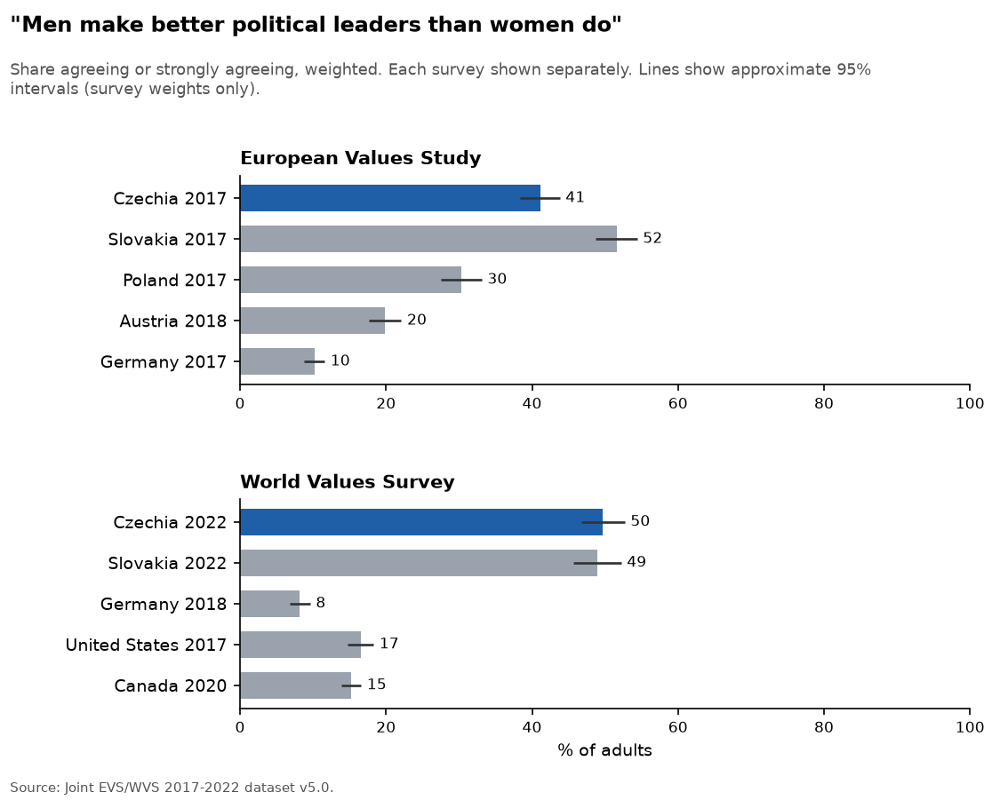

## The claim

### What the guides say

Dominik keeps a set of old culture guides for visitors to the Czech Republic. He wrote some of the material himself and collected the rest; parts go back to the 1990s, and he used them again in a 2023 briefing. The guides are private, so this page paraphrases them rather than quoting them. They describe the experience of foreigners living in the country and do not cite surveys.

Dominik picked three claims that a values survey could test:

1. Czechs take part in professional and interest groups less than Americans and West Europeans.
2. The boundary between people Czechs know and strangers is strong, and friendships take a long time to form.
3. Women work, but are still expected to carry the family, and few reach leadership.

He chose to compare Czechia with the United States, Canada and the neighbouring countries, and later added Hungary and Ukraine.

## The answer

### In short

- **Women and family: the claim holds for attitudes.** In three surveys Czechs say men make better leaders far more often than Germans, Austrians or Americans, and in the ISSP 2022 38% agree that earning money is a man's job and looking after the home a woman's, against 8% in Germany. The surveys measure attitudes, not how many women actually lead.
- **Strangers: the claim needed restating.** Czechs trust people they meet for the first time about as much as Americans do. When Dominik saw that result, he said the guides meant something else: how readily people make friends and start working with people outside their circle. The closest survey measure is about going out with friends. Czechs do that more often than Americans, but only 5% often meet new people there, against 12% of Americans.
- **Groups: open.** The 2022 World Values Survey puts Czechs far below Germans and Americans; the 2017 European Values Study puts them close to Germany. The surveys asked differently, and this check cannot say which is right.

Countries are compared only within the same survey, because the 2017 and 2022 values surveys often give different answers for Czechia (see [The surveys disagree](#the-surveys-disagree)).

## Women and leadership

Czechs and Slovaks give similar answers in both values surveys, far above Germany, Austria, the US and Canada, with Poland in between. The ISSP 2022 survey on family and gender roles asks related questions:

| ISSP 2022, % agreeing | Czechia | Slovakia | Poland | Hungary | Germany | Austria | US |
|---|---:|---:|---:|---:|---:|---:|---:|
| Men are better suited than women to serve in the national government | 26 | 44 | 17 | 31 | 9 | 13 | 8 |
| Men are better suited than women to be senior executives of large companies | 31 | 49 | 19 | 37 | 11 | 14 | 8 |
| A man's job is to earn money; a woman's job is to look after the home and family | 38 | 52 | 30 | 44 | 8 | 16 | 15 |

One item points the other way. Asked whether children suffer when their mother works, Czechs agree less often than Austrians or Poles in the European Values Study (32% against 47% and 51%).

## Making friends and working with strangers

### Trust is not the same as reserve

In the World Values Survey, 39% of Czechs trust people they meet for the first time completely or somewhat, against 35% of Germans and 40% of Americans. In the European Values Study the figure is 37%, against 30% of Germans and 40% of Austrians. People of another nationality are different: 45–46% of Czechs trust them, against 59–64% of Germans and Austrians and 74–82% of Americans and Canadians.

### Going out and meeting new people

The ISSP 2017 survey on social networks asks how often people go out to eat or drink with three or more friends or acquaintances who are not family, and how often they get to know new people on those occasions. It covers Czechia, Slovakia, Hungary, Germany, Austria and the US.

| ISSP 2017, % of adults | Czechia | Slovakia | Hungary | Germany | Austria | US |
|---|---:|---:|---:|---:|---:|---:|
| Goes out to eat or drink with three or more friends at least weekly | 25 | 47 | 19 | 22 | 28 | 17 |
| Often or very often gets to know new people at such outings | 5 | 11 | 6 | 5 | 5 | 13 |
| Takes part in leisure, sport or culture group activities at least monthly | 32 | 39 | 22 | 43 | 40 | 32 |

The second row counts people who never go out as not meeting new people; among those who go out, the figures are 6, 12, 8, 5, 6 and 15.

Czechs go out with groups of friends more often than Americans, but meet new people there less than half as often. That fits the guides' picture of a closed circle when compared with Americans. Against Germans and Austrians, Czechs answer much the same.

## Groups and joint action

| % of adults | Belongs to a civic group, EVS | Belongs to a civic group, WVS | Has taken part in joint public action, EVS | Has taken part in joint public action, WVS |
|---|---:|---:|---:|---:|
| Czechia | 54 | 25 | 48 | 24 |
| Slovakia | 16 | 37 | 42 | 49 |
| Poland | 18 | – | 40 | – |
| Hungary | 25 | – | 21 | – |
| Ukraine | 16 | 30 | 16 | 22 |
| Germany | 62 | 64 | 70 | 73 |
| Austria | 48 | – | 62 | – |
| US | – | 64 | – | 64 |
| Canada | – | 55 | – | 73 |

Civic groups are eight types of organisation, excluding churches, unions and parties; the World Values Survey counts active and inactive members together. Joint public action means having ever signed a petition, joined a boycott or attended a lawful demonstration. EVS fieldwork ran from 2017 to 2020 and WVS from 2017 to 2022; Czechia was surveyed in 2017 (EVS) and 2022 (WVS).

In the 2022 World Values Survey, Czechs belong to groups and take part in joint action far less often than Germans, Americans or Canadians. In the 2017 European Values Study, Czechs are close to Germany and Austria. The Czech 2017 figure is itself uncertain: 10.5% of Czech respondents could not be classified, and counting them all as members or all as non-members moves the figure between about 49% and 59%.

The two surveys asked differently. The European Values Study showed a card and asked which groups people belong to; the World Values Survey read each organisation out and asked whether the person is an active member, an inactive member or not a member. That difference does not explain the Czech drop, though: Slovakia and Ukraine went the other way, from 16% to 37% and 30%. Which Czech figure is closer to the truth stays open.

## Family and work

This section compares countries only within one survey, and leaves out family items whose Czech wording changed between the two values surveys (see below).

| % agreeing | Czechia | Slovakia | Poland | Hungary | Germany | Austria | US |
|---|---:|---:|---:|---:|---:|---:|---:|
| Adult children have a duty to look after elderly parents (ISSP 2017) | 75 | 79 | – | 60 | 55 | 51 | 73 |
| Can rely more on close relatives than on close friends (ISSP 2022) | 56 | 58 | 42 | 48 | 32 | 34 | 46 |
| Work is a duty towards society (EVS 2017–18) | 60 | 66 | 74 | 69 | 78 | 74 | – |

Czechs see duties to parents much as Slovaks and Americans do, and far more strongly than Germans or Austrians. Fewer Czechs than their neighbours call work a duty towards society. In the World Values Survey, which uses the same Czech wording, the Czech figure is 49%, against 58% in Slovakia, 75% in Germany and 59% in the US.

### The surveys disagree

On several family items the 2017 and 2022 Czech values surveys give very different answers, and the Czech wording changed between them:

| Question | Czech EVS 2017 | Czech WVS 2022 | Czech answers |
|---|---|---|---:|
| Hard work as a quality for children | "pracovitost" (industriousness) | "tvrdá práce" (hard work; can suggest toil) | 81% → 23% |
| Having children and society | "zodpovědnost" (a responsibility) | "povinnost" (a duty) | 58% → 28% |
| Caring for parents | duty to look after a parent who is ill long term | duty to provide long-term care for parents | 70% → 55% |

These items are left out of the comparisons above. The questionnaires show that the wording changed; they cannot show how much of each gap the change caused, and other things changed too, including the year and the start of the Russian invasion of Ukraine during the Czech 2022 fieldwork. How values surveys translate the same question into Czech, Slovak, Polish and other languages is worth a check of its own.

## Limits of this check

- These are national averages of attitudes and a few reported behaviours. They say nothing about any individual Czech, and none of these surveys observes how people actually behave with strangers.
- Surveys were carried out in different years and modes (see [Data and method](#data-and-method)); the US and Canadian WVS samples answered mostly online, the Czech ones face to face.
- The intervals in the charts account for the survey weights only, not for clustering or stratification, so they are approximate. Overlapping intervals do not show that two countries are the same.
- Each guide claim was turned into survey items by judgement. A different choice of items could give a different picture.
- The guides contain material written by other people, some of it from the 1990s. This page tests whether the claims fit recent survey answers, not whether they were true when written or who made them.

## How this was made

### Timeline

All times UK time (GMT).

- **21–22 November, scoping (not measured here):** an agent searched the guides and matched their claims to survey questions. Dominik picked group membership, trust and gender roles, and chose the countries.
- **22 November 01:14–01:27:** Dominik downloaded the joint EVS/WVS and ESS files; first weighted tables.
- **08:57–09:14:** Dominik restated the friendship claim as being about contact and cooperation, not trust, added Hungary and Ukraine, and asked about duties to family and work and about the Czech question wording. He downloaded the ISSP files and the Czech EVS questionnaire; the agent downloaded the WVS questionnaires and the Czech WVS technical report.
- **09:27–09:45:** Codex reviewed the scripts and claims, reproduced every table and found errors in the membership measure, the description of the outing question and the labelling of surveys. All were corrected.
- **14:55–15:05:** Gemini 4 Neon and GPT-6.2 Astra reviewed the draft independently. Both found that it had reversed the Czech–US comparison on going out, and both asked for a shorter page and clearer charts.
- **24 November 07:49:** Dominik decided to drop the family items whose wording differs between surveys and to leave translation for a separate check. The page was revised.

### Data and method

| Survey | Fieldwork used here | Mode |
|---|---|---|
| European Values Study 2017 | CZ, SK, PL 2017; DE 2017–18; AT, HU 2018; UA 2020 | face to face; Germany also web and mail |
| World Values Survey wave 7 | US 2017; DE 2018; CA, UA 2020; CZ, SK 2022 | CZ face to face; US mainly and Canada entirely web |
| ISSP 2017 Social Networks | CZ, SK, HU 2017; DE, AT, US 2018 | CZ face to face; DE mainly self-completion |
| ISSP 2022 Family and Gender Roles | CZ, SK, PL 2022; US 2022–23; DE, AT, HU 2023 | as documented by each country |

- All figures are weighted percentages of adults with valid answers ("don't know" and no answer excluded). Weights: `gwght` (EVS/WVS), `WEIGHT` (ISSP 2017), `WEIGHT_COM` (ISSP 2022).
- Membership uses every respondent who can be classified: a yes if they named at least one group, a no only if their missing answers could not change the result.
- Judgement steps: which survey items stand for each guide claim; collapsing strongly agree and agree; which organisation types count as civic groups; treating 1–3 on the ISSP 2022 seven-point scale as leaning towards relatives.
- The survey microdata are not redistributed. Derived tables, the code and the item definitions will be published in the data repository before this page goes live.

### Models, tools and tokens

| Model | Role | Calls | Tokens read | Tokens written |
|---|---|---:|---:|---:|
| claude-opus-5-5 | analysis, questionnaire reading, drafting | 139 | 26,080,258 | 111,346 |
| claude-sonnet-5-5 | survey coverage check | 12 | 796,323 | 6,833 |
| gpt-6.2-sol (Codex) | review of scripts and claims | – | – | – |
| gemini-4-neon, gpt-6.2-astra | review of the draft | – | – | – |

Claude counts cover the Claude Code session of 22 November from 01:14 to 09:37 UK time. Tokens read include the cached conversation history re-read on each call. The scoping session, the reviews and the 24 November revision are not included yet.

Other tools: Python with pandas and matplotlib for the analysis, pdftotext for the questionnaires, Vega-Lite for the interactive charts.
