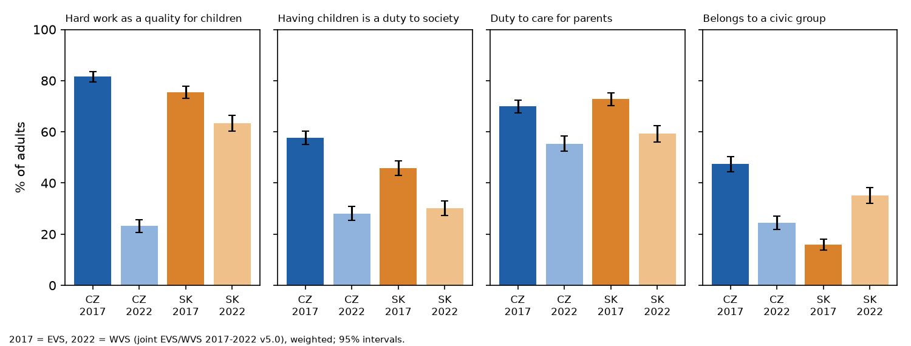

## The claim

### What the guides say

Dominik keeps a set of old culture guides for visitors to the Czech Republic. He wrote some of the material himself and collected the rest; parts go back to the 1990s, and he used them again in a 2023 briefing. The guides are private, so this page paraphrases them rather than quoting them.

The guides make many claims. Dominik picked three that a values survey could test:

1. Czechs take part in professional and interest groups less than Americans and West Europeans.
2. The boundary between people Czechs know and strangers is strong, and friendships take a long time to form.
3. Women work, but are still expected to carry the family, and few reach leadership.

He chose to compare Czechia with the United States, Canada and the neighbouring countries, and later added Hungary and Ukraine.

### Where the claims come from

The guides do not cite surveys. They describe the experience of foreigners living in the country. Most of what they say about etiquette (greetings, shoes indoors, tipping) is outside what any of these surveys ask.

## The answer

### In short

- **Gender roles: the claim holds.** In three surveys Czechs say men make better leaders about three times as often as Germans, Austrians, Americans or Canadians. Slovaks answer much like Czechs.
- **Strangers: the claim needed restating.** Czechs do not distrust strangers more than their neighbours do. When Dominik looked at the trust result, he said that the guides meant something else: how readily people make friends, share and start working with people outside their circle. On those measures Czechs go out with friends and make new friends less often than Americans or Slovaks. They look like Germans and Austrians.
- **Groups: the claim holds against the US, Germany and Canada,** but the size of the gap depends on how the question is asked.

### The surveys disagree with each other

Czechia was surveyed by the European Values Study in 2017 and by the World Values Survey in 2022. On several questions the two give very different answers. Reading the Czech questionnaires shows that most of these differences come from the wording, not from changes in opinion (see [Wording changes the answer](#wording-changes-the-answer)).

## Gender roles

### Leaders and jobs

| Agrees that… | Czechia | Slovakia | Poland | Germany | Austria | US | Canada |
|---|---:|---:|---:|---:|---:|---:|---:|
| men make better political leaders | 41–50 | 49–52 | 30 | 8–10 | 20 | 17 | 15 |
| men should have priority when jobs are scarce | 22–27 | 37–42 | 24 | 7–9 | 14 | 5 | 6 |
| children suffer when the mother works | 32 | 25–37 | 51 | 29–34 | 47 | 21 | 21 |

Weighted percentages from the joint EVS/WVS dataset. Where a country has two surveys, both are shown as a range.

A third source agrees. In the ISSP 2022 survey on family and gender roles, 26% of Czechs say men are better suited to serve in government and 31% to run a large company, against 8–14% in Germany, Austria and the US. Slovakia is higher (44–49%) and Poland lower (17–19%).

The working-mother question is the exception. Czechs are less traditional on it than Austrians or Poles.

## Making friends and working with strangers

### Trust is not the same as reserve

| Trusts completely or somewhat | Czechia | Slovakia | Poland | Hungary | Ukraine | Germany | Austria | US | Canada |
|---|---:|---:|---:|---:|---:|---:|---:|---:|---:|
| people met for the first time | 37–39 | 30–33 | 27 | 39 | 21–29 | 30–35 | 40 | 40 | 50 |
| people of another nationality | 45–46 | 41–43 | 51 | 57 | 46–50 | 63–64 | 59 | 74 | 82 |

Czechs trust strangers about as much as Americans and Austrians, and more than Germans, Slovaks, Poles or Ukrainians. They trust people of another nationality less than Germans or North Americans do, but about as much as their eastern neighbours.

### How people meet and make friends

The ISSP 2017 survey on social networks asks about behaviour, not trust. It covers Czechia, Slovakia, Hungary, Germany, Austria and the US, but not Poland, Canada or Ukraine.

| | Czechia | Slovakia | Hungary | Germany | Austria | US |
|---|---:|---:|---:|---:|---:|---:|
| Often or very often makes new friends or acquaintances when going out | 6 | 12 | 8 | 5 | 6 | 15 |
| Goes out with friends at least weekly | 25 | 47 | 19 | 22 | 28 | 17 |
| Leisure, sport or culture group activities at least monthly | 32 | 39 | 22 | 43 | 40 | 32 |
| Would ask family or close friends first to find a job | 25 | 44 | 47 | 29 | 22 | 41 |

Czechs rarely make new friends when they go out: 6%, against 15% of Americans. That supports the guides against the American comparison. But Germans and Austrians answer the same way, and Slovaks go out with friends twice as often as Czechs.

### Groups and joint action

| | Czechia | Slovakia | Poland | Hungary | Germany | Austria | US | Canada |
|---|---:|---:|---:|---:|---:|---:|---:|---:|
| Belongs to two or more civic groups | 9–24 | 3–16 | 5 | 11 | 27–32 | 19 | 46 | 34 |
| Has signed a petition, boycotted or demonstrated | 24–44 | 39–48 | 39 | 20 | 68–72 | 60 | 63 | 73 |

Civic groups here exclude churches, unions and parties. Czechs take part in joint public action less than Germans, Austrians or North Americans, about as much as Slovaks and Poles.

## Family and work

### Duties to family

| Agrees… | Czechia | Slovakia | Poland | Hungary | Germany | Austria | US | Canada |
|---|---:|---:|---:|---:|---:|---:|---:|---:|
| adult children have a duty to care for their parents (EVS/WVS) | 55–70 | 59–73 | 74 | 60 | 45–48 | 41 | 40 | 36 |
| can rely more on close relatives than close friends (ISSP 2022) | 56 | 58 | 42 | 48 | 32 | 34 | 46 | – |

On family Czechs sit between west and east, and closer to Slovakia than to Germany or Austria.

### Duties to work

| Agrees… | Czechia | Slovakia | Poland | Hungary | Ukraine | Germany | Austria | US | Canada |
|---|---:|---:|---:|---:|---:|---:|---:|---:|---:|
| work is a duty towards society | 49–60 | 58–66 | 74 | 69 | 40–43 | 75–78 | 74 | 59 | 55 |
| people who don't work turn lazy | 68–78 | 79 | 82 | 79 | 64–66 | 56–60 | 57 | 44 | 40 |

Work as a duty to society is weaker in Czechia than in any other European country here except Ukraine. Yet most Czechs agree that people who don't work turn lazy, as their eastern neighbours do.

## Wording changes the answer

### What the Czech questionnaires say

| Question | Czech EVS 2017 | Czech WVS 2022 | Answers |
|---|---|---|---:|
| Hard work as a quality for children | "pracovitost" (industriousness) | "tvrdá práce" (hard labour, toil) | 81% → 23% |
| Having children and society | "zodpovědnost" (a responsibility) | "povinnost" (an obligation) | 58% → 28% |
| Caring for parents | duty to look after a parent who is ill long term | duty to provide long-term care for parents | 70% → 55% |
| Group membership | which organisations do you belong to (list) | active member, inactive member or not a member, item by item | 47% → 25% |

The Slovak WVS 2022 questionnaire uses "pracovitosť" for hard work, and 63% of Slovaks chose it.

Two more problems showed up:

- In the Czech EVS 2017, 18% of respondents chose more than five qualities for children, although the questionnaire asked for at most five. Every Czech EVS figure on that list is therefore too high.
- The general trust question is translated differently in different surveys. Both Czech values surveys keep the original contrast with "you have to be very careful in dealing with people". The Czech ISSP 2017 version offers "people can usually be trusted" against "people usually cannot be trusted". Czech trust comes out at 22% (EVS 2017), 37% (WVS 2022) and 59% (ISSP 2017).

### Change or wording?

If a gap comes from wording, it should be about the same size in every group of people. For hard work (52 to 62 points), duty to have children (25 to 33 points) and group membership (19 to 27 points), the 2017–2022 gap is similar across age and education groups. For trust and for the duty to care for parents, the gap varies between groups, so part of it may be real change. The Czech WVS was carried out between February and May 2022, after COVID and during the first months of the Russian invasion of Ukraine.

## Limits of this check

- These are national averages. They say nothing about any individual Czech, and the differences within each country are larger than those between countries.
- The surveys ask about attitudes and a few reported behaviours. They do not observe how people actually behave with strangers or at work.
- Comparisons across surveys are unsafe. Figures are compared only within the same survey, and a range is shown where a country has two.
- The ISSP 2017 module does not cover Poland, Canada or Ukraine; ESS round 10 does not cover Germany, Austria or Poland.
- The translation findings rest on reading the questionnaires. The German, Austrian and English versions were not compared item by item.
- Each guide claim was turned into survey items by judgement (see [Data and method](#data-and-method)). A different choice of items could give a different picture.
- The guides contain material written by other people, some of it from the 1990s. This page tests the claims, not who made them.

## How this was made

### Timeline

All times UK time (GMT).

- **21–22 November, scoping (not measured here):** an agent searched for the guides, wrote a short map of the main models of national culture, and matched claims in the guides to survey questions. Dominik picked group membership, trust and gender roles.
- **22 November 01:14:** Dominik chose the countries: the US, Canada and the neighbours.
- **01:18–01:22:** Dominik downloaded the joint EVS/WVS and ESS files.
- **01:24–01:27:** first weighted tables for the three claims.
- **08:57:** Dominik restated the friendship claim: it was about patterns of contact, not trust. He added Hungary and Ukraine.
- **08:59:** he asked about duties to family and work.
- **09:04:** he asked for the disagreements to be checked against the question wording, including the Czech translations.
- **09:06–09:14:** Dominik downloaded the ISSP 2017 and 2022 files and the Czech and Slovak EVS questionnaires; the agent downloaded the WVS questionnaires.
- **09:27:** second-model review requested; subgroup check and draft.

### Data and method

- All figures are weighted percentages of adults with valid answers ("don't know" and no answer excluded). Weights: `gwght` (EVS/WVS), `anweight` (ESS), `WEIGHT` (ISSP 2017), `WEIGHT_COM` (ISSP 2022). Intervals are 95% intervals using the effective sample size.
- Judgement steps: which survey items stand for each guide claim; collapsing agree-strongly and agree; which organisation types count as civic groups (all except churches, unions and parties); treating 1–3 on the ISSP 2022 seven-point scales as leaning one way.
- The survey microdata are not redistributed. Derived tables, the code and the item definitions will be published in the data repository before this page goes live.

### Models, tools and tokens

| Model | Role | Calls | Tokens read | Tokens written |
|---|---|---:|---:|---:|
| claude-opus-5-5 | analysis, questionnaire reading, drafting | 109 | 17,698,085 | 82,350 |
| claude-sonnet-5-5 | survey coverage check | 12 | 796,323 | 6,833 |

Counts cover the Claude Code session of 22 November from 01:14 to 09:29 UK time, from `scripts/session-usage.py`. Tokens read include the cached conversation history re-read on each call. The earlier scoping session and the Codex review are not included yet.

Other tools: Python with pandas and matplotlib for the analysis, pdftotext for the questionnaires, Vega-Lite for the interactive charts.
